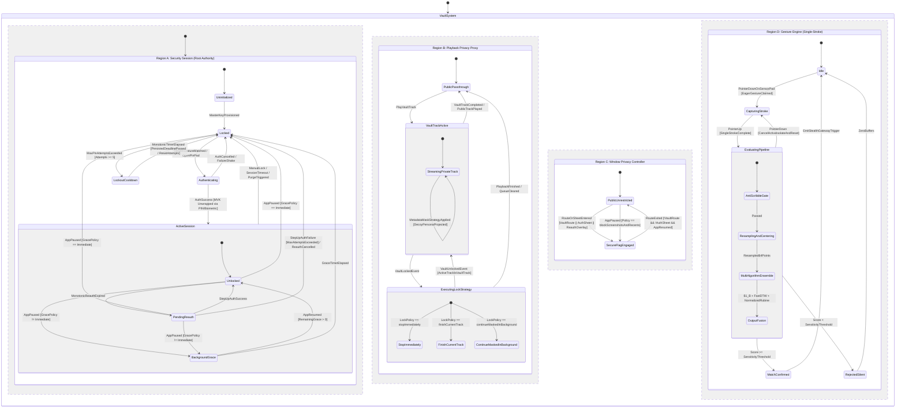

# SYSTEM SPECIFICATION: "Private Playlists" Secure Vault Module

## Role & Objective
Act as a Principal Mobile Architect and Security Systems Engineer. Design and implement a complete, production-grade, bug-free **"Private Playlists" Vault System** for the Musify application (Flutter/Dart presentation and domain layers integrated with Musify's existing native C++ audio engine via `dart:ffi`, Native Android Kotlin platform channels for hardware security and `FLAG_SECURE`, and existing player domain models).

You must write clean, fully realized, modular code adhering strictly to **Object-Oriented Programming (OOP)**, **SOLID principles**, **Clean Architecture**, and **David Harel's Statechart Automata (Hierarchical Finite State Machines with Concurrent Orthogonal Regions)** driven by explicit **State Enums and Dart 3 Sealed Classes** across both the main coordinator and every underlying sub-service.

### Core Foundation Mandate & Rule Precedence
1. **Rule Precedence Over Generic Presets:**
    - This specification is authoritative and strictly preempts and overrides any generic workspace rules, prompts, or presets referencing `just_audio` or `audio_service` (e.g., generic Layer 6 audio rules).
    - Musify's audio stack is natively implemented via C++ FFI bindings (`MusifyNativeAudioEngine` via `libmusify_audio.so`), Spotify-based Mobius reactive architecture (`PlayerQueueMobiusController`), `NativeEsperantoTransport`, and `NativePlaybackSessionBridge`.
    - Do NOT import, introduce, or wrap `just_audio`, `audio_service`, or `ExoPlayer`.
2. **Full Player & Mobius Architecture Integration:**
    - Never call `MusifyNativeAudioEngine.loadLocal(filePath)` in isolation from UI or BLoC layers. Bypassing Musify's Mobius loop leaves `PlayerQueueBloc`, `NativePlaybackSessionBridge`, the mini-player, the full player screen, and lockscreen controls out of sync.
    - All audio queue, track, and playback operations must operate directly upon Musify's established player layer: `ContextTrack`, `PlayerState`, `PlayerQueue`, `ContextPlayerControlClient`, `PlayerQueueMobiusController`, and `PlayerQueueBloc`.
    - Private tracks are packaged into canonical `ContextTrack` domain objects (with `ContextTrackMetadata.keyLocalFilePath` pointing to `<app_storage>/vault_media/.nomedia/<track_id>.mp3`) and dispatched through `PlayerQueueMobiusController.playContext(...)`.
3. **Direct Local Playback (Zero Audio Byte Encryption):**
    - Do NOT encrypt raw audio track binary files with AES. Encrypting raw audio files introduces latency, breaks native decoder random-access seeking (`lseek`/`fseek`), and causes failures with pipes or temporary buffers.
    - Audio tracks are stored in an isolated, private directory hidden from Android (`<app_storage>/vault_media/.nomedia`), while all playlist records, track references, and metadata are strongly encrypted in the vault database.
4. **Android Native Target & Manifest Requirements:**
    - `android/app/src/main/kotlin/.../MainActivity.kt` MUST extend `FlutterFragmentActivity` (not `FlutterActivity`). Invoking `BiometricPrompt.CryptoObject` on a standard `FlutterActivity` causes fatal uncatchable runtime crashes on Android.
    - `android/app/build.gradle` must declare `implementation("androidx.biometric:biometric:1.2.0-alpha05")`.

---

## 1. Core Visual & Design Guidelines (Non-Negotiable)
1. **Strictly Anti-Vibe & Cliche-Free:**
    - **Zero Purple Gradients:** Never use purple or violet gradients anywhere in the UI.
    - **Zero Pill-Shaped Buttons:** All buttons and interactive cards must use **Subtle Geometric Curves with an 8px border radius** (`BorderRadius.circular(8)`) and crisp 1px tone-on-tone borders. Never use full capsule or pill shapes (`StadiumBorder`, `BorderRadius.circular(999)`).
    - **Zero Emojis & Zero Em Dashes:** Never use emoji icons in UI copy or documentation; use official vector icons (`Icons.*` or custom SVG icons). Do not use em dashes anywhere in text or UI copy (use standard hyphens, colons, or parentheses).
    - **Zero Fake Metrics or Over-The-Top Animations:** Keep animations purposeful, tactile, and performant (150ms to 280ms duration curves).
2. **Dual Vault Theme Palettes (Selectable in Vault Settings):**
    - **Palette 1: Warm Espresso (`VaultThemePalettePolicyEnum.warmEspresso`):**
        - Scaffold: `#1A120E`
        - Background: `#3A2418`
        - Cards / Surfaces: `#6B4A2E`
        - Text & High-Salience Elements: `#A88462`
    - **Palette 2: Forest Noir (`VaultThemePalettePolicyEnum.forestNoir`):**
        - Scaffold: `#0F1F17`
        - Background: `#1E3A2E`
        - Cards / Surfaces: `#3E5A3F`
        - Text & High-Salience Elements: `#6B7F67`
3. **Typography & Styling:**
    - Font family: `Poppins` (matching Musify design system).
    - High contrast, legible typography with dedicated tokenized styling for titles, metadata chips, and keypad labels.

---

## 2. The "Zero Loose Boolean Flags" Mandate & State-Payload Separation
You are **strictly forbidden** from using loose boolean flags (`bool isLoading`, `bool isAuthenticated`, `bool isDrawing`, `bool isBiometricEnabled`, `bool isMasked`, `bool hasError`, etc.) to track lifecycle or domain state in Services, BLoCs/Cubits, Repositories, or Data Models.

1. **State vs. Payload Separation (Preventing State Explosion):**
    - **State defines Lifecycle Phase:** What operational state is the subsystem currently in? (e.g., `recordingSample`, `persistingConfig`, `vaultTrackActive`).
    - **Payload defines Context and Data:** What strongly-typed parameters belong to that phase? (e.g., `sampleIndex: int`, `totalRequired: int`, `previousSamples: List<GestureSample>`).
    - **FORBIDDEN (Over-Specific State Explosion):** Never encode loop counters, list indices, or orthogonal flags into enum identifiers (e.g., banning `recordingSampleOne`, `recordingSampleTwo`, `privateActiveUnmasked`, `privateActiveMasked`).
2. **Exhaustive State Hierarchies via Dart 3 Sealed Classes:**
    - Every service and sub-service MUST define an explicit state model using Dart 3 `sealed class` hierarchies where state-specific data exists *only* in the variant that requires it.
3. **Policy Enums Over Config Booleans:**
    - User settings and preferences must use descriptive domain enums rather than loose `bool` fields so invalid state combinations are unrepresentable at compile time.
4. **Exhaustive Switch Enforcement:**
    - All state transitions and UI builders must use exhaustive `switch` expressions over the defined State Enums and Sealed Types, with zero `default:` or `_ =>` fallbacks.

---

## 3. Architecture & OOP Design Patterns
Enforce strict separation of concerns across three layers:

1. **Domain Layer (Pure Business Logic & Contracts)**
    - **Entities:** Immutable value objects (`PrivatePlaylist`, `PrivateTrackRef`, `VaultConfig`, `GestureTemplate`, `GestureSample`, `AuthSession`, `RecognitionScore`).
    - **Interfaces (Abstractions):** `IVaultAuthService`, `IVaultStorageRepository`, `IGestureRecognizer`, `IMediaMaskingStrategy`, `IScreenPrivacyController`, `IMonotonicClock`.
    - **Use Cases (Interactors):** Single-responsibility command classes (`UnlockVaultUseCase`, `VerifySessionCoolOffUseCase`, `EnrollGestureUseCase`, `RotatePinUseCase`, `MutateVaultConfigUseCase`, `PurgeVaultDataUseCase`).
2. **Data & Infrastructure Layer (Metadata Encryption & Media Isolation)**
    - **Multi-Slot Envelope Encryption Architecture (Metadata & References Only):**
        - The Master Vault Key (MVK, 256-bit AES-GCM) encrypts vault databases, playlist definitions, and track metadata.
        - **Slot 1 (PIN KEK):** MVK is wrapped by a Key Encryption Key derived from the user 6-digit PIN using PBKDF2-HMAC-SHA256 (via `package:crypto`) executed on a background Dart isolate with unique salt.
        - **Slot 2 (Biometric KEK):** MVK is wrapped by a hardware-backed Android KeyStore AES-256 key unlocked via `BiometricPrompt.CryptoObject(Cipher)` in native Kotlin.
        - Either slot can independently unwrap the MVK into memory without conflating PIN derivation with hardware KeyStore keys. If biometric keys are invalidated by new fingerprint enrollments, the system cleanly triggers `cryptoFault` and falls back to Slot 1 PIN derivation to re-wrap Slot 2.
    - **Media Isolation (Hiding from Android MediaStore without Audio Encryption):**
        - Raw audio files are NOT encrypted with AES.
        - When private local tracks are imported into the vault, their physical files are relocated to an app-private, hidden directory: `<app_storage>/vault_media/.nomedia`.
        - The presence of the `.nomedia` sentinel file and storage in app-internal sandbox guarantees that Android's `MediaStore` scanner, external music players, and photo/file managers cannot index or display the private audio files.
        - **Scoped Storage Safe Deletion Fallback:** On Android 10+ (API 29+), when importing from public storage, the original file is safely unlinked. If Scoped Storage permissions restrict raw deletion without system dialogs, the file is copied into the vault sandbox and marked as excluded/hidden in Musify's local database without throwing unhandled `FileSystemException`.
        - When a private track is queued, it is wrapped in a `ContextTrack` and passed through `PlayerQueueMobiusController.playContext(...)`. This guarantees 100% native audio decoding compatibility, zero playback latency, and full random-access seeking (`lseek`/`fseek`) without broken FIFO pipes or temporary decrypted disk copies.
    - **Dart VM Memory Lifecycle:**
        - Sensitive cryptographic keys in RAM exist strictly as mutable `Uint8List` byte buffers. Upon vault lock, these buffers are immediately zeroed (`buffer.fillRange(0, buffer.length, 0)`).
        - Domain objects and metadata in the Dart heap are dereferenced immediately, allowing the Dart garbage collector to reclaim memory.
    - **Platform Channel Bridge (Android Kotlin):** Native implementations for `WindowManager.LayoutParams.FLAG_SECURE` and `BiometricPrompt` with `CryptoObject` running on `FlutterFragmentActivity`.
    - **Monotonic Clock Implementation:** Timers and cool-offs utilize Dart's built-in `Stopwatch` (natively backed by the OS monotonic clock `CLOCK_MONOTONIC`) or direct FFI timestamp reads, avoiding asynchronous platform channel IPC overhead for time checks.
3. **Presentation Layer (Coordinators, Sub-Service Cubits & Screens)**
    - **Design Patterns Required:**
        - **Harel Statechart Pattern:** Model the system as hierarchical statecharts with concurrent orthogonal regions to eliminate Cartesian product state explosion.
        - **Explicit Coordinator Pattern:** A central `VaultCoordinator` manages cross-BLoC communication using event streams. Sub-service Cubits (`PinPadCubit`, `ScreenPrivacyCubit`, `SettingsMutationCubit`) do NOT maintain circular dependencies on one another.
        - **Stealth Gateway Trigger Pattern:** The Stealth Gesture is strictly an invisible entryway trigger that transitions the security state from `locked` to `authenticating` (opening the PIN/Biometric auth sheet). It does NOT perform cryptographic key derivation.
        - **Single-Stroke Gesture Arena Eager Capture:** The stealth gesture pad uses a single continuous stroke gesture wrapped in a `RawGestureDetector` with an `EagerGestureRecognizer` (or raw `Listener`) so touch inside the `DrawerMenu` spacer unconditionally wins the gesture arena over the parent Drawer's horizontal drag-to-dismiss recognizers.
        - **Strategy Pattern (`IMediaMaskingStrategy`):** Decouple metadata masking from FSM states. When `MetadataVisibilityPolicyEnum.maskWithPlaceholder` is enabled, outgoing `ContextTrack.metadata` is projected using user-customizable decoy persona fields (`decoyTitle`, `decoyArtist`, `decoyAlbum`) for OS notifications, Bluetooth AVRCP, and mini-player displays. When `showActualMetadata` is enabled, original decrypted metadata is projected.
        - **Strategy Pattern (`ILockPlaybackStrategy`):** Pluggable behavior on vault lock (`StopImmediatelyStrategy`, `FinishCurrentTrackStrategy`, `ContinueMaskedInBackgroundStrategy`).
        - **Isolate Offloading Pattern:** All heavy geometric gesture matching (Golden Section Search, FastDTW, normalized Rubine features) and cryptographic derivations (PBKDF2-HMAC-SHA256) run inside dedicated background isolates via `Isolate.run` to guarantee 0 dropped UI frames.

---

## 4. Harel Statechart Automaton Specification

The Musify Secure Vault is formally defined as a **Hierarchical Concurrent Statechart Automaton**:

$$\mathcal{M} = \langle S, S_0, E, T, \mathcal{H}, \mathcal{O} \rangle$$

Where:
- $S$ is the finite set of compound and atomic states.
- $S_0 = \text{Uninitialized}$ is the initial root state.
- $E$ is the set of system events and platform triggers.
- $T: S \times E \times C \to S$ is the deterministic transition function governed by boolean guard conditions $C$.
- $\mathcal{H}$ defines the hierarchical tree of parent-child states (OR-decomposition).
- $\mathcal{O}$ defines four concurrent orthogonal regions (AND-decomposition) executing simultaneously without combinatorial explosion:
    1. `Region A: VaultSessionFSM` (Root Security Authority)
    2. `Region B: PlaybackPrivacyProxy` (Audio Interception & Metadata Masking)
    3. `Region C: WindowPrivacyController` (`FLAG_SECURE` Native Window Enforcement)
    4. `Region D: GestureEngineFSM` (Single-Stroke Touch Stream & Stealth Gateway Pipeline)

### Mermaid Statechart Diagram

---

## 5. Mandatory State Enums & Sealed Hierarchies

### A. Main Coordinator: `VaultSessionState` (Hierarchical FSM)
Governs the overarching security lifecycle of the Private Vault:
- `uninitialized`: No PIN or secret gesture has been provisioned yet.
- `locked`: Default secure state. Cryptographic keys in RAM are zeroed. Domain models are dereferenced for GC collection. If audio is actively playing under `ContinueMaskedInBackgroundStrategy`, playback proceeds through the Mobius controller with decoy metadata.
- `authenticating`: Actively awaiting Custom PIN or Biometric verification in `VaultAuthSheet`.
- `activeSession` (Compound State):
    - `unlocked`: User is actively browsing the vault; unwrapped MVK exists in RAM; decrypted metadata loaded; active cool-off timer is ticking.
    - `backgroundGrace`: App moved to background (`AppLifecycleState.paused` / `inactive`) while unlocked; monotonic background countdown is active. If `GracePolicy == immediate`, the system bypasses this state directly to `locked`.
    - `pendingReauth`: Active-session cool-off timer expired mid-session; UI is blurred by a non-destructive re-auth overlay while preserving scroll and screen state. If the app is paused during `pendingReauth`, it transitions into `backgroundGrace` (or `locked` if immediate). If user cancels, it transitions to `locked`.
- `lockoutCooldown`: Brute-force protection active after 5 consecutive failed PIN attempts; counts down via monotonic clock. The deadline (`lockout_deadline_monotonic_ms`) is persisted securely. When the deadline passes and state transitions back to `locked`, session failed attempt counters reset to 0.

### B. Sub-Service 1: Gesture Engine (`GestureEngineStateEnum` & `GestureEnrollmentState`)
Governs the single-stroke gesture recognition pipeline on a background Dart isolate:
- `GestureEngineStateEnum`:
    - `idle`: Waiting for initial pointer down inside the fixed stealth sensor pad.
    - `capturingStroke`: Pointer actively moving across the canvas; buffering timestamped coordinate stream $(x_i, y_i, t_i)$.
    - `evaluatingPipeline`: Executing single-stroke multi-stage recognition pipeline in `Isolate.run` (anti-scribble trajectory gate, equidistant resampling, bidirectional $1 Golden Section Search, FastDTW sequence alignment, normalized Rubine geometric feature cosine check, and ensemble score fusion). If a new `PointerDown` arrives during evaluation, the in-flight isolate is discarded and state resets to `capturingStroke`.
    - `matchConfirmed`: Calibrated ensemble consensus score met or exceeded threshold; emitting `EmitStealthGatewayTrigger` to Coordinator to prompt PIN/Biometric authentication, accompanied by distinct haptic feedback.
    - `rejectedSilent`: Score below threshold, anti-scribble tripped, or feature divergence detected; silently zeroing raw and resampled buffers with zero UI feedback.

- `GestureEnrollmentState` (Dart 3 Sealed Class):
    - `RecordingSample(sampleIndex: int, totalRequiredSamples: int, previousSamples: List<GestureSample>)`: Unified state representing single-stroke sample recording (typically 3 consistent samples).
    - `SynthesizingTemplate`: Running DTW Barycenter Averaging (DBA) on a background isolate to generate master golden template $T$.
    - `SandboxTesting`: Interactive test pad allowing the user to test the synthesized gesture live.
    - `Committed`: Master template successfully encrypted and stored.

### C. Sub-Service 2: Cryptographic Engine (`CryptoEngineStateEnum`)
Governs hardware key wrapping, envelope slots, and RAM key lifecycle:
- `unprovisioned`: No wrapped master key exists on disk.
- `keyWrappedAtRest`: Master Vault Key (MVK) is encrypted on disk; zero key material in RAM.
- `unwrappingMasterKey`: Actively unwrapping MVK via Slot 1 (PBKDF2 on background isolate) or Slot 2 (Android `BiometricPrompt` CryptoObject resolution on `FlutterFragmentActivity`).
- `masterKeyUnwrappedInRam`: Active `AES-256-GCM` session key available in mutable `Uint8List` buffer.
- `rotatingWrappingKey`: Re-wrapping the MVK with a new PIN or biometric cipher without modifying stored audio files.
- `purgingAllVaultData`: Securely shredding encrypted metadata databases, isolated vault media files, and KeyStore aliases upon user confirmation.
- `cryptoFault`: KeyStore invalidation (e.g., new biometric enrolled in Android OS) or decryption failure requiring Slot 1 PIN fallback recovery to re-wrap Slot 2.

### D. Sub-Service 3: Playback Privacy Interceptor (`PlaybackPrivacyModeEnum` & Strategies)
Governs how the audio player and OS notifications behave relative to vault tracks without duplicating the underlying player lifecycle:
- The core audio playback lifecycle is governed strictly by Musify's existing `PlayerState`, `PlayerQueueMobiusController`, and `MusifyNativeAudioEngine`.
- `PlaybackPrivacyModeEnum` models strictly the privacy boundary:
    - `publicPassthrough`: Playing standard public tracks; zero proxy interception.
    - `vaultTrackActive`: Playing a vault track; proxy intercepts and sanitizes metadata.
- **Dynamic Masking via Strategy Pattern (`IMediaMaskingStrategy`):**
    - Resolves metadata dynamically based on `MetadataVisibilityPolicyEnum`:
        - `maskWithPlaceholder`: Outgoing `ContextTrack.metadata` broadcast to OS MediaSession, Android Auto, lockscreen, and Bluetooth AVRCP is projected with user-customizable decoy persona fields (`decoyTitle`, `decoyArtist`, `decoyAlbum`).
        - `showActualMetadata`: Outgoing metadata projects original decrypted title, artist, album, and artwork.
- **Dynamic Lock Handling via Strategy Pattern (`ILockPlaybackStrategy`):**
    - Upon receiving `VaultSessionState.locked`, the active strategy executes the configured behavior:
        - `StopImmediatelyStrategy`: Stops playback immediately and clears the private queue from `PlayerQueueBloc`.
        - `FinishCurrentTrackStrategy`: Allows the current private song to finish, then halts playback and flushes RAM.
        - `ContinueMaskedInBackgroundStrategy`: Maintains uninterrupted playback in the background with decoy metadata while locking UI inspection.
    - **Re-Unlock Recovery:** When the vault transitions from `locked` back to `activeSession.unlocked` while a vault track is actively playing, Region B transitions directly from `ExecutingLockStrategy` back to `VaultTrackActive`, restoring unmasked metadata projection if configured.

### E. Sub-Service 4: OS Window Privacy Controller (`ScreenPrivacyStateEnum`)
Governs Android `WindowManager.LayoutParams.FLAG_SECURE` via RouteObserver and lifecycle integration:
- `publicUnrestricted`: Standard window flags; screenshots allowed on public screens.
- `secureFlagEngaged`: Native `FLAG_SECURE` active on window; blocks screenshots, screen recording, and blacks out recent apps thumbnail whenever a Vault screen, `VaultAuthSheet` modal bottom sheet, or `ReauthBlurOverlay` is active, or when the app moves to background while vault data is loaded.
- `platformSyncPending`: Awaiting native Kotlin `MethodChannel` confirmation of window flag mutation.

### F. Sub-Service 5: Vault Settings & Mutation Controller (`SettingsMutationStateEnum`)
Governs reading and updating `VaultConfig`:
- `syncedIdle`: Configuration loaded and idle.
- `awaitingStepUpAuth`: User requested a sensitive change (PIN rotation, disabling biometrics, changing gesture, data purge); awaiting step-up verification.
- `persistingConfig`: Validating, mutating, and encrypting updated `VaultConfig` to disk.
- `mutationRejected`: Validation or authentication failed; reverted to last known good config.

### G. Sub-Service 6: PIN Authentication Controller (`PinPadStateEnum`)
Governs the presentation and lifecycle of the fixed 6-digit PIN pad:
- `idleInput`: Awaiting user digit taps (tracking entered length $0..6$).
- `evaluatingAndDeriving`: 6th digit entered; showing subtle inline loading animation while isolate derives key via PBKDF2-HMAC-SHA256.
- `authSuccess`: Derived key verified; showing brief tactile success indicator before transition.
- `authFailureShake`: Incorrect PIN; triggering subtle tactile error shake animation and decrementing remaining attempts.
- `lockedOut`: 5 consecutive failures reached; displaying monotonic countdown timer (30s cooldown after 5 failures, 5m cooldown after 10 failures). Cooldown deadline is backed by persistent storage. Upon cooldown completion, failed attempt count resets to 0.

### H. Configuration Policy Enums & Decoy Persona Fields in `VaultConfig`
- `VaultThemePalettePolicyEnum`: `warmEspresso`, `forestNoir`
- `BiometricAuthPolicyEnum`: `pinOnly`, `pinAndBiometricStrong`
- `ActiveReauthIntervalEnum`: `every5Minutes`, `every15Minutes`, `every30Minutes`, `never`
- `BackgroundGraceTimeoutEnum`: `immediate`, `thirtySeconds`, `oneMinute`, `fiveMinutes`
- `ScreenSecurityPolicyEnum`: `allowCapture`, `blockScreenshotsAndRecents`
- `MetadataVisibilityPolicyEnum`: `maskWithPlaceholder`, `showActualMetadata`
- **Decoy Persona Configuration (Used when `maskWithPlaceholder` is enabled):**
    - `decoyTitle: String` (Default: "System Audio")
    - `decoyArtist: String` (Default: "Media Service")
    - `decoyAlbum: String` (Default: "Internal Playback")
- `LockPlaybackBehaviorEnum`: `stopImmediately`, `finishCurrentTrack`, `continueMaskedInBackground`
- `GestureSensitivityTierEnum`: `strict92Percent`, `balanced84Percent`, `relaxed76Percent`
- `GestureVisibilityPolicyEnum`: `invisibleStealth`, `faintDissipatingHairline`
- `KeypadLayoutPolicyEnum`: `standardOrdered`, `randomizedPerAttempt`

---

## 6. Deterministic State Transitions & Security Invariants
1. **Monotonic Time Invariants:**
    - All cool-off timers (`ActiveReauthIntervalEnum`, `BackgroundGraceTimeoutEnum`, and `lockoutCooldown`) MUST calculate elapsed duration using Dart's native `Stopwatch` (backed by OS monotonic clock `CLOCK_MONOTONIC`) or direct C++ clock reads, never `DateTime.now()`, preventing bypass via device clock tampering.
    - Lockout deadline timestamp must be stored in secure persistent storage to maintain lockout across application force-stops.
2. **Lockout Escalation & Reset Policy:**
    - 1 to 4 failed PIN attempts: Instant failure shake animation; attempt count tracked.
    - 5 consecutive failed PIN attempts: Mandatory 30-second monotonic lockout cooldown.
    - 10 consecutive failed PIN attempts: Mandatory 5-minute monotonic lockout cooldown.
    - Upon timer completion (`MonotonicTimerElapsed`), transition to `Locked` and reset `sessionFailedAttempts = 0`.
3. **Non-Destructive "Verify It's You" Interception:**
    - When `ActiveReauthIntervalEnum` expires during `VaultSessionState.unlocked`, transition to `pendingReauth`.
    - Audio continues playing uninterrupted in the background.
    - Screen displays a frosted blurred glass overlay with a single geometric `Tap to Authenticate` button (8px radius).
    - Tapping triggers `BiometricPrompt` (if enabled) or opens the PIN entry sheet.
    - If the app is paused while in `pendingReauth`, it transitions into `backgroundGrace` (or `locked` if grace is `immediate`). If user dismisses or cancels authentication, it transitions directly to `locked`.
    - Upon successful verification, the overlay dismisses and restores the exact view and scroll offset without route reconstruction.
4. **Reactive Sub-Service Synchronization:**
    - Whenever `VaultSessionState` transitions, `CryptoEngine`, `PlaybackPrivacyProxy`, and `ScreenPrivacyController` deterministically react via event streams and exhaustive `switch` mappings without tight coupling.

---

## 7. Stealth Gesture Engine: Single-Stroke Recognizer Pipeline
The Private Vault has **zero visible buttons or icons** in the public UI. It is triggered solely via an invisible fixed-size 250x250dp single-stroke gesture canvas in the blank spacer area of the `DrawerMenu`.

To prevent Flutter's `Drawer` from hijacking horizontal strokes, the canvas MUST be wrapped in a `RawGestureDetector` with an `EagerGestureRecognizer` (or raw `Listener`) that unconditionally claims the gesture arena on pointer down. Using a single continuous stroke eliminates multi-stroke debounce race conditions and guarantees the arena is held throughout the entire gesture.

All mathematical pipeline calculations are executed off the main thread inside `Isolate.run`:

### Job 1: Raw Touch De-Jittering & Spatial Deadband Pre-filtering
- Ingest stream of raw touch points $P_i = (x_i, y_i, t_i)$. Drop consecutive points where Euclidean distance $\Delta d = \sqrt{(x_i - x_{i-1})^2 + (y_i - y_{i-1})^2} < 2.5\text{px}$ to eliminate stationary touch chatter.
- Apply a 3-point Gaussian kernel filter $\hat{P}_i = 0.25 P_{i-1} + 0.50 P_i + 0.25 P_{i+1}$ (preserving endpoints $P_1$ and $P_n$) to suppress touchscreen sensor noise and finger micro-tremors without blunting intentional sharp corners.

### Job 2: Kinematic Sanity & Anti-Scribble Trajectory Gate
Executes in $<0.1\text{ms}$ as a hard fail-fast gate prior to running geometric normalization:
- **Bounding Span Check:** Reject silently if bounding box span $\max(\Delta x, \Delta y) < 28.0\text{px}$ (prevents accidental micro-taps or pocket friction).
- **Point Density Budget:** Reject silently if raw point count $n < 10$ or $n > 800$.
- **Straightness / Tortuosity Envelope:** Compute ratio of total raw path length $L_{raw}$ to net displacement $\|P_n - P_1\|$. Reject if ratio exceeds the maximum tortuosity bound configured for the gesture profile, preventing dense circular scribbling from matching complex paths.
- **Cumulative Angular Curvature Budget:** Calculate total directional turning angle $\sum_{i=2}^{n-1} |\Delta \theta_i|$; reject chaotic high-frequency oscillations.

### Job 3: Equidistant Arc-Length Resampling
- Compute cumulative path length $L = \sum_{i=1}^{n-1} \|P_{i+1} - P_i\|$.
- Resample the filtered stroke into an exact, deterministic array of $N = 64$ points equidistant along the trajectory contour with step interval $I = \frac{L}{N - 1}$.
- Use linear segment interpolation to guarantee uniform spatial point distribution regardless of drawing speed.

### Job 4: Centroid Centering & Aspect-Preserving Reference Scaling
- Compute centroid $C = \left(\frac{1}{N} \sum_{i=1}^N x_i, \frac{1}{N} \sum_{i=1}^N y_i\right)$ and translate all points so $C = (0, 0)$.
- Evaluate aspect ratio $\min(W, H) / \max(W, H)$:
    - If ratio $< 0.20$ (1D gesture): Scale uniformly by reference factor $S = B / \max(W, H)$ where reference canvas $B = 250.0\text{px}$.
    - If ratio $\ge 0.20$ (2D gesture): Scale non-uniformly to reference square $B \times B$ ($x'_i = x_i \cdot \frac{B}{W}, y'_i = y_i \cdot \frac{B}{H}$) to achieve full scale invariance.

### Job 5: The Bidirectional $1 Recognizer ($1-B) with Golden Section Search
- Test both forward path candidate $C_{fwd} = [P_1, P_2, \dots, P_N]$ and reverse candidate $C_{rev} = [P_N, P_{N-1}, \dots, P_1]$.
- Find optimal rotation angle $\theta^*$ in bounded window $[-45^\circ, +45^\circ]$ via Golden Section Search ($\phi = \frac{\sqrt{5}-1}{2}$):
  $$D(C, T, \theta) = \frac{1}{N} \sum_{i=1}^N \sqrt{(x_i \cos\theta - y_i \sin\theta - T_{x,i})^2 + (x_i \sin\theta + y_i \cos\theta - T_{y,i})^2}$$
- Calculate bidirectional distance: $D_{\$1}(C, T) = \min\left(\min_\theta D(C_{fwd}, T, \theta), \min_\theta D(C_{rev}, T, \theta)\right)$.
- Compute normalized score: $S_{\$1} = 1.0 - \frac{D_{\$1}(C, T)}{0.5 \times \sqrt{2 \times B^2}} \in [0.0, 1.0]$.

### Job 6: Fast Dynamic Time Warping (FastDTW) Sequence Alignment
- Run bidirectional DTW against template points:
  $$\text{DTW}_{bi}(C, T) = \min(\text{FastDTW}(C_{fwd}, T), \text{FastDTW}(C_{rev}, T))$$
- Convert cumulative DTW warp cost into a normalized score:
  $$S_{\text{DTW}} = \exp\left(-\frac{\text{DTW}_{bi}(C, T)}{N \cdot \sigma_{\text{DTW}}}\right) \in [0.0, 1.0]$$

### Job 7: Normalized Rubine Geometric Feature Vector & Cosine Gate
Extract a normalized structural feature vector $\mathbf{F} \in [0.0, 1.0]^7$:
1. Initial vector direction: $\cos(\alpha_{start}), \sin(\alpha_{start})$ from $P_1$ to $P_4$ (mapped from $[-1, 1]$ to $[0, 1]$ via $(v + 1) / 2$).
2. Terminal vector direction: $\cos(\alpha_{end}), \sin(\alpha_{end})$ from $P_{N-3}$ to $P_N$ (mapped to $[0, 1]$).
3. Start-to-end net displacement magnitude normalized by path length: $\|P_N - P_1\| / L \in [0, 1]$.
4. Total signed turning angle normalized: $\left(\sum_{i=2}^{N-1} (\theta_i - \theta_{i-1}) + 4\pi\right) / (8\pi) \in [0, 1]$.
5. Peak curvature point index normalized: $i_{peak} / N \in [0, 1]$.
- Compute bidirectional Cosine Similarity between normalized live vector $\mathbf{F}_C$ and template vector $\mathbf{F}_T$:
  $$S_{feat} = \max\left(\frac{\mathbf{F}_{C,fwd} \cdot \mathbf{F}_T}{\|\mathbf{F}_{C,fwd}\| \|\mathbf{F}_T\|}, \frac{\mathbf{F}_{C,rev} \cdot \mathbf{F}_T}{\|\mathbf{F}_{C,rev}\| \|\mathbf{F}_T\|}\right) \in [0.0, 1.0]$$

### Job 8: Multi-Stage Ensemble Consensus & Decision Fusion
1. **Structural Gate:** Require $S_{feat} \ge 0.68$.
2. **Individual Classifier Safety Floors:** Require $S_{\$1} \ge 0.65$ and $S_{\text{DTW}} \ge 0.60$.
3. **Weighted Ensemble Consensus Score:**
   $$S_{ensemble} = 0.50 \cdot S_{\$1} + 0.35 \cdot S_{\text{DTW}} + 0.15 \cdot S_{feat}$$
4. **Sensitivity Tier Evaluation:**
   Compare $S_{ensemble}$ against active `GestureSensitivityTierEnum`:
    - `strict92Percent`: $S_{ensemble} \ge 0.88$
    - `balanced84Percent`: $S_{ensemble} \ge 0.78$
    - `relaxed76Percent`: $S_{ensemble} \ge 0.68$
      If condition passes, transition to `matchConfirmed` and trigger `EmitStealthGatewayTrigger` with haptic tick; otherwise, transition to `rejectedSilent`.

### Job 9: Multi-Sample Template Synthesis (Enrollment Wizard)
During `GestureEnrollmentState`:
1. Record 3 consistent single-stroke samples inside `RecordingSample(sampleIndex, totalRequiredSamples, previousSamples)` with live ink display.
2. Run DTW consistency checks between samples (rejecting wild variations with instant retry guidance).
3. Synthesize into golden template using DTW Barycenter Averaging (DBA) on background isolate to align strokes onto sample 1's trajectory, averaging coordinates into master $N=64$ point reference array $T$.
4. Transition to `SandboxTesting` allowing user to test recognition against template $T$ before committing to encrypted storage (`Committed`).

---

## 8. Dedicated Screens & UI Flows
All screens must be themed with the active `VaultThemePalettePolicyEnum` and feature 8px rounded corners:

1. **`StealthGesturePad`:**
    - 250x250dp invisible single-stroke sensor canvas anchored in the lower-spacer area of `DrawerMenu` between Equalizer and Log Out.
    - Wrapped in `RawGestureDetector` with `EagerGestureRecognizer` to win gesture arena over Drawer dismissal drags.
    - Respects `GestureVisibilityPolicyEnum`: pure stealth (0 ink) by default, or subtle dissipating hairline.
    - Emits tactile haptic feedback upon verified single-stroke match and requests Coordinator to present `VaultAuthSheet`.
2. **`VaultAuthSheet` & `ReauthBlurOverlay`:**
    - Fixed 6-digit PIN pad with auto-submit on the 6th digit.
    - Clear visual feedback for states: `idleInput`, `evaluatingAndDeriving` (inline loader), `authSuccess` (tactile confirmation), `authFailureShake`, and `lockedOut` (monotonic timer countdown).
    - Biometric authentication trigger button (if `BiometricAuthPolicyEnum.pinAndBiometricStrong` is enabled).
    - Mid-session re-auth: Frosted glass overlay with 8px rounded `Tap to Authenticate` button; audio keeps playing.
3. **`PrivateVaultDashboardScreen`:**
    - **Dense Information List Only:** Pure vertical list of private playlists with 48px square thumbnails, playlist title, duration, track count, and swipe actions.
    - **Frosted Artwork Peek Mode:** Cover art is subtly blurred with a privacy overlay in list view, de-blurring when actively playing or viewing details.
    - **Quick Inline Filter:** Text field at top of dashboard filtering playlists by name.
    - **App Bar Quick-Lock Action:** Top app bar lock icon for immediate manual RAM wipe and lock.
4. **`PrivatePlaylistDetailScreen`:**
    - Header with cover art (frosted or de-blurred based on playback state), playlist title, and duration.
    - In-playlist track search filter.
    - Reorderable track list with swipe-to-remove actions.
    - Playback controls routed directly through Musify's existing `PlayerQueueMobiusController` and `ContextPlayerControlClient`.
5. **`Track & Playlist Ingestion Flow`:**
    - Public UI integration: "Clone to Private Vault" for playlists and "Add to Private Playlists" for tracks.
    - **STRICT STEALTH GATE:** These actions are ONLY displayed in public context menus when the vault cool-off period is active (`VaultSessionState.unlocked` or active grace); completely hidden when locked or uninitialized.
    - **Spotify vs. Local Behavior:**
        - Spotify tracks: Cloned into private vault entity references preserving existing `ContextTrack` identifiers.
        - Local tracks: Physical file relocated to `<app_storage>/vault_media/.nomedia` (deleted from public `LocalTracksStore` and hidden from Android MediaStore). Metadata stored encrypted in vault DB. Bidirectional export back to public local library supported.
    - Operates on existing Musify domain entities (`PlaylistEntity`, `PlaylistItem`, `LocalTrack`, `ContextTrack`).
6. **`GestureEnrollmentScreen`:**
    - Guided single-stroke enrollment wizard with live ink trails.
    - Real-time DTW consistency feedback across samples.
    - Sandbox testing pad to practice unlocking before final encryption.
7. **`VaultSettingsScreen`:**
    - Palette Selector: `warmEspresso` vs `forestNoir`.
    - Security Policy Enums: Biometrics toggle, Active Re-auth interval, Background grace timeout, Screen security flag.
    - Playback & Metadata Privacy: Metadata masking toggle (`maskWithPlaceholder` vs `showActualMetadata`) and custom decoy persona text inputs (`decoyTitle`, `decoyArtist`, `decoyAlbum` broadcast to OS notifications/Bluetooth/Auto).
    - Gesture Configuration: Sensitivity tier and ink visibility toggles, plus gesture re-enrollment button.
    - PIN Rotation Flow: Step-up authentication followed by new 6-digit PIN confirmation.
    - Destructive Action at Bottom: `Delete Vault and Erase Data` button with two-step PIN confirmation, shredding all encrypted vault keys and metadata, unlinking isolated files, and reverting to `uninitialized` state.

---

## 9. Phased Modular Delivery Plan (Operational Checkpoint Protocol)

> **CRITICAL EXECUTION RULE FOR AI AGENTS:**
> To guarantee zero code omission, zero token truncation, and 100% compilation integrity, DO NOT attempt to emit all code in a single turn. You must execute strictly phase by phase, stopping after each phase to verify contracts and allow compilation checks.

### Execution Sequence:
- **Phase 1: Domain Layer, Policy Enums & Contracts**
    - Create all immutable domain entities (`PrivatePlaylist`, `PrivateTrackRef`, `VaultConfig`, `GestureTemplate`, `GestureSample`, `AuthSession`).
    - Define all policy enums, sealed state classes, and pure abstract interfaces (`IVaultAuthService`, `IVaultStorageRepository`, `IGestureRecognizer`, `IMediaMaskingStrategy`, `IScreenPrivacyController`, `IMonotonicClock`).
    - Implement use case interactors (`UnlockVaultUseCase`, `VerifySessionCoolOffUseCase`, `EnrollGestureUseCase`, `RotatePinUseCase`, `MutateVaultConfigUseCase`, `PurgeVaultDataUseCase`).
    - **STOP & CHECKPOINT:** Verify domain layer has zero loose booleans and zero external UI/native dependencies.

- **Phase 2: Cryptographic Engine, Isolated Media Storage & Audio Wiring**
    - Verify `MainActivity.kt` extends `FlutterFragmentActivity` and `androidx.biometric` dependency exists.
    - Implement Slot 1 PBKDF2-HMAC-SHA256 derivation via `package:crypto` on background isolate.
    - Implement Slot 2 Android KeyStore `BiometricPrompt.CryptoObject` native Kotlin channel bridge.
    - Implement encrypted Drift/SQLite vault metadata storage.
    - Implement media file isolation manager (`.nomedia` directory relocation with scoped storage safe fallback).
    - Wire playback through `PlayerQueueMobiusController.playContext(...)` with `ContextTrack` integration and `PlaybackPrivacyProxy` decoy persona masking.
    - **STOP & CHECKPOINT:** Verify direct file playback compatibility through Mobius and memory zeroing routines.

- **Phase 3: Single-Stroke Stealth Gesture Pipeline & Isolate Math**
    - Implement touch deadband filtering, Gaussian smoothing, and kinematic anti-scribble gate.
    - Implement arc-length equidistant resampling ($N = 64$), centroid centering, and aspect ratio scaling.
    - Implement Golden Section Search Bidirectional $1 ($1-B), FastDTW, normalized Rubine 7D feature extraction, and DBA template synthesis in `Isolate.run`.
    - Connect to `StealthGesturePad` using `RawGestureDetector` with `EagerGestureRecognizer`.
    - **STOP & CHECKPOINT:** Verify isolate execution latency, single-stroke gesture arena stability, and zero main thread UI jank.

- **Phase 4: FSM Coordinators, BLoCs & Dedicated Presentation UI**
    - Implement `VaultSessionBloc` (Harel Region A) with persistent lockout cooldown management, immediate grace handling, and clean `pendingReauth` lifecycle.
    - Implement `PlaybackPrivacyProxy` (Harel Region B) applying `IMediaMaskingStrategy` over `ContextTrack.metadata` with customizable decoy metadata, coordinating lock/unlock recovery with `PlayerQueueBloc`.
    - Implement `ScreenPrivacyCubit` (Harel Region C) covering `VaultRoute`, modal bottom sheets, re-auth overlays, and background transitions.
    - Implement `SettingsMutationCubit` and all dedicated UI screens and theme bindings adhering strictly to the 8px geometric radius, Poppins typography, zero emojis, and zero em dashes.

---

## 10. Strict Pre-Commit Code Audit
Before marking any deliverable complete:
1. Verify that zero loose `bool` fields exist inside any state class, service, cubit, or `VaultConfig` entity.
2. Verify that `MainActivity.kt` extends `FlutterFragmentActivity` and native biometric channel uses `CryptoObject`.
3. Verify that raw audio track files are NOT encrypted and are instead isolated in `<app_storage>/vault_media/.nomedia`, playable via `ContextTrack` dispatched through `PlayerQueueMobiusController`.
4. Verify that zero references to `just_audio`, `audio_service`, or `ExoPlayer` exist in the codebase.
5. Verify that all state builders and transitions use exhaustive `switch` expressions without `default:` or `_ =>` fallbacks.
6. Verify that statechart transitions for immediate grace lock (`Unlocked -> Locked`) and re-unlock playback recovery (`ExecutingLockStrategy -> VaultTrackActive`) are implemented.
7. Verify that every modified or created file is emitted 100% complete from line 1 to EOF with zero placeholders (`// TODO`, `// ... existing code ...`).
