# C++ Native Network Queue, Offline Wait/Auto-Resume & Seekbar Loading UX Plan

## 1. Executive Summary & Root Cause Analysis

When the device is offline (or experiences a transient connection drop), an unplayable track or an uncached portion of a partially cached track previously **skipped to the next song** instead of waiting in a buffering state and resuming automatically when internet connectivity returns.

Tracing the C++ audio pipeline and Dart state machine from the socket layer to the UI revealed **four structural root causes**:

### Root Cause 1: Offline Block Read Failure (`readAt() == -1`) Triggering False `END_OF_STREAM` (`EOS`) -> Auto-Skip
- In [HttpRangeStreamCache.cpp](file:///home/Documents/Musify_MU/android/app/src/main/cpp/network/HttpRangeStreamCache.cpp), when `readFromBlock()` missed both the hot RAM LRU cache and the persistent `DiskCache` while offline (`!NativeHttpClient::hasActiveNetworkRoute()`), it immediately returned `-1`.
- Android NDK's `AMediaDataSource` bridges `readAt() == -1` to `AMediaExtractor_readSampleData()`, which returns a negative `ssize_t` (`AMEDIA_ERROR_IO` / `AMEDIA_ERROR_END_OF_STREAM`).
- In [NativeDecoder.cpp](file:///home/Documents/Musify_MU/android/app/src/main/cpp/NativeDecoder.cpp), `feedInputBuffer()` treated **any** `sampleSize <= 0` (when `mSeekRequested` and `mRunState` were not stopping/suspended) as genuine **End-Of-Stream (`EOS`)**:
  ```cpp
  AMediaCodec_queueInputBuffer(mCodec, inputIdx, 0, 0, 0, AMEDIACODEC_BUFFER_FLAG_END_OF_STREAM);
  mInputEos.store(true, std::memory_order_release);
  ```
- `AMediaCodec` then emitted `AMEDIACODEC_BUFFER_FLAG_END_OF_STREAM` on its output buffer, latching `NativeDecoder::mEndOfStream = true` and `AudioEngine::mDecoderEndOfStream = true`.
- In [AudioEngine.cpp](file:///home/Documents/Musify_MU/android/app/src/main/cpp/AudioEngine.cpp), `onAudioReady()` saw `eos && mRingBuffer.availableToRead() == 0`, transitioned `mState` to `EngineState::Stopped`, and triggered `mEosCallback`.
- [CoreAudioTrackPlayer.cpp](file:///home/Documents/Musify_MU/android/app/src/main/cpp/rendering/CoreAudioTrackPlayer.cpp) forwarded `on_eos_` to [AudioTrackPlayer.cpp](file:///home/Documents/Musify_MU/android/app/src/main/cpp/rendering/AudioTrackPlayer.cpp) (`onCoreTrackFinished`), which called `callbacks_.advance_track(AdvanceReason::EndOfTrack)` -> [ContextPlayerImpl.cpp](file:///home/Documents/Musify_MU/android/app/src/main/cpp/player/ContextPlayerImpl.cpp) (`advance_to_next_track`), **skipping to the next song in the queue**.

### Root Cause 2: Dual-Source Chunk-0 Head Playback Hits False EOS at ~6s When Secondary Stream Fails Offline
- In [CoreAudioTrackPlayer.cpp](file:///home/Documents/Musify_MU/android/app/src/main/cpp/rendering/CoreAudioTrackPlayer.cpp), when a track had its 128 KiB Ogg head file cached on disk, `runPlaybackWorker()` started dual-source playback immediately on Chunk 0 (`loadDualSource`) and called `file_streamer_.resolveFullTrackStream()`.
- When offline, `resolveFullTrackStream()` failed immediately, so `attachSecondaryStream()` was never called (`mSecondaryPending == false` and `!mSecondaryWorkerThread.joinable()`).
- In [AudioEngine.cpp](file:///home/Documents/Musify_MU/android/app/src/main/cpp/AudioEngine.cpp), `decoderMonitorFunc()` latched `mDecoderEndOfStream = true` on the last frame of the 6-second head file, transitioning to `EngineState::Stopped`, firing `mEosCallback`, and **skipping to the next track after playing only the 6-second head**.

### Root Cause 3: Offline `DiskCache` Stream Bypassed When CDN URL Was Not in RAM
- `DiskCache` keys 64 KiB stream blocks by Spotify's 20-byte `audio_id` hex extracted from the CDN path (`/audio/<40-hex-chars>`), which is identical to `file_id_mp4_128`.
- However, [FileStreamerImpl.cpp](file:///home/Documents/Musify_MU/android/app/src/main/cpp/streamer/FileStreamerImpl.cpp) previously called `storage_resolve_.resolveAudioFile(file_id)` *before* checking if `DiskCache` already had `readStreamTotalSize(file_id) > 0` and block `0` cached on disk. If the user was offline and `StorageResolveClient`'s RAM cache was cold, even a track whose MP4 blocks were cached on disk failed to open.

### Root Cause 4: Uncached Track Setup & Metadata Requests Dropped When Offline
- In [TrackInfoProvider.cpp](file:///home/Documents/Musify_MU/android/app/src/main/cpp/metadata/TrackInfoProvider.cpp), when `fetchBatch()` failed while offline, the batch was erased from `queued_or_inflight_` without notifying listeners or holding the request for online recovery.
- In [CoreAudioTrackPlayer.cpp](file:///home/Documents/Musify_MU/android/app/src/main/cpp/rendering/CoreAudioTrackPlayer.cpp), if neither the head file nor the MP4 stream was cached on disk while offline, `runPlaybackWorker()` aborted instead of keeping the player in `Prebuffering` and waiting in the C++ network queue until connectivity returned.

---

## 2. Target Architecture Overview (4 Layers + Explicit State Machines)

```mermaid
flowchart TD
    subgraph Layer4["Layer 4: Flutter Now Playing Seekbar UI"]
        PS["PlayerScreen (player_screen.dart)"]
        PSB["PlayerSeekBar (player_controls.dart)"]
        SFP["_SilverFlowingSliderTrackShape (Right-to-Left Silver Wave on Unplayed Track)"]
        PS -->|NowPlayingTransportPhase + position + duration| PSB
        PSB -->|transportPhase == bufferingUnplayedSegment| SFP
    end

    subgraph Layer3["Layer 3: AudioEngine & NativeDecoder Buffering State Machine"]
        AE["AudioEngine (PrimaryHeadState + EngineState::Prebuffering / Playing)"]
        ND["NativeDecoder (DecoderRunState: Active / Suspended / Stopping)"]
        ATP["CoreAudioTrackPlayer & AudioTrackPlayer (PlaybackIntent + EosTriggerState)"]
        ATP <-->|EngineState::Prebuffering| AE
        AE <--> ND
    end

    subgraph Layer2["Layer 2: C++ Audio & Metadata Consumers"]
        HRSC["HttpRangeStreamCache (BlockTransferPhase + WorkerPoolState)"]
        HFM["HeadFileManager (HeadDownloadPhase)"]
        WLC["WidevineLicenseClient (P1_PlaybackSetup + Warm Session Cache)"]
        SRC["StorageResolveClient (StorageResolveStatus + AcquisitionIntent)"]
        TIP["TrackInfoProvider (BatchFetchResult + P2_InteractiveMetadata)"]
        DC["DiskCache (Instant Offline Hit for Head & 64 KiB Stream Blocks)"]
    end

    subgraph Layer1["Layer 1: C++ NativeTrafficController & Route Monitor"]
        NTC["NativeTrafficController (RequestPriority P0..P3 + OfflinePolicy)"]
        NRM["Linux AF_NETLINK Route Socket + UDP FIB Probe (RouteStatus)"]
        NHC["NativeHttpClient (HTTP/2 + TLS Session Pool)"]
        NRM -->|Instant Reconnect Wakeup| NTC
        NTC -->|NetworkQuality Fast/Slow/Offline & PermitLifecycleState| NHC
    end

    Layer3 --> Layer2
    Layer2 --> DC
    Layer2 --> Layer1
    ATP -->|Protobuf PlayerState is_buffering| Layer4
```



---

## 3. Explicit State Machines Introduced Across All 4 Layers

To eliminate loose boolean flags and invalid flag combinations across C++ and Dart, every subsystem is modeled with explicit state machine `enum class` / `enum` transitions:

1. **Layer 1 ([NativeTrafficController.h](file:///home/Documents/Musify_MU/android/app/src/main/cpp/network/NativeTrafficController.h) & [NativeTrafficController.cpp](file:///home/Documents/Musify_MU/android/app/src/main/cpp/network/NativeTrafficController.cpp))**:
   - `RequestPriority`: `P0_PlaybackCritical`, `P1_PlaybackSetup`, `P2_InteractiveMetadata`, `P3_BackgroundBatch`
   - `OfflinePolicy`: `WaitForOnline`, `FailFastOffline`
   - `AcquisitionIntent`: `InteractivePlayback`, `BackgroundPrefetch`
   - `NetworkQuality`: `Fast`, `Slow`, `Offline`
   - `TransferOutcome`: `Success`, `TransportFailure`, `TimedOut`
   - `PermitLifecycleState`: `Unacquired`, `GrantedActive`, `CompletedWithTelemetry`, `ReleasedSlot`
   - `RouteStatus`: `Offline`, `Online`
   - `WaiterState`: `Queued`, `SlotGranted`, `CanceledByTag`
   - `ControllerLifecycle`: `Running`, `ShuttingDown`

2. **Layer 2 ([HttpRangeStreamCache.h](file:///home/Documents/Musify_MU/android/app/src/main/cpp/network/HttpRangeStreamCache.h), [StorageResolveClient.h](file:///home/Documents/Musify_MU/android/app/src/main/cpp/content_delivery/StorageResolveClient.h), [HeadFileManager.h](file:///home/Documents/Musify_MU/android/app/src/main/cpp/content_delivery/HeadFileManager.h), [FileStreamerImpl.h](file:///home/Documents/Musify_MU/android/app/src/main/cpp/streamer/FileStreamerImpl.h), [TrackInfoProvider.h](file:///home/Documents/Musify_MU/android/app/src/main/cpp/metadata/TrackInfoProvider.h))**:
   - `HttpRangeStreamCache::BlockTransferPhase`: `Streaming`, `CompletedOk`, `PreemptedBySeek`, `Aborted`
   - `HttpRangeStreamCache::WorkerPoolState`: `Unstarted`, `Running`, `Stopped`
   - `StorageResolveStatus`: `Unresolved`, `Resolved`, `Restricted`
   - `HeadDownloadPhase`: `Connecting`, `StreamingHeaderReady`, `Completed`, `Failed`
   - `StreamEncryptionScheme`: `Unencrypted`, `WidevineCenc`
   - `TrackInfoProvider::BatchFetchResult`: `Completed`, `TransientNetworkFailure`

3. **Layer 3 ([NativeDecoder.h](file:///home/Documents/Musify_MU/android/app/src/main/cpp/NativeDecoder.h), [AudioEngine.h](file:///home/Documents/Musify_MU/android/app/src/main/cpp/AudioEngine.h), [CoreAudioTrackPlayer.h](file:///home/Documents/Musify_MU/android/app/src/main/cpp/rendering/CoreAudioTrackPlayer.h))**:
   - `DecoderRunState`: `Active`, `Suspended`, `Stopping`
   - `AudioEngine::PrimaryHeadState`: `Active`, `SuspendedForOutOfRangeSeek`, `Released`
   - `CoreAudioTrackPlayer::EosTriggerState`: `Disarmed`, `Armed`
   - `CoreAudioTrackPlayer::PlaybackIntent`: `AutoPlay`, `HoldPaused`

4. **Layer 4 ([now_playing_view_model.dart](file:///home/Documents/Musify_MU/lib/features/player/domain/models/now_playing_view_model.dart), [player_screen.dart](file:///home/Documents/Musify_MU/lib/features/player/presentation/screens/player_screen.dart), [player_controls.dart](file:///home/Documents/Musify_MU/lib/features/player/presentation/widgets/player_controls.dart))**:
   - `NowPlayingTransportPhase`: `paused`, `playing`, `bufferingUnplayedSegment`

---

## 4. Implementation Task Checklist (All 4 Layers)

### Layer 1: C++ `NativeTrafficController` & Kernel Route Monitor
- [x] **Task 1.1**: Create [NativeTrafficController.h](file:///home/Documents/Musify_MU/android/app/src/main/cpp/network/NativeTrafficController.h) and [NativeTrafficController.cpp](file:///home/Documents/Musify_MU/android/app/src/main/cpp/network/NativeTrafficController.cpp) with:
  - `RequestPriority` (`P0_PlaybackCritical`, `P1_PlaybackSetup`, `P2_InteractiveMetadata`, `P3_BackgroundBatch`)
  - `OfflinePolicy` (`WaitForOnline`, `FailFastOffline`)
  - `NetworkQuality` (`Fast`, `Slow`, `Offline`) with EMA RTT tracking (`1500ms` threshold) and Fast-Lane slot reservation
  - Linux `AF_NETLINK` (`NETLINK_ROUTE`) + UDP FIB route monitor thread with `< 5ms` wake-up on network restore
  - Cancellable `acquirePermit(priority, offline_policy, tag, cancel_flag, cancel_pred)` RAII permit & `waitForOnline(cancel_flag, cancel_pred)` helper
- [x] **Task 1.2**: Register `network/NativeTrafficController.cpp` in [CMakeLists.txt](file:///home/Documents/Musify_MU/android/app/src/main/cpp/CMakeLists.txt).

### Layer 2: C++ Network Consumers & Offline `DiskCache` Fast-Path
- [x] **Task 2.1 (`HttpRangeStreamCache`)**:
  - Support opening directly from `DiskCache` by `file_id` (`stream_key_`, `kOfflineSyntheticUrlPrefix`) when offline even if no CDN URL is resolved yet, lazy-resolving `urls_` via `url_refresh_cb_()` when an uncached block is needed.
  - Replace offline `-1` returns in `open()` and `readFromBlock()` / `streamSpanWithFailover()` with `NativeTrafficController` `P0_PlaybackCritical` `WaitForOnline` permits, waking immediately (`< 1ms`) if `seek_epoch_` changes (e.g., user seeks back to a cached block offline) or `canceled_` is set.
- [x] **Task 2.2 (`FileStreamerImpl` & `StorageResolveClient`)**:
  - In `FileStreamerImpl::resolveFullTrackStream()`, check `DiskCache` for existing `file_id` stream metadata + block `0` before requiring a live CDN URL so cached streams open in `0ms` offline.
  - Route `StorageResolveClient::resolveAudioFile()` through `NativeTrafficController` (`P1_PlaybackSetup`, `WaitForOnline`) with `AcquisitionIntent` and cancellation support on track switch.
- [x] **Task 2.3 (`WidevineLicenseClient` & `HeadFileManager`)**:
  - Route `WidevineLicenseClient` HTTP POSTs through `NativeTrafficController` (`P1_PlaybackSetup`, `WaitForOnline`) while keeping warm session cache hits `0ms` offline (`hasWarmSession()`).
  - Route `HeadFileManager` HTTP fetches through `NativeTrafficController` (`P0_PlaybackCritical` / `P3_BackgroundBatch` via `AcquisitionIntent`).
- [x] **Task 2.4 (`TrackInfoProvider`)**:
  - Route track metadata lookups through `NativeTrafficController` (`P2_InteractiveMetadata`, `WaitForOnline`).
  - When offline, hold pending metadata batches in the queue (`BatchFetchResult::TransientNetworkFailure`) instead of dropping them from `queued_or_inflight_`, automatically resolving and notifying `AudioTrackPlayer` the instant connectivity returns.

### Layer 3: `AudioEngine`, `CoreAudioTrackPlayer` & `AudioTrackPlayer` Offline Wait State Machine
- [x] **Task 3.1 (`AudioEngine` Dual-Source & Stall Handling)**:
  - Add `AudioEngine::setSecondaryPending(bool)` so `CoreAudioTrackPlayer` marks `mSecondaryPending = true` as soon as dual-source head playback begins.
  - In `AudioEngine::decoderMonitorFunc()`, when Chunk 0 finishes (`mPrimaryDecoder->isEndOfStream()`) and `mRingBuffer.availableToRead() == 0` while `mSecondaryPending` is `true`, transition `EngineState::Playing` -> `EngineState::Prebuffering` (`is_buffering = true`) and pause the Oboe stream instead of firing false `EOS` or advancing to the next song.
  - Preserve `mPrimaryDecoder` in `PrimaryHeadState::SuspendedForOutOfRangeSeek` (`DecoderRunState::Suspended`) when seeking past 6s before `mSecondaryReady` is true so offline users can seek back into the 0..6s cached head and resume immediately.
  - Order `requestSeek()` before `mDataSource->onSeek()` in `AudioEngine::seekMs()` so waking a blocked offline `readAt()` never latches false `mInputEos`.
- [x] **Task 3.2 (`CoreAudioTrackPlayer` & `AudioTrackPlayer`)**:
  - Pass per-track cancellation predicates into `FileStreamerImpl` / `StorageResolveClient` and wake `NativeTrafficController` & `HeadFileManager` waiters in `cancelWorker()` so switching tracks or seeking cancels any pending offline wait in `< 1ms` while keeping the active track waiting in `is_buffering_ = true`.

### Layer 4: Flutter Seekbar Right-to-Left Silver Flowing Loading Animation
- [x] **Task 4.1 (`NowPlayingViewModel` & `PlayerScreen`)**:
  - Add `NowPlayingTransportPhase` (`paused`, `playing`, `bufferingUnplayedSegment`) to `NowPlayingViewModel` in [now_playing_view_model.dart](file:///home/Documents/Musify_MU/lib/features/player/domain/models/now_playing_view_model.dart).
  - Update [player_screen.dart](file:///home/Documents/Musify_MU/lib/features/player/presentation/screens/player_screen.dart) to pass `transportPhase: vm.transportPhase` to `PlayerSeekBar` and `PlayerPlaybackControls`, and pause synthetic ticker advancement during `bufferingUnplayedSegment`.
- [x] **Task 4.2 (`PlayerSeekBar` Silver Flowing Track in `player_controls.dart`)**:
  - Update `PlayerSeekBar` and `PlayerPlaybackControls` in [player_controls.dart](file:///home/Documents/Musify_MU/lib/features/player/presentation/widgets/player_controls.dart) to use `NowPlayingTransportPhase`.
  - Implement `_SilverFlowingSliderTrackShape` driven by a lifecycle-safe `AnimationController` that renders a smooth right-to-left flowing metallic silver wave from the right end of the seekbar (`trackRect.right`) to the seek thumb (`thumbCenter.dx`) whenever `transportPhase == NowPlayingTransportPhase.bufferingUnplayedSegment`.

### Verification Gate
- [x] **Task 5.1**: Compile native C++ library (`libmusify_audio.so`) with `-std=c++20 -Wall -Wextra -Werror` with zero errors or warnings.
- [x] **Task 5.2**: Run `flutter analyze` across all modified Dart files and verify all `<PRE_COMMIT_VERIFICATION_GATE>` invariants.
