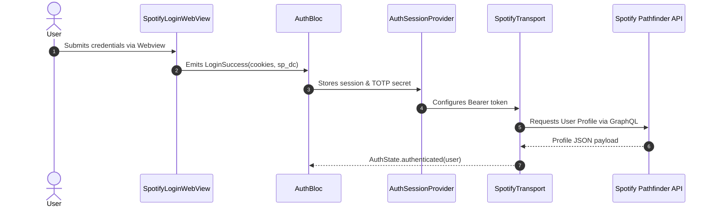
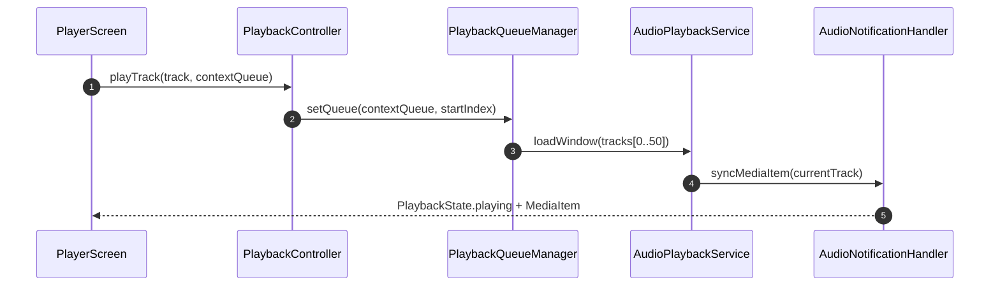
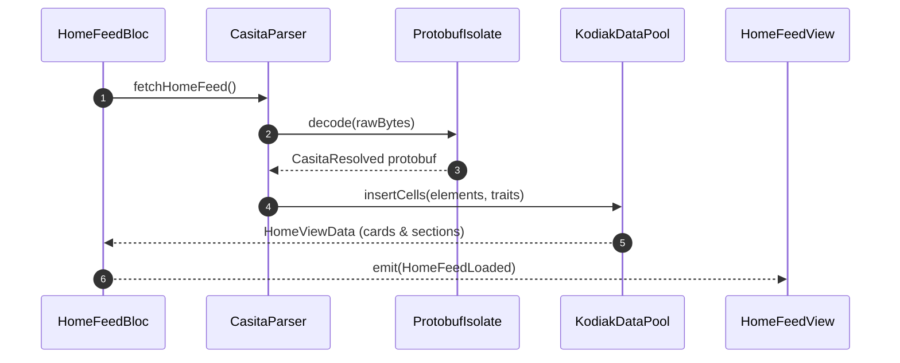
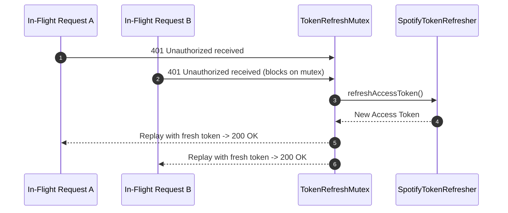

# System Data Flow & Lifecycle

This document traces primary asynchronous and reactive data flows throughout Musify MU.

## 1. Spotify Authentication & Multi-Host Session Flow

## 2. Low-Latency Audio Playback & Sliding Queue

## 3. Kodiak Reactive Feeds & Background Protobuf Decoding

## 4. Asynchronous 401 Mutex Token Recovery

