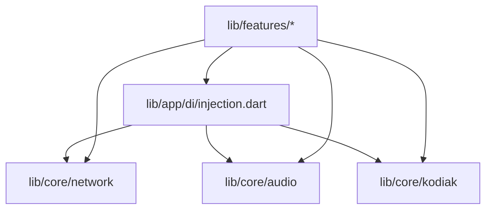

# Cross-File Dependency Graph

This document maps inter-module dependencies across the Musify MU codebase, identifying high-fanout utility hubs and clean architectural boundaries.

## Top Central Components (Highest Inbound Dependencies)

| Component | Layer | Inbound References | Outbound References | Documentation |
|-----------|-------|--------------------|---------------------|---------------|
| `traits.dart` | `lib/features/home_feed/domain/models` | 48 | 0 | [[04-Reference/lib/features/home_feed/domain/models/traits|traits.dart]] |
| `data_pool.dart` | `lib/core/kodiak/dataloader` | 42 | 3 | [[04-Reference/lib/core/kodiak/dataloader/data_pool|data_pool.dart]] |
| `spotify_entity.dart` | `lib/features/home_feed/domain/models` | 34 | 0 | [[04-Reference/lib/features/home_feed/domain/models/spotify_entity|spotify_entity.dart]] |
| `app_network_image.dart` | `lib/core/widgets` | 28 | 2 | [[04-Reference/lib/core/widgets/app_network_image|app_network_image.dart]] |
| `extended_metadata_plugin.dart` | `lib/core/kodiak/extendedmetadataimpl` | 22 | 1 | [[04-Reference/lib/core/kodiak/extendedmetadataimpl/extended_metadata_plugin|extended_metadata_plugin.dart]] |
| `data_statement.dart` | `lib/core/kodiak/statement` | 22 | 1 | [[04-Reference/lib/core/kodiak/statement/data_statement|data_statement.dart]] |
| `network_monitor_service.dart` | `lib/core/network/status` | 20 | 1 | [[04-Reference/lib/core/network/status/network_monitor_service|network_monitor_service.dart]] |
| `network_status.dart` | `lib/core/network/status` | 19 | 0 | [[04-Reference/lib/core/network/status/network_status|network_status.dart]] |
| `data_element.dart` | `lib/core/kodiak/element` | 18 | 2 | [[04-Reference/lib/core/kodiak/element/data_element|data_element.dart]] |
| `data_requirement.dart` | `lib/core/kodiak/statement` | 17 | 0 | [[04-Reference/lib/core/kodiak/statement/data_requirement|data_requirement.dart]] |
| `playback_controller.dart` | `lib/core/audio` | 16 | 0 | [[04-Reference/lib/core/audio/playback_controller|playback_controller.dart]] |
| `network_priority.dart` | `lib/core/network/priority` | 16 | 0 | [[04-Reference/lib/core/network/priority/network_priority|network_priority.dart]] |
| `home_view_data.dart` | `lib/features/home_feed/domain/models` | 14 | 0 | [[04-Reference/lib/features/home_feed/domain/models/home_view_data|home_view_data.dart]] |
| `media_item_mapper.dart` | `lib/core/media` | 13 | 1 | [[04-Reference/lib/core/media/media_item_mapper|media_item_mapper.dart]] |
| `scroll_card_descriptor.dart` | `lib/features/player/domain/models` | 12 | 9 | [[04-Reference/lib/features/player/domain/models/scroll_card_descriptor|scroll_card_descriptor.dart]] |
| `app_cache_manager.dart` | `lib/core/cache` | 12 | 0 | [[04-Reference/lib/core/cache/app_cache_manager|app_cache_manager.dart]] |
| `color_extraction_service.dart` | `lib/core/color` | 12 | 3 | [[04-Reference/lib/core/color/color_extraction_service|color_extraction_service.dart]] |
| `cell_key.dart` | `lib/core/kodiak/table` | 12 | 1 | [[04-Reference/lib/core/kodiak/table/cell_key|cell_key.dart]] |
| `runtime_context.dart` | `lib/core/config` | 11 | 0 | [[04-Reference/lib/core/config/runtime_context|runtime_context.dart]] |
| `network_result.dart` | `lib/core/network/result` | 11 | 0 | [[04-Reference/lib/core/network/result/network_result|network_result.dart]] |

## Core Layer Interaction Graph

