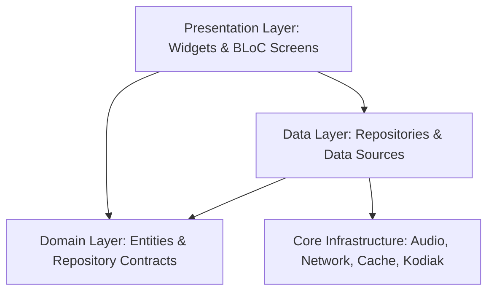

# Musify MU System Architecture

Musify MU is built as a high-fidelity, high-performance Spotify client and offline music manager for Flutter (targeting Android, iOS, Windows, macOS, Linux, and Web).

## Architectural Principles

1. **Feature-First Organization**: Code is structured by business domain (`auth`, `player`, `home_feed`, `library`, `browse`, `local_music`, `shell`).
2. **Clean Architecture Separation**: Strict boundaries between Presentation (Widgets, BLoCs), Domain (Entities, Repository Interfaces), and Data (Drift, Remote Sources, Mappers).
3. **Dependency Inversion**: High-level modules do not depend on low-level modules; all dependencies are bound via `get_it` in `lib/app/di/injection.dart`.
4. **BLoC State Management**: Unidirectional data flow using `flutter_bloc` and `equatable`. UI widgets emit events and listen to immutable states.
5. **Kodiak Reactive Data Layer**: High-density UI feeds are driven by Spotify's cell-and-trait data architecture for maximum frame rates and zero-jank rendering.

## High-Level Layer Topology

## Detailed Subsystem Mapping
- **Audio Engine & Queue Pipeline**: `lib/core/audio/` & `lib/features/player/domain/` - JustAudio 2-slot gapless prefetch pipeline, AudioService, PlaybackQueueManager, QueueMutator, QueueFilterHelper, Cosmos LocalContextResolver
- **Network Stack**: `lib/core/network/` - Dio, Cronet HTTP/3, Token Refresh Mutex
- **Protobuf Core**: `lib/core/protocol/` - Wire parsers, background isolates
- **Reactive Cache**: `lib/core/kodiak/` - Kodiak data pool, trait plugins
- **Color Engine**: `lib/core/color/` - Perceptual Oklab palette extraction
- **Offline Database**: `lib/features/local_music/data/database/` - Drift SQLite
