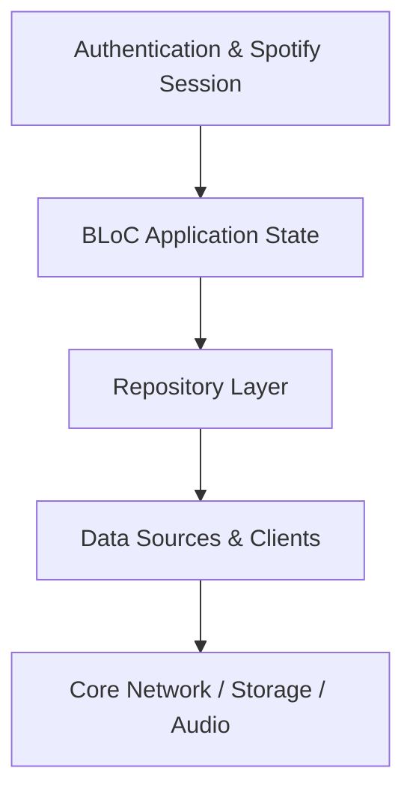

# Authentication & Spotify Session

Handles Spotify OAuth webview login, sp_dc extraction, client token generation, TOTP generation, and multi-host authenticated token refreshing.

## Architectural Structure
- Primary Domain Layer: `lib/features/auth`
- Core Support Layer: `lib/core/network/spotify/auth`

## Subsystem File Inventory
| Component File | Role | Reference |
|----------------|------|-----------|
| `auth_session_provider.dart` | `Core Component` | [[04-Reference/lib/core/network/spotify/auth/auth_session_provider|auth_session_provider.dart]] |
| `spotify_client_token.dart` | `Data Source / Remote Client` | [[04-Reference/lib/core/network/spotify/auth/spotify_client_token|spotify_client_token.dart]] |
| `spotify_token_refresher.dart` | `Core Component` | [[04-Reference/lib/core/network/spotify/auth/spotify_token_refresher|spotify_token_refresher.dart]] |
| `spotify_token_store.dart` | `Core Component` | [[04-Reference/lib/core/network/spotify/auth/spotify_token_store|spotify_token_store.dart]] |
| `spotify_totp.dart` | `Core Component` | [[04-Reference/lib/core/network/spotify/auth/spotify_totp|spotify_totp.dart]] |
| `auth_bloc.dart` | `BLoC State Machine` | [[04-Reference/lib/features/auth/application/auth_bloc|auth_bloc.dart]] |
| `auth_event.dart` | `Domain Model / Entity` | [[04-Reference/lib/features/auth/application/auth_event|auth_event.dart]] |
| `spotify_profile_fetcher.dart` | `Data Source / Remote Client` | [[04-Reference/lib/features/auth/data/spotify_profile_fetcher|spotify_profile_fetcher.dart]] |
| `auth_state.dart` | `Domain Model / Entity` | [[04-Reference/lib/features/auth/domain/entities/auth_state|auth_state.dart]] |
| `spotify_user.dart` | `Domain Model / Entity` | [[04-Reference/lib/features/auth/domain/entities/spotify_user|spotify_user.dart]] |
| `spotify_login_webview.dart` | `Stateful Widget` | [[04-Reference/lib/features/auth/presentation/widgets/spotify_login_webview|spotify_login_webview.dart]] |
| `spotify_welcome_landing.dart` | `Stateless Widget` | [[04-Reference/lib/features/auth/presentation/widgets/spotify_welcome_landing|spotify_welcome_landing.dart]] |

## Subsystem Data Flow & Interactions

