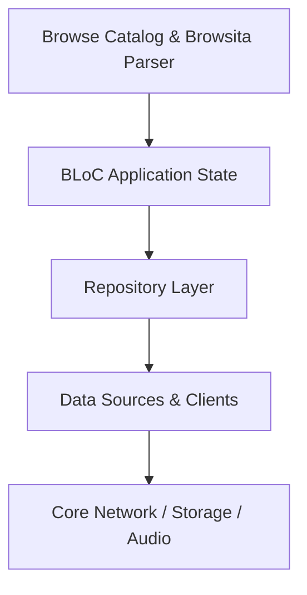

# Browse Catalog & Browsita Parser

Provides category discovery, genre browsing, and search views backed by the Browsita wire protocol.

## Architectural Structure
- Primary Domain Layer: `lib/features/browse`
- Core Support Layer: `lib/core/protocol/generated/spotify/browsita`

## Subsystem File Inventory
| Component File | Role | Reference |
|----------------|------|-----------|
| `browse_bloc.dart` | `Domain Model / Entity` | [[04-Reference/lib/features/browse/application/browse_bloc|browse_bloc.dart]] |
| `browse_cache.dart` | `Kodiak Trait Plugin / Reactive Element` | [[04-Reference/lib/features/browse/data/browse_cache|browse_cache.dart]] |
| `browse_metadata_fetcher.dart` | `Core Component` | [[04-Reference/lib/features/browse/data/browse_metadata_fetcher|browse_metadata_fetcher.dart]] |
| `browse_repository.dart` | `Repository Pattern` | [[04-Reference/lib/features/browse/data/browse_repository|browse_repository.dart]] |
| `browsita_parser.dart` | `Parser / Data Mapper` | [[04-Reference/lib/features/browse/data/browsita_parser|browsita_parser.dart]] |
| `browse_view_data.dart` | `Domain Model / Entity` | [[04-Reference/lib/features/browse/domain/models/browse_view_data|browse_view_data.dart]] |
| `browse_repository.dart` | `Repository Pattern` | [[04-Reference/lib/features/browse/domain/repositories/browse_repository|browse_repository.dart]] |
| `load_browse.dart` | `Core Component` | [[04-Reference/lib/features/browse/domain/usecases/load_browse|load_browse.dart]] |
| `browse_view.dart` | `Stateful Widget` | [[04-Reference/lib/features/browse/presentation/browse_view|browse_view.dart]] |
| `offline_browse_view.dart` | `Stateful Widget` | [[04-Reference/lib/features/browse/presentation/offline_browse_view|offline_browse_view.dart]] |

## Subsystem Data Flow & Interactions

