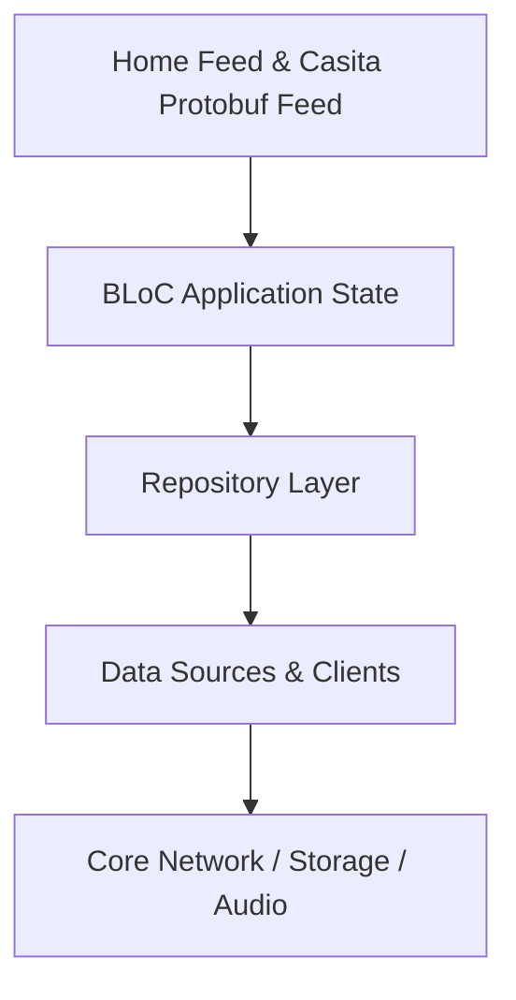

# Home Feed & Casita Protobuf Feed

Parses Spotify Casita protobuf feeds, managing home recents, quick grids, carousels, podcasts, audio spotlights, and interactive prompt cards.

## Architectural Structure
- Primary Domain Layer: `lib/features/home_feed`
- Core Support Layer: `lib/features/home`

## Subsystem File Inventory
| Component File | Role | Reference |
|----------------|------|-----------|
| `home_tab.dart` | `Stateless Widget` | [[04-Reference/lib/features/home/presentation/home_tab|home_tab.dart]] |
| `online_home_screen.dart` | `Stateful Widget` | [[04-Reference/lib/features/home/presentation/online_home_screen|online_home_screen.dart]] |
| `home_header.dart` | `Stateless Widget` | [[04-Reference/lib/features/home/presentation/widgets/home_header|home_header.dart]] |
| `home_feed_bloc.dart` | `Core Component` | [[04-Reference/lib/features/home_feed/application/home_feed_bloc|home_feed_bloc.dart]] |
| `casita_parser.dart` | `Parser / Data Mapper` | [[04-Reference/lib/features/home_feed/data/casita_parser|casita_parser.dart]] |
| `eagerload_payload_builder.dart` | `Core Component` | [[04-Reference/lib/features/home_feed/data/eagerload/eagerload_payload_builder|eagerload_payload_builder.dart]] |
| `section_trait_provider.dart` | `Kodiak Trait Plugin / Reactive Element` | [[04-Reference/lib/features/home_feed/data/eagerload/section_trait_provider|section_trait_provider.dart]] |
| `trait_plugin_registry.dart` | `Kodiak Trait Plugin / Reactive Element` | [[04-Reference/lib/features/home_feed/data/eagerload/trait_plugin_registry|trait_plugin_registry.dart]] |
| `campaign_card_data_element.dart` | `Kodiak Trait Plugin / Reactive Element` | [[04-Reference/lib/features/home_feed/data/elements/campaign_card_data_element|campaign_card_data_element.dart]] |
| `caught_up_banner_data_element.dart` | `Kodiak Trait Plugin / Reactive Element` | [[04-Reference/lib/features/home_feed/data/elements/caught_up_banner_data_element|caught_up_banner_data_element.dart]] |
| `destination_image_link_card_data_element.dart` | `Kodiak Trait Plugin / Reactive Element` | [[04-Reference/lib/features/home_feed/data/elements/destination_image_link_card_data_element|destination_image_link_card_data_element.dart]] |
| `episode_row_data_element.dart` | `Kodiak Trait Plugin / Reactive Element` | [[04-Reference/lib/features/home_feed/data/elements/episode_row_data_element|episode_row_data_element.dart]] |
| `full_bleed_banner_data_element.dart` | `Kodiak Trait Plugin / Reactive Element` | [[04-Reference/lib/features/home_feed/data/elements/full_bleed_banner_data_element|full_bleed_banner_data_element.dart]] |
| `image_link_card_data_element.dart` | `Kodiak Trait Plugin / Reactive Element` | [[04-Reference/lib/features/home_feed/data/elements/image_link_card_data_element|image_link_card_data_element.dart]] |
| `interactive_prompt_card_data_element.dart` | `Kodiak Trait Plugin / Reactive Element` | [[04-Reference/lib/features/home_feed/data/elements/interactive_prompt_card_data_element|interactive_prompt_card_data_element.dart]] |
| `live_event_card_data_element.dart` | `Kodiak Trait Plugin / Reactive Element` | [[04-Reference/lib/features/home_feed/data/elements/live_event_card_data_element|live_event_card_data_element.dart]] |
| `podcast_preview_data_element.dart` | `Kodiak Trait Plugin / Reactive Element` | [[04-Reference/lib/features/home_feed/data/elements/podcast_preview_data_element|podcast_preview_data_element.dart]] |
| `preview_card_data_element.dart` | `Kodiak Trait Plugin / Reactive Element` | [[04-Reference/lib/features/home_feed/data/elements/preview_card_data_element|preview_card_data_element.dart]] |
| `recents_card_data_element.dart` | `Kodiak Trait Plugin / Reactive Element` | [[04-Reference/lib/features/home_feed/data/elements/recents_card_data_element|recents_card_data_element.dart]] |
| `reflection_card_data_element.dart` | `Kodiak Trait Plugin / Reactive Element` | [[04-Reference/lib/features/home_feed/data/elements/reflection_card_data_element|reflection_card_data_element.dart]] |
| `shortcuts_card_data_element.dart` | `Kodiak Trait Plugin / Reactive Element` | [[04-Reference/lib/features/home_feed/data/elements/shortcuts_card_data_element|shortcuts_card_data_element.dart]] |
| `showcase_card_data_element.dart` | `Kodiak Trait Plugin / Reactive Element` | [[04-Reference/lib/features/home_feed/data/elements/showcase_card_data_element|showcase_card_data_element.dart]] |
| `video_promo_card_data_element.dart` | `Kodiak Trait Plugin / Reactive Element` | [[04-Reference/lib/features/home_feed/data/elements/video_promo_card_data_element|video_promo_card_data_element.dart]] |
| `home_feed_cache.dart` | `Core Component` | [[04-Reference/lib/features/home_feed/data/home_feed_cache|home_feed_cache.dart]] |
| `home_repository.dart` | `Repository Pattern` | [[04-Reference/lib/features/home_feed/data/home_repository|home_repository.dart]] |
| `recents_parser.dart` | `Core Component` | [[04-Reference/lib/features/home_feed/data/recents_parser|recents_parser.dart]] |
| `section_mapper.dart` | `Parser / Data Mapper` | [[04-Reference/lib/features/home_feed/data/section_mapper|section_mapper.dart]] |
| `home_feature_type.dart` | `Domain Model / Entity` | [[04-Reference/lib/features/home_feed/domain/models/home_feature_type|home_feature_type.dart]] |
| `home_view_data.dart` | `Domain Model / Entity` | [[04-Reference/lib/features/home_feed/domain/models/home_view_data|home_view_data.dart]] |
| `spotify_entity.dart` | `Domain Model / Entity` | [[04-Reference/lib/features/home_feed/domain/models/spotify_entity|spotify_entity.dart]] |
| `traits.dart` | `Component` | [[04-Reference/lib/features/home_feed/domain/models/traits|traits.dart]] |
| `audio_preview_playback_trait.dart` | `Kodiak Trait Plugin / Reactive Element` | [[04-Reference/lib/features/home_feed/domain/models/traits/audio_preview_playback_trait|audio_preview_playback_trait.dart]] |
| `audiobook_price_trait.dart` | `Kodiak Trait Plugin / Reactive Element` | [[04-Reference/lib/features/home_feed/domain/models/traits/audiobook_price_trait|audiobook_price_trait.dart]] |
| `audiobook_specifics_trait.dart` | `Kodiak Trait Plugin / Reactive Element` | [[04-Reference/lib/features/home_feed/domain/models/traits/audiobook_specifics_trait|audiobook_specifics_trait.dart]] |
| `concert_location_trait.dart` | `Kodiak Trait Plugin / Reactive Element` | [[04-Reference/lib/features/home_feed/domain/models/traits/concert_location_trait|concert_location_trait.dart]] |
| `concert_marketing_trait.dart` | `Kodiak Trait Plugin / Reactive Element` | [[04-Reference/lib/features/home_feed/domain/models/traits/concert_marketing_trait|concert_marketing_trait.dart]] |
| `concert_trait.dart` | `Kodiak Trait Plugin / Reactive Element` | [[04-Reference/lib/features/home_feed/domain/models/traits/concert_trait|concert_trait.dart]] |
| `consumption_experience_trait.dart` | `Kodiak Trait Plugin / Reactive Element` | [[04-Reference/lib/features/home_feed/domain/models/traits/consumption_experience_trait|consumption_experience_trait.dart]] |
| `credits_trait.dart` | `Core Component` | [[04-Reference/lib/features/home_feed/domain/models/traits/credits_trait|credits_trait.dart]] |
| `episode_meta_trait.dart` | `Kodiak Trait Plugin / Reactive Element` | [[04-Reference/lib/features/home_feed/domain/models/traits/episode_meta_trait|episode_meta_trait.dart]] |
| `fallback_metadata_trait.dart` | `Kodiak Trait Plugin / Reactive Element` | [[04-Reference/lib/features/home_feed/domain/models/traits/fallback_metadata_trait|fallback_metadata_trait.dart]] |
| `identity_trait.dart` | `Kodiak Trait Plugin / Reactive Element` | [[04-Reference/lib/features/home_feed/domain/models/traits/identity_trait|identity_trait.dart]] |
| `on_platform_reputation_trait.dart` | `Kodiak Trait Plugin / Reactive Element` | [[04-Reference/lib/features/home_feed/domain/models/traits/on_platform_reputation_trait|on_platform_reputation_trait.dart]] |
| `preview_card_trait.dart` | `Kodiak Trait Plugin / Reactive Element` | [[04-Reference/lib/features/home_feed/domain/models/traits/preview_card_trait|preview_card_trait.dart]] |
| `preview_playback_trait.dart` | `Kodiak Trait Plugin / Reactive Element` | [[04-Reference/lib/features/home_feed/domain/models/traits/preview_playback_trait|preview_playback_trait.dart]] |
| `promo_v1_trait.dart` | `Kodiak Trait Plugin / Reactive Element` | [[04-Reference/lib/features/home_feed/domain/models/traits/promo_v1_trait|promo_v1_trait.dart]] |
| `promo_v3_trait.dart` | `Kodiak Trait Plugin / Reactive Element` | [[04-Reference/lib/features/home_feed/domain/models/traits/promo_v3_trait|promo_v3_trait.dart]] |
| `recents_metadata_trait.dart` | `Kodiak Trait Plugin / Reactive Element` | [[04-Reference/lib/features/home_feed/domain/models/traits/recents_metadata_trait|recents_metadata_trait.dart]] |
| `shortcuts_card_trait.dart` | `Kodiak Trait Plugin / Reactive Element` | [[04-Reference/lib/features/home_feed/domain/models/traits/shortcuts_card_trait|shortcuts_card_trait.dart]] |
| `show_access_trait.dart` | `Kodiak Trait Plugin / Reactive Element` | [[04-Reference/lib/features/home_feed/domain/models/traits/show_access_trait|show_access_trait.dart]] |
| `simple_card_trait.dart` | `Kodiak Trait Plugin / Reactive Element` | [[04-Reference/lib/features/home_feed/domain/models/traits/simple_card_trait|simple_card_trait.dart]] |
| `track_meta_trait.dart` | `Kodiak Trait Plugin / Reactive Element` | [[04-Reference/lib/features/home_feed/domain/models/traits/track_meta_trait|track_meta_trait.dart]] |
| `trait.dart` | `Kodiak Trait Plugin / Reactive Element` | [[04-Reference/lib/features/home_feed/domain/models/traits/trait|trait.dart]] |
| `video_card_trait.dart` | `Kodiak Trait Plugin / Reactive Element` | [[04-Reference/lib/features/home_feed/domain/models/traits/video_card_trait|video_card_trait.dart]] |
| `visual_identity_trait.dart` | `Core Component` | [[04-Reference/lib/features/home_feed/domain/models/traits/visual_identity_trait|visual_identity_trait.dart]] |
| `home_repository.dart` | `Repository Pattern` | [[04-Reference/lib/features/home_feed/domain/repositories/home_repository|home_repository.dart]] |
| `load_home_feed.dart` | `Core Component` | [[04-Reference/lib/features/home_feed/domain/usecases/load_home_feed|load_home_feed.dart]] |
| `home_feed_view.dart` | `Stateful Widget` | [[04-Reference/lib/features/home_feed/presentation/home_feed_view|home_feed_view.dart]] |
| `section_registry.dart` | `Core Component` | [[04-Reference/lib/features/home_feed/presentation/section_registry|section_registry.dart]] |
| `artist_circle_card.dart` | `Stateless Widget` | [[04-Reference/lib/features/home_feed/presentation/widgets/cards/artist_circle_card|artist_circle_card.dart]] |
| `episode_preview_card.dart` | `Stateful Widget` | [[04-Reference/lib/features/home_feed/presentation/widgets/cards/episode_preview_card|episode_preview_card.dart]] |
| `preview_card.dart` | `Stateful Widget` | [[04-Reference/lib/features/home_feed/presentation/widgets/cards/preview_card|preview_card.dart]] |
| `show_preview_card.dart` | `Stateful Widget` | [[04-Reference/lib/features/home_feed/presentation/widgets/cards/show_preview_card|show_preview_card.dart]] |
| `square_card.dart` | `Stateless Widget` | [[04-Reference/lib/features/home_feed/presentation/widgets/cards/square_card|square_card.dart]] |
| `facet_chip_row.dart` | `Stateless Widget` | [[04-Reference/lib/features/home_feed/presentation/widgets/facet_chip_row|facet_chip_row.dart]] |
| `home_feed_shimmer.dart` | `Stateful Widget` | [[04-Reference/lib/features/home_feed/presentation/widgets/home_feed_shimmer|home_feed_shimmer.dart]] |
| `quick_grid_section.dart` | `Stateless Widget` | [[04-Reference/lib/features/home_feed/presentation/widgets/quick_grid_section|quick_grid_section.dart]] |
| `action_card_section.dart` | `Stateless Widget` | [[04-Reference/lib/features/home_feed/presentation/widgets/sections/action_card_section|action_card_section.dart]] |
| `audio_spotlight_section.dart` | `Stateless Widget` | [[04-Reference/lib/features/home_feed/presentation/widgets/sections/audio_spotlight_section|audio_spotlight_section.dart]] |
| `campaign_carousel_section.dart` | `Stateless Widget` | [[04-Reference/lib/features/home_feed/presentation/widgets/sections/campaign_carousel_section|campaign_carousel_section.dart]] |
| `caught_up_banner_section.dart` | `Stateful Widget` | [[04-Reference/lib/features/home_feed/presentation/widgets/sections/caught_up_banner_section|caught_up_banner_section.dart]] |
| `content_carousel_section.dart` | `Stateful Widget` | [[04-Reference/lib/features/home_feed/presentation/widgets/sections/content_carousel_section|content_carousel_section.dart]] |
| `episode_list_section.dart` | `Stateful Widget` | [[04-Reference/lib/features/home_feed/presentation/widgets/sections/episode_list_section|episode_list_section.dart]] |
| `full_bleed_banner_section.dart` | `Stateless Widget` | [[04-Reference/lib/features/home_feed/presentation/widgets/sections/full_bleed_banner_section|full_bleed_banner_section.dart]] |
| `immersive_preview_section.dart` | `Stateless Widget` | [[04-Reference/lib/features/home_feed/presentation/widgets/sections/immersive_preview_section|immersive_preview_section.dart]] |
| `inline_card_section.dart` | `Stateless Widget` | [[04-Reference/lib/features/home_feed/presentation/widgets/sections/inline_card_section|inline_card_section.dart]] |
| `interactive_prompt_section.dart` | `Stateless Widget` | [[04-Reference/lib/features/home_feed/presentation/widgets/sections/interactive_prompt_section|interactive_prompt_section.dart]] |
| `live_event_section.dart` | `Stateless Widget` | [[04-Reference/lib/features/home_feed/presentation/widgets/sections/live_event_section|live_event_section.dart]] |
| `play_link_section.dart` | `Stateless Widget` | [[04-Reference/lib/features/home_feed/presentation/widgets/sections/play_link_section|play_link_section.dart]] |
| `podcast_preview_section.dart` | `Stateful Widget` | [[04-Reference/lib/features/home_feed/presentation/widgets/sections/podcast_preview_section|podcast_preview_section.dart]] |
| `preview_carousel_section.dart` | `Stateful Widget` | [[04-Reference/lib/features/home_feed/presentation/widgets/sections/preview_carousel_section|preview_carousel_section.dart]] |
| `preview_feed_section.dart` | `Stateful Widget` | [[04-Reference/lib/features/home_feed/presentation/widgets/sections/preview_feed_section|preview_feed_section.dart]] |
| `promotion_banner_section.dart` | `Stateless Widget` | [[04-Reference/lib/features/home_feed/presentation/widgets/sections/promotion_banner_section|promotion_banner_section.dart]] |
| `recents_carousel_section.dart` | `Stateful Widget` | [[04-Reference/lib/features/home_feed/presentation/widgets/sections/recents_carousel_section|recents_carousel_section.dart]] |
| `reflection_section.dart` | `Stateless Widget` | [[04-Reference/lib/features/home_feed/presentation/widgets/sections/reflection_section|reflection_section.dart]] |
| `showcase_section.dart` | `Stateless Widget` | [[04-Reference/lib/features/home_feed/presentation/widgets/sections/showcase_section|showcase_section.dart]] |
| `story_bubble_carousel.dart` | `Stateless Widget` | [[04-Reference/lib/features/home_feed/presentation/widgets/sections/story_bubble_carousel|story_bubble_carousel.dart]] |
| `vertical_card_section.dart` | `Stateless Widget` | [[04-Reference/lib/features/home_feed/presentation/widgets/sections/vertical_card_section|vertical_card_section.dart]] |
| `video_carousel_section.dart` | `Stateful Widget` | [[04-Reference/lib/features/home_feed/presentation/widgets/sections/video_carousel_section|video_carousel_section.dart]] |
| `video_promo_section.dart` | `Stateless Widget` | [[04-Reference/lib/features/home_feed/presentation/widgets/sections/video_promo_section|video_promo_section.dart]] |

## Subsystem Data Flow & Interactions

