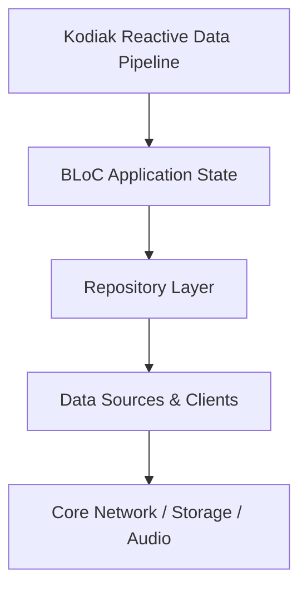

# Kodiak Reactive Data Pipeline

Implements Spotify's high-performance data architecture: DataPool, DataStatement, reactive table cells, and isolated trait plugin registration.

## Architectural Structure
- Primary Domain Layer: `lib/core/kodiak`
- Core Support Layer: `lib/core/kodiak/extendedmetadataimpl`

## Subsystem File Inventory
| Component File | Role | Reference |
|----------------|------|-----------|
| `data_pool.dart` | `Core Component` | [[04-Reference/lib/core/kodiak/dataloader/data_pool|data_pool.dart]] |
| `data_pool_impl.dart` | `Core Component` | [[04-Reference/lib/core/kodiak/dataloader/data_pool_impl|data_pool_impl.dart]] |
| `kodiak_disk_cache.dart` | `Core Component` | [[04-Reference/lib/core/kodiak/dataloader/kodiak_disk_cache|kodiak_disk_cache.dart]] |
| `data_element.dart` | `Kodiak Trait Plugin / Reactive Element` | [[04-Reference/lib/core/kodiak/element/data_element|data_element.dart]] |
| `kodiak_reactive_card.dart` | `Stateless Widget` | [[04-Reference/lib/core/kodiak/element/kodiak_reactive_card|kodiak_reactive_card.dart]] |
| `batched_extension_response_parser.dart` | `Parser / Data Mapper` | [[04-Reference/lib/core/kodiak/extendedmetadataimpl/batched_extension_response_parser|batched_extension_response_parser.dart]] |
| `extended_metadata_client.dart` | `Data Source / Remote Client` | [[04-Reference/lib/core/kodiak/extendedmetadataimpl/extended_metadata_client|extended_metadata_client.dart]] |
| `extended_metadata_data_source.dart` | `Data Source / Remote Client` | [[04-Reference/lib/core/kodiak/extendedmetadataimpl/extended_metadata_data_source|extended_metadata_data_source.dart]] |
| `extended_metadata_plugin.dart` | `Kodiak Trait Plugin / Reactive Element` | [[04-Reference/lib/core/kodiak/extendedmetadataimpl/extended_metadata_plugin|extended_metadata_plugin.dart]] |
| `extended_metadata_plugin_registry.dart` | `Kodiak Trait Plugin / Reactive Element` | [[04-Reference/lib/core/kodiak/extendedmetadataimpl/extended_metadata_plugin_registry|extended_metadata_plugin_registry.dart]] |
| `kodiak_cell_mapper.dart` | `Parser / Data Mapper` | [[04-Reference/lib/core/kodiak/extendedmetadataimpl/kodiak_cell_mapper|kodiak_cell_mapper.dart]] |
| `metadata_subscription.dart` | `Core Component` | [[04-Reference/lib/core/kodiak/extendedmetadataimpl/metadata_subscription|metadata_subscription.dart]] |
| `audio_preview_playback_trait_plugin.dart` | `Kodiak Trait Plugin / Reactive Element` | [[04-Reference/lib/core/kodiak/extendedmetadataimpl/plugins/audio_preview_playback_trait_plugin|audio_preview_playback_trait_plugin.dart]] |
| `audiobook_price_plugin.dart` | `Kodiak Trait Plugin / Reactive Element` | [[04-Reference/lib/core/kodiak/extendedmetadataimpl/plugins/audiobook_price_plugin|audiobook_price_plugin.dart]] |
| `audiobook_specifics_plugin.dart` | `Kodiak Trait Plugin / Reactive Element` | [[04-Reference/lib/core/kodiak/extendedmetadataimpl/plugins/audiobook_specifics_plugin|audiobook_specifics_plugin.dart]] |
| `builtin_plugins.dart` | `Component` | [[04-Reference/lib/core/kodiak/extendedmetadataimpl/plugins/builtin_plugins|builtin_plugins.dart]] |
| `concert_location_trait_plugin.dart` | `Kodiak Trait Plugin / Reactive Element` | [[04-Reference/lib/core/kodiak/extendedmetadataimpl/plugins/concert_location_trait_plugin|concert_location_trait_plugin.dart]] |
| `concert_marketing_trait_plugin.dart` | `Kodiak Trait Plugin / Reactive Element` | [[04-Reference/lib/core/kodiak/extendedmetadataimpl/plugins/concert_marketing_trait_plugin|concert_marketing_trait_plugin.dart]] |
| `concert_trait_plugin.dart` | `Kodiak Trait Plugin / Reactive Element` | [[04-Reference/lib/core/kodiak/extendedmetadataimpl/plugins/concert_trait_plugin|concert_trait_plugin.dart]] |
| `consumption_experience_trait_plugin.dart` | `Kodiak Trait Plugin / Reactive Element` | [[04-Reference/lib/core/kodiak/extendedmetadataimpl/plugins/consumption_experience_trait_plugin|consumption_experience_trait_plugin.dart]] |
| `credits_trait_plugin.dart` | `Kodiak Trait Plugin / Reactive Element` | [[04-Reference/lib/core/kodiak/extendedmetadataimpl/plugins/credits_trait_plugin|credits_trait_plugin.dart]] |
| `episode_v4_plugin.dart` | `Kodiak Trait Plugin / Reactive Element` | [[04-Reference/lib/core/kodiak/extendedmetadataimpl/plugins/episode_v4_plugin|episode_v4_plugin.dart]] |
| `identity_trait_plugin.dart` | `Kodiak Trait Plugin / Reactive Element` | [[04-Reference/lib/core/kodiak/extendedmetadataimpl/plugins/identity_trait_plugin|identity_trait_plugin.dart]] |
| `on_platform_reputation_trait_plugin.dart` | `Kodiak Trait Plugin / Reactive Element` | [[04-Reference/lib/core/kodiak/extendedmetadataimpl/plugins/on_platform_reputation_trait_plugin|on_platform_reputation_trait_plugin.dart]] |
| `plugin_utils.dart` | `Component` | [[04-Reference/lib/core/kodiak/extendedmetadataimpl/plugins/plugin_utils|plugin_utils.dart]] |
| `preview_card_trait_plugin.dart` | `Kodiak Trait Plugin / Reactive Element` | [[04-Reference/lib/core/kodiak/extendedmetadataimpl/plugins/preview_card_trait_plugin|preview_card_trait_plugin.dart]] |
| `preview_playback_trait_plugin.dart` | `Kodiak Trait Plugin / Reactive Element` | [[04-Reference/lib/core/kodiak/extendedmetadataimpl/plugins/preview_playback_trait_plugin|preview_playback_trait_plugin.dart]] |
| `promo_v1_trait_plugin.dart` | `Kodiak Trait Plugin / Reactive Element` | [[04-Reference/lib/core/kodiak/extendedmetadataimpl/plugins/promo_v1_trait_plugin|promo_v1_trait_plugin.dart]] |
| `promo_v3_trait_plugin.dart` | `Kodiak Trait Plugin / Reactive Element` | [[04-Reference/lib/core/kodiak/extendedmetadataimpl/plugins/promo_v3_trait_plugin|promo_v3_trait_plugin.dart]] |
| `shortcuts_card_trait_plugin.dart` | `Kodiak Trait Plugin / Reactive Element` | [[04-Reference/lib/core/kodiak/extendedmetadataimpl/plugins/shortcuts_card_trait_plugin|shortcuts_card_trait_plugin.dart]] |
| `show_access_trait_plugin.dart` | `Kodiak Trait Plugin / Reactive Element` | [[04-Reference/lib/core/kodiak/extendedmetadataimpl/plugins/show_access_trait_plugin|show_access_trait_plugin.dart]] |
| `simple_card_trait_plugin.dart` | `Kodiak Trait Plugin / Reactive Element` | [[04-Reference/lib/core/kodiak/extendedmetadataimpl/plugins/simple_card_trait_plugin|simple_card_trait_plugin.dart]] |
| `track_v4_plugin.dart` | `Kodiak Trait Plugin / Reactive Element` | [[04-Reference/lib/core/kodiak/extendedmetadataimpl/plugins/track_v4_plugin|track_v4_plugin.dart]] |
| `visual_identity_trait_plugin.dart` | `Kodiak Trait Plugin / Reactive Element` | [[04-Reference/lib/core/kodiak/extendedmetadataimpl/plugins/visual_identity_trait_plugin|visual_identity_trait_plugin.dart]] |
| `data_requirement.dart` | `Core Component` | [[04-Reference/lib/core/kodiak/statement/data_requirement|data_requirement.dart]] |
| `data_statement.dart` | `Core Component` | [[04-Reference/lib/core/kodiak/statement/data_statement|data_statement.dart]] |
| `cell_key.dart` | `Core Component` | [[04-Reference/lib/core/kodiak/table/cell_key|cell_key.dart]] |
| `data_source.dart` | `Data Source / Remote Client` | [[04-Reference/lib/core/kodiak/table/data_source|data_source.dart]] |
| `data_source_result.dart` | `Data Source / Remote Client` | [[04-Reference/lib/core/kodiak/table/data_source_result|data_source_result.dart]] |
| `data_source_subscription.dart` | `Data Source / Remote Client` | [[04-Reference/lib/core/kodiak/table/data_source_subscription|data_source_subscription.dart]] |
| `table_key.dart` | `Core Component` | [[04-Reference/lib/core/kodiak/table/table_key|table_key.dart]] |

## Subsystem Data Flow & Interactions

