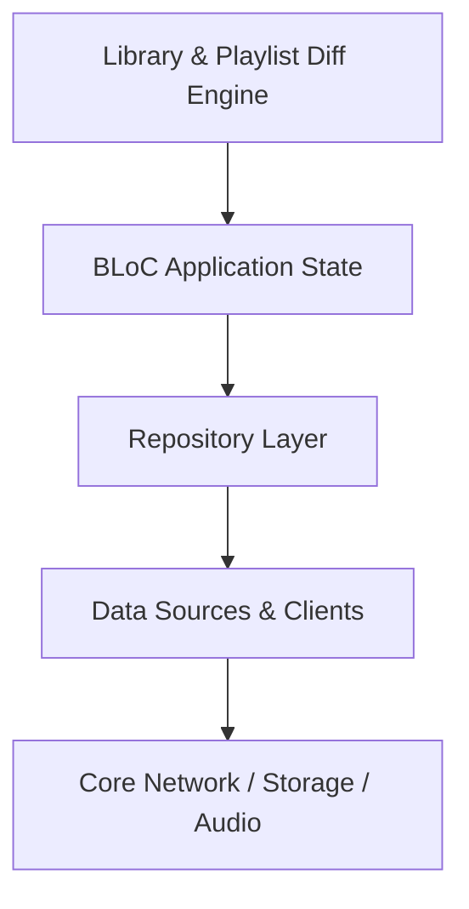

# Library & Playlist Diff Engine

Manages user saved playlists, albums, and artists; implements playlist snapshot diffing and cover art resolution.

## Architectural Structure
- Primary Domain Layer: `lib/features/library`
- Core Support Layer: `lib/features/playlist_detail`

## Subsystem File Inventory
| Component File | Role | Reference |
|----------------|------|-----------|
| `library_bloc.dart` | `Core Component` | [[04-Reference/lib/features/library/application/library_bloc|library_bloc.dart]] |
| `library_cache.dart` | `Core Component` | [[04-Reference/lib/features/library/data/cache/library_cache|library_cache.dart]] |
| `playlist_detail_cache.dart` | `Core Component` | [[04-Reference/lib/features/library/data/cache/playlist_detail_cache|playlist_detail_cache.dart]] |
| `library_mapper.dart` | `Parser / Data Mapper` | [[04-Reference/lib/features/library/data/mappers/library_mapper|library_mapper.dart]] |
| `playlist_mapper.dart` | `Core Component` | [[04-Reference/lib/features/library/data/mappers/playlist_mapper|playlist_mapper.dart]] |
| `library_decorator.dart` | `Core Component` | [[04-Reference/lib/features/library/data/repository/library_decorator|library_decorator.dart]] |
| `library_repository_impl.dart` | `Repository Pattern` | [[04-Reference/lib/features/library/data/repository/library_repository_impl|library_repository_impl.dart]] |
| `library_remote_source.dart` | `Core Component` | [[04-Reference/lib/features/library/data/sources/library_remote_source|library_remote_source.dart]] |
| `playlist_remote_source.dart` | `Core Component` | [[04-Reference/lib/features/library/data/sources/playlist_remote_source|playlist_remote_source.dart]] |
| `library_item.dart` | `Domain Model / Entity` | [[04-Reference/lib/features/library/domain/models/library_item|library_item.dart]] |
| `library_view_data.dart` | `Domain Model / Entity` | [[04-Reference/lib/features/library/domain/models/library_view_data|library_view_data.dart]] |
| `playlist_snapshot.dart` | `Core Component` | [[04-Reference/lib/features/library/domain/models/playlist_snapshot|playlist_snapshot.dart]] |
| `library_repository.dart` | `Repository Pattern` | [[04-Reference/lib/features/library/domain/repositories/library_repository|library_repository.dart]] |
| `cover_resolver.dart` | `Core Component` | [[04-Reference/lib/features/library/domain/services/cover_resolver|cover_resolver.dart]] |
| `diff_op.dart` | `Core Component` | [[04-Reference/lib/features/library/domain/services/diff_op|diff_op.dart]] |
| `playlist_diff_engine.dart` | `Core Component` | [[04-Reference/lib/features/library/domain/services/playlist_diff_engine|playlist_diff_engine.dart]] |
| `load_library.dart` | `Core Component` | [[04-Reference/lib/features/library/domain/usecases/load_library|load_library.dart]] |
| `library_view.dart` | `Stateful Widget` | [[04-Reference/lib/features/library/presentation/library_view|library_view.dart]] |
| `offline_library_view.dart` | `Stateful Widget` | [[04-Reference/lib/features/library/presentation/offline_library_view|offline_library_view.dart]] |
| `playlist_detail_bloc.dart` | `Core Component` | [[04-Reference/lib/features/playlist_detail/application/playlist_detail_bloc|playlist_detail_bloc.dart]] |
| `playlist_detail_screen.dart` | `Stateful Widget` | [[04-Reference/lib/features/playlist_detail/presentation/playlist_detail_screen|playlist_detail_screen.dart]] |

## Subsystem Data Flow & Interactions

