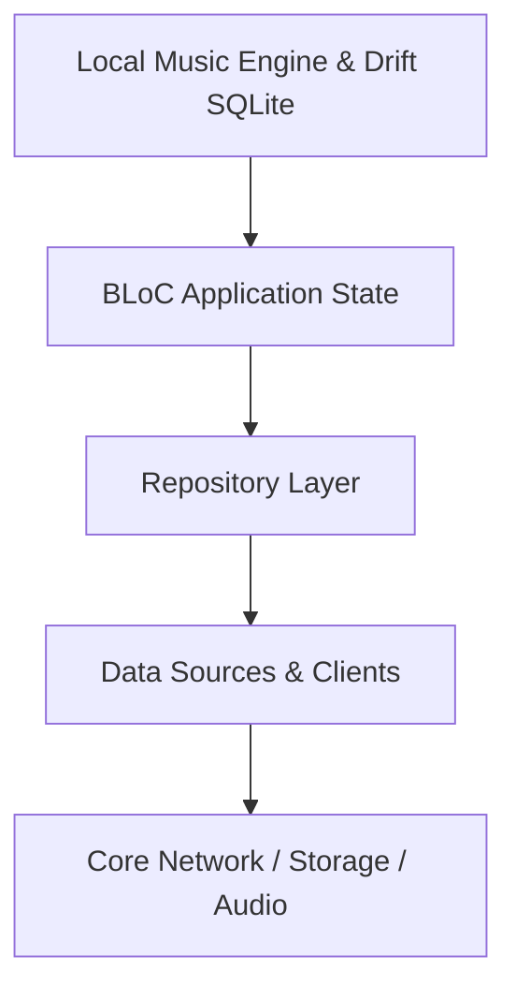

# Local Music Engine & Drift SQLite

Scans device audio via on_audio_query, persists track metadata in Drift SQLite, chunks offline collections into discrete 50-track Cosmos `ContextPage` instances via `LocalContextResolver`, and synchronizes offline playback with the main player.

## Architectural Structure
- Primary Domain Layer: `lib/features/local_music`
- Core Support Layer: `lib/core/cache`

## Subsystem File Inventory
| Component File | Role | Reference |
|----------------|------|-----------|
| `app_cache_manager.dart` | `Service / Controller` | [[04-Reference/lib/core/cache/app_cache_manager|app_cache_manager.dart]] |
| `cache_policy.dart` | `Core Component` | [[04-Reference/lib/core/cache/cache_policy|cache_policy.dart]] |
| `local_music_playback_synchronizer.dart` | `Core Component` | [[04-Reference/lib/features/local_music/application/local_music_playback_synchronizer|local_music_playback_synchronizer.dart]] |
| `app_database.dart` | `Core Component` | [[04-Reference/lib/features/local_music/data/database/app_database|app_database.dart]] |
| `device_music_data_source.dart` | `Data Source / Remote Client` | [[04-Reference/lib/features/local_music/data/datasources/device_music_data_source|device_music_data_source.dart]] |
| `local_tracks_store.dart` | `Core Component` | [[04-Reference/lib/features/local_music/data/datasources/local_tracks_store|local_tracks_store.dart]] |
| `local_music_repository_impl.dart` | `Repository Pattern` | [[04-Reference/lib/features/local_music/data/repositories/local_music_repository_impl|local_music_repository_impl.dart]] |
| `local_music_sync_service.dart` | `Service / Controller` | [[04-Reference/lib/features/local_music/data/services/local_music_sync_service|local_music_sync_service.dart]] |
| `domain_track.dart` | `Core Component` | [[04-Reference/lib/features/local_music/domain/entities/domain_track|domain_track.dart]] |
| `local_context_resolver.dart` | `Domain Service / Context Resolver` | [[04-Reference/lib/features/local_music/domain/local_context_resolver|local_context_resolver.dart]] |
| `local_music_repository.dart` | `Repository Pattern` | [[04-Reference/lib/features/local_music/domain/repositories/local_music_repository|local_music_repository.dart]] |
| `local_music_bloc.dart` | `BLoC State Machine` | [[04-Reference/lib/features/local_music/presentation/bloc/local_music_bloc|local_music_bloc.dart]] |
| `local_music_event.dart` | `Domain Model / Entity` | [[04-Reference/lib/features/local_music/presentation/bloc/local_music_event|local_music_event.dart]] |
| `local_music_state.dart` | `Domain Model / Entity` | [[04-Reference/lib/features/local_music/presentation/bloc/local_music_state|local_music_state.dart]] |
| `local_music_screen.dart` | `Stateless Widget` | [[04-Reference/lib/features/local_music/presentation/screens/local_music_screen|local_music_screen.dart]] |

## Subsystem Data Flow & Interactions

