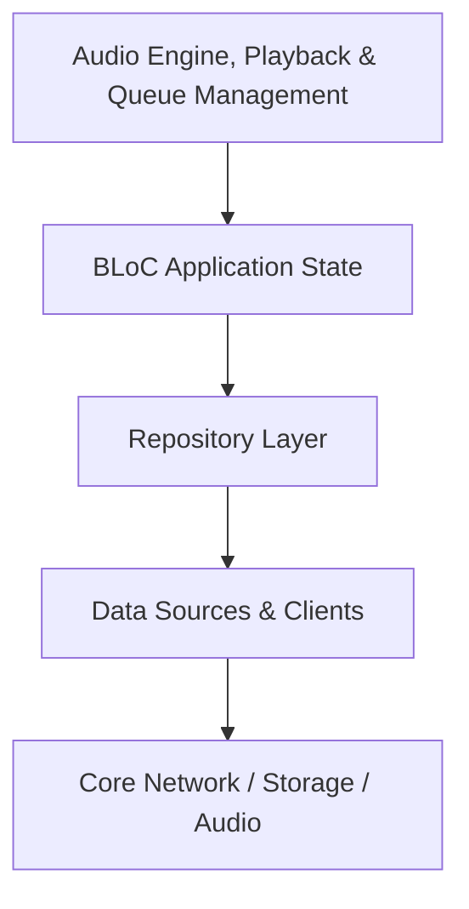

# Audio Engine, Playback & Queue Management

Orchestrates playback state, 2-slot gapless prefetch queue pipeline (Slot 0 active, Slot 1 prefetched via PrefetchLevel.media), single linear queue with pure operational transformations (`QueueMutator`), dynamic Cosmos pagination, background audio notifications, and Spotify player sheet animations.

## Architectural Structure
- Primary Domain Layer: `lib/features/player`
- Core Support Layer: `lib/core/audio`

## Subsystem File Inventory
| Component File | Role | Reference |
|----------------|------|-----------|
| `audio_notification_handler.dart` | `Service / Controller` | [[04-Reference/lib/core/audio/audio_notification_handler|audio_notification_handler.dart]] |
| `audio_playback_service.dart` | `Service / Controller` | [[04-Reference/lib/core/audio/audio_playback_service|audio_playback_service.dart]] |
| `playback_controller.dart` | `Service / Controller` | [[04-Reference/lib/core/audio/playback_controller|playback_controller.dart]] |
| `playback_queue_manager.dart` | `Service / Controller` | [[04-Reference/lib/core/audio/playback_queue_manager|playback_queue_manager.dart]] |
| `queue_bloc.dart` | `Core Component` | [[04-Reference/lib/features/player/application/queue/queue_bloc|queue_bloc.dart]] |
| `queue_event.dart` | `Domain Model / Entity` | [[04-Reference/lib/features/player/application/queue/queue_event|queue_event.dart]] |
| `queue_state.dart` | `Domain Model / Entity` | [[04-Reference/lib/features/player/application/queue/queue_state|queue_state.dart]] |
| `now_playing_scroll_bloc.dart` | `BLoC State Machine` | [[04-Reference/lib/features/player/application/scroll/now_playing_scroll_bloc|now_playing_scroll_bloc.dart]] |
| `now_playing_scroll_event.dart` | `Domain Model / Entity` | [[04-Reference/lib/features/player/application/scroll/now_playing_scroll_event|now_playing_scroll_event.dart]] |
| `now_playing_scroll_state.dart` | `Domain Model / Entity` | [[04-Reference/lib/features/player/application/scroll/now_playing_scroll_state|now_playing_scroll_state.dart]] |
| `color_lyrics_client.dart` | `Data Source / Remote Client` | [[04-Reference/lib/features/player/data/datasources/color_lyrics_client|color_lyrics_client.dart]] |
| `scrollsita_client.dart` | `Data Source / Remote Client` | [[04-Reference/lib/features/player/data/datasources/scrollsita_client|scrollsita_client.dart]] |
| `about_artist_data_element.dart` | `Kodiak Trait Plugin / Reactive Element` | [[04-Reference/lib/features/player/data/elements/about_artist_data_element|about_artist_data_element.dart]] |
| `credits_card_data_element.dart` | `Kodiak Trait Plugin / Reactive Element` | [[04-Reference/lib/features/player/data/elements/credits_card_data_element|credits_card_data_element.dart]] |
| `live_events_card_data_element.dart` | `Kodiak Trait Plugin / Reactive Element` | [[04-Reference/lib/features/player/data/elements/live_events_card_data_element|live_events_card_data_element.dart]] |
| `color_lyrics_repository.dart` | `Repository Pattern` | [[04-Reference/lib/features/player/data/repositories/color_lyrics_repository|color_lyrics_repository.dart]] |
| `scrollsita_repository.dart` | `Repository Pattern` | [[04-Reference/lib/features/player/data/repositories/scrollsita_repository|scrollsita_repository.dart]] |
| `context_page.dart` | `Domain Model / Value Object` | [[04-Reference/lib/features/player/domain/models/context_page|context_page.dart]] |
| `context_track.dart` | `Domain Model / Entity` | [[04-Reference/lib/features/player/domain/models/context_track|context_track.dart]] |
| `playback_context.dart` | `Domain Model / Aggregate Root` | [[04-Reference/lib/features/player/domain/models/playback_context|playback_context.dart]] |
| `player_queue.dart` | `Domain Model / Entity` | [[04-Reference/lib/features/player/domain/models/player_queue|player_queue.dart]] |
| `prefetch_level.dart` | `Domain Enum / Configuration` | [[04-Reference/lib/features/player/domain/models/prefetch_level|prefetch_level.dart]] |
| `prepare_play_options.dart` | `Domain Model / Command Options` | [[04-Reference/lib/features/player/domain/models/prepare_play_options|prepare_play_options.dart]] |
| `command_options.dart` | `Domain Model / Command Options` | [[04-Reference/lib/features/player/domain/models/command_options|command_options.dart]] |
| `set_queue_command.dart` | `Domain Command / Builder Pattern` | [[04-Reference/lib/features/player/domain/models/set_queue_command|set_queue_command.dart]] |
| `update_page_command.dart` | `Domain Command / Value Object` | [[04-Reference/lib/features/player/domain/models/update_page_command|update_page_command.dart]] |
| `queue_filter_helper.dart` | `Domain Service / Filter Engine` | [[04-Reference/lib/features/player/domain/queue/queue_filter_helper|queue_filter_helper.dart]] |
| `queue_mutator.dart` | `Operational Transformation / State Algebra` | [[04-Reference/lib/features/player/domain/queue/queue_mutator|queue_mutator.dart]] |
| `scroll_card_descriptor.dart` | `Core Component` | [[04-Reference/lib/features/player/domain/models/scroll_card_descriptor|scroll_card_descriptor.dart]] |
| `lyrics_repository.dart` | `Repository Pattern` | [[04-Reference/lib/features/player/domain/repositories/lyrics_repository|lyrics_repository.dart]] |
| `scrollsita_repository.dart` | `Repository Pattern` | [[04-Reference/lib/features/player/domain/repositories/scrollsita_repository|scrollsita_repository.dart]] |
| `debug_now_playing_screen.dart` | `Stateful Widget` | [[04-Reference/lib/features/player/presentation/screens/debug_now_playing_screen|debug_now_playing_screen.dart]] |
| `player_screen.dart` | `Stateful Widget` | [[04-Reference/lib/features/player/presentation/screens/player_screen|player_screen.dart]] |
| `queue_sheet_screen.dart` | `Stateless Widget` | [[04-Reference/lib/features/player/presentation/screens/queue_sheet_screen|queue_sheet_screen.dart]] |
| `scroll_card_registry.dart` | `Core Component` | [[04-Reference/lib/features/player/presentation/scroll/scroll_card_registry|scroll_card_registry.dart]] |
| `edge_to_edge_scrim.dart` | `Stateless Widget` | [[04-Reference/lib/features/player/presentation/widgets/edge_to_edge_scrim|edge_to_edge_scrim.dart]] |
| `mini_player.dart` | `Stateful Widget` | [[04-Reference/lib/features/player/presentation/widgets/mini_player|mini_player.dart]] |
| `peek_scroll_view.dart` | `Stateful Widget` | [[04-Reference/lib/features/player/presentation/widgets/peek_scroll_view|peek_scroll_view.dart]] |
| `player_artwork.dart` | `Core Component` | [[04-Reference/lib/features/player/presentation/widgets/player_artwork|player_artwork.dart]] |
| `player_controls.dart` | `Stateless Widget` | [[04-Reference/lib/features/player/presentation/widgets/player_controls|player_controls.dart]] |
| `player_header.dart` | `Stateless Widget` | [[04-Reference/lib/features/player/presentation/widgets/player_header|player_header.dart]] |
| `player_metadata.dart` | `Stateless Widget` | [[04-Reference/lib/features/player/presentation/widgets/player_metadata|player_metadata.dart]] |
| `player_sections.dart` | `Component` | [[04-Reference/lib/features/player/presentation/widgets/player_sections|player_sections.dart]] |
| `player_sheets.dart` | `Stateless Widget` | [[04-Reference/lib/features/player/presentation/widgets/player_sheets|player_sheets.dart]] |
| `player_theme.dart` | `Core Component` | [[04-Reference/lib/features/player/presentation/widgets/player_theme|player_theme.dart]] |
| `pull_to_dismiss_scaffold.dart` | `Service / Controller` | [[04-Reference/lib/features/player/presentation/widgets/pull_to_dismiss_scaffold|pull_to_dismiss_scaffold.dart]] |
| `queue_controls_layout.dart` | `Stateless Widget` | [[04-Reference/lib/features/player/presentation/widgets/queue_controls_layout|queue_controls_layout.dart]] |
| `queue_now_playing_card.dart` | `Stateless Widget` | [[04-Reference/lib/features/player/presentation/widgets/queue_now_playing_card|queue_now_playing_card.dart]] |
| `queue_now_playing_row.dart` | `Stateless Widget` | [[04-Reference/lib/features/player/presentation/widgets/queue_now_playing_row|queue_now_playing_row.dart]] |
| `queue_track_row.dart` | `Stateful Widget` | [[04-Reference/lib/features/player/presentation/widgets/queue_track_row|queue_track_row.dart]] |
| `queue_track_tile.dart` | `Stateless Widget` | [[04-Reference/lib/features/player/presentation/widgets/queue_track_tile|queue_track_tile.dart]] |
| `about_artist_card.dart` | `Stateful Widget` | [[04-Reference/lib/features/player/presentation/widgets/sections/about_artist_card|about_artist_card.dart]] |
| `credits_card.dart` | `Stateful Widget` | [[04-Reference/lib/features/player/presentation/widgets/sections/credits_card|credits_card.dart]] |
| `events_card.dart` | `Stateless Widget` | [[04-Reference/lib/features/player/presentation/widgets/sections/events_card|events_card.dart]] |
| `lyrics_card.dart` | `Stateless Widget` | [[04-Reference/lib/features/player/presentation/widgets/sections/lyrics_card|lyrics_card.dart]] |
| `lyrics_color_parser.dart` | `Component` | [[04-Reference/lib/features/player/presentation/widgets/sections/lyrics_color_parser|lyrics_color_parser.dart]] |
| `merch_card.dart` | `Core Component` | [[04-Reference/lib/features/player/presentation/widgets/sections/merch_card|merch_card.dart]] |
| `spotify_scroll_physics.dart` | `Core Component` | [[04-Reference/lib/features/player/presentation/widgets/spotify_scroll_physics|spotify_scroll_physics.dart]] |

## Subsystem Data Flow & Interactions

