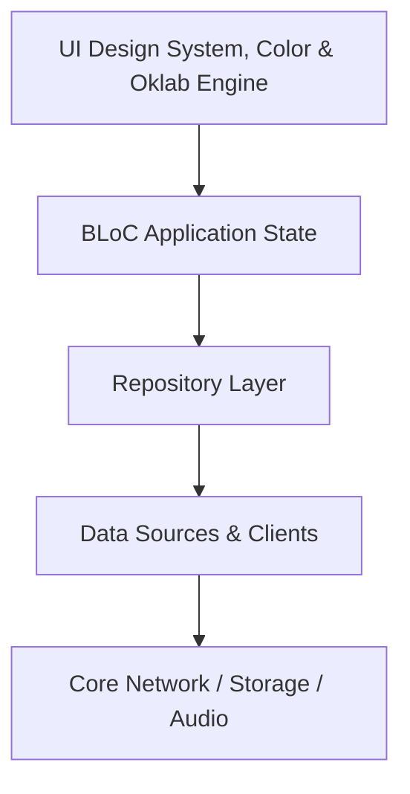

# UI Design System, Color & Oklab Engine

Implements 1:1 Spotify Encore design tokens, Oklab perceptual color extraction from album artwork, and fluid edge-to-edge gestures.

## Architectural Structure
- Primary Domain Layer: `lib/core/ui`
- Core Support Layer: `lib/core/color`

## Subsystem File Inventory
| Component File | Role | Reference |
|----------------|------|-----------|
| `artwork_color_scheme.dart` | `Core Component` | [[04-Reference/lib/core/color/artwork_color_scheme|artwork_color_scheme.dart]] |
| `color_cache.dart` | `Core Component` | [[04-Reference/lib/core/color/color_cache|color_cache.dart]] |
| `color_extraction_service.dart` | `Service / Controller` | [[04-Reference/lib/core/color/color_extraction_service|color_extraction_service.dart]] |
| `eased_gradient.dart` | `Core Component` | [[04-Reference/lib/core/color/eased_gradient|eased_gradient.dart]] |
| `oklab.dart` | `Core Component` | [[04-Reference/lib/core/color/oklab|oklab.dart]] |
| `scheme_deriver.dart` | `Core Component` | [[04-Reference/lib/core/color/scheme_deriver|scheme_deriver.dart]] |
| `spotify_post_processor.dart` | `Core Component` | [[04-Reference/lib/core/color/spotify_post_processor|spotify_post_processor.dart]] |
| `mode_transition.dart` | `Core Component` | [[04-Reference/lib/core/ui/animations/mode_transition|mode_transition.dart]] |
| `duration_formatter.dart` | `Core Component` | [[04-Reference/lib/core/ui/formatters/duration_formatter|duration_formatter.dart]] |
| `spotify_encore_icons.dart` | `Core Component` | [[04-Reference/lib/core/ui/icons/spotify_encore_icons|spotify_encore_icons.dart]] |
| `app_scroll_behavior.dart` | `Core Component` | [[04-Reference/lib/core/ui/scroll/app_scroll_behavior|app_scroll_behavior.dart]] |
| `app_header.dart` | `Stateless Widget` | [[04-Reference/lib/core/ui/widgets/app_header|app_header.dart]] |
| `app_snack_bar.dart` | `Core Component` | [[04-Reference/lib/core/ui/widgets/app_snack_bar|app_snack_bar.dart]] |
| `auth_gated_bloc_provider.dart` | `Component` | [[04-Reference/lib/core/ui/widgets/auth_gated_bloc_provider|auth_gated_bloc_provider.dart]] |
| `connect_spotify_prompt.dart` | `Stateless Widget` | [[04-Reference/lib/core/ui/widgets/connect_spotify_prompt|connect_spotify_prompt.dart]] |
| `shell_bottom_spacer.dart` | `Stateless Widget` | [[04-Reference/lib/core/ui/widgets/shell_bottom_spacer|shell_bottom_spacer.dart]] |
| `sticky_header_delegate.dart` | `Core Component` | [[04-Reference/lib/core/ui/widgets/sticky_header_delegate|sticky_header_delegate.dart]] |

## Subsystem Data Flow & Interactions

