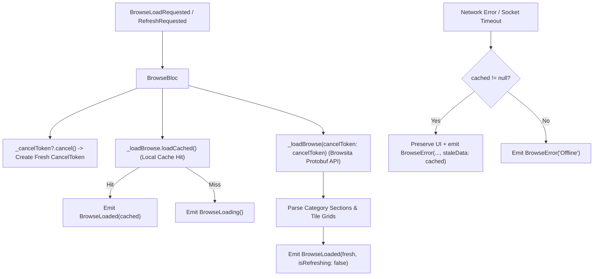

# browse_bloc.dart

> Source File: `[lib/features/browse/application/browse_bloc.dart](file:///c:/Users/Admin/Musify_MU/lib/features/browse/application/browse_bloc.dart)`
> Layer: `lib/features/browse/application`

## Executive Summary
`browse_bloc.dart` governs the asynchronous state machine for Spotify search categories. It integrates Stale-While-Revalidate (SWR) fetching (immediate local SQLite cache emit followed by remote Browsita protobuf sync), Dio cancellation tokens on route deactivation, and background network revalidation upon reconnection.

## Core Architectural Mechanics

### 1. Two-Phase SWR Pipeline
On `BrowseLoadRequested`:
1. **Local cache check**: `_loadBrowse.loadCached()` executes first. If cached categories exist, `BrowseLoaded(cached)` emits immediately, presenting category cards on frame 1 without spinners.
2. **Remote synchronization**: Calls `_loadBrowse(cancelToken: cancelToken)`. Once fresh metadata returns, it overwrites the state with `BrowseLoaded(data)` and marks `_needsRevalidation = false`.

### 2. Request Cancellation via `BrowseCancelRequested`
When switching tabs away from Search:
- Sets `_isActive = false`.
- Cancels active network connections via `_cancelToken?.cancel('User left browse screen')`.
- If a pull-to-refresh spinner was active, resets `isRefreshing: false` without losing displayed categories.

### 3. Network Restoration Auto-Sync
Listens to `_networkMonitor?.statusStream`:
- If `status == NetworkStatus.restored` or `NetworkStatus.online` while `_needsRevalidation` is flagged:
  - If screen is currently visible (`_isActive == true`), immediately fires `BrowseRefreshRequested()`.
  - If backgrounded, marks `_needsRevalidation = true` so `BrowseActivated()` triggers the refresh as soon as the user returns.

## API Breakdown

### Events (`sealed class BrowseEvent extends Equatable`)
- `BrowseLoadRequested`: Initial screen load with SWR pipeline.
- `BrowseRefreshRequested`: Pull-to-refresh trigger.
- `BrowseCancelRequested`: Aborts in-flight network requests.
- `BrowseActivated`: Screen becomes foregrounded, triggering revalidation if required.

### States (`sealed class BrowseState extends Equatable`)
- `BrowseLoading`: Initial loading state when local cache is empty.
- `BrowseLoaded`: Data loaded successfully with `data: BrowseViewData` and `isRefreshing: bool`.
- `BrowseError`: Failure state with `message: String` and optional `staleData: BrowseViewData?`.

### `class BrowseBloc extends Bloc<BrowseEvent, BrowseState>`
- **Fields**:
  - `_loadBrowse`: Use case handling repository cache and network calls.
  - `_networkMonitor`: Connectivity listener.
  - `_cancelToken`: Dio cancellation handle.
  - `_isActive`: Screen visibility flag.
  - `_needsRevalidation`: Revalidation flag for network reconnects.

## Dependency Mapping

### Incoming Dependencies (What imports this file)
- `app.dart`: App-level factory registration.
- `hidden_drawer_scaffold.dart` & `main_screen.dart`: Shell navigation integration.
- `browse_view.dart`: View presentation layer.
- `injection.dart`: Dependency injection registration.
- `browse_bloc_test.dart`: Unit testing suite.

### Outgoing Dependencies (What this file imports)
- `network_monitor_service.dart`: [[04-Reference/lib/core/network/status/network_monitor_service|network_monitor_service.dart]]
- `network_status.dart`: [[04-Reference/lib/core/network/status/network_status|network_status.dart]]
- `load_browse.dart`: [[04-Reference/lib/features/browse/domain/usecases/load_browse|load_browse.dart]]

## Architectural Warnings & Gotchas
1. **Never Show Error Screen Over Valid Cached Categories**: If network refresh fails while categories are already displayed, `BrowseLoaded` must remain active and the error must be dispatched as a temporary snackbar via `staleData`.
2. **CancelToken Disposal**: `_cancelToken?.cancel('BrowseBloc closed')` must be called in `close()` to prevent memory leaks from retained Dio futures.
