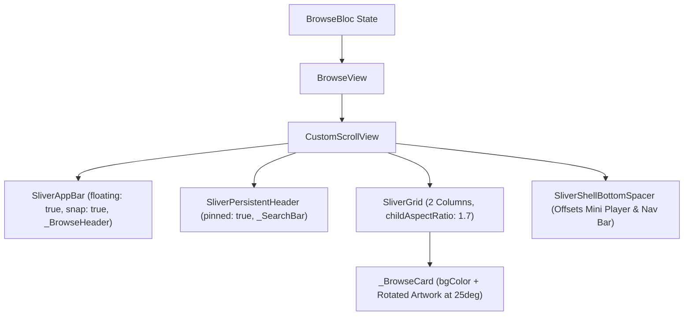

# browse_view.dart

> Source File: `[lib/features/browse/presentation/browse_view.dart](file:///c:/Users/Admin/Musify_MU/lib/features/browse/presentation/browse_view.dart)`
> Layer: `lib/features/browse/presentation`

## Executive Summary
`browse_view.dart` provides the online Spotify search and discovery interface. It renders a floating header app bar, a sticky persistent search bar, and a two-column grid of Spotify category tiles (`_BrowseCard`) with rotated corner cover art replicating Spotify Android's visual design. It coordinates with `BrowseBloc` for SWR data updates and lifecycle cancellation.

## Core Architectural Mechanics

### 1. Replicating Spotify's Rotated Category Card
The `_BrowseCard` widget accurately reconstructs Spotify's iconic category tiles:
- **Geometry**: Aspect ratio `1.7` (`childAspectRatio: 1.7`) with 8px border radius.
- **Background**: Dynamic background color parsed from `item.backgroundColor` (or fallback `#535353`).
- **Typography**: 15pt bold title positioned top-left, constrained to `maxLines: 2`.
- **Rotated Artwork**: Positioned at `right: -8`, `bottom: -4`, rotated at `0.44 rad` (~25 degrees) with a soft drop shadow (`BoxShadow(color: Colors.black30, blurRadius: 8, offset: Offset(-2, 2))`), giving the illusion of a vinyl sleeve sliding into the card.

### 2. Header and Search Bar Sliver Behavior
- `_BrowseHeader`: Embedded in a `floating: true`, `snap: true` `SliverAppBar`. Displays user avatar, search title, and mode switch button. It scrolls away on upward scroll and snaps back down immediately on any reverse gesture.
- `_SearchBar`: Embedded in a `SliverPersistentHeader(pinned: true)` using `StickyHeaderDelegate(height: 64)`. Stays permanently pinned at the top below the status bar while users browse through category tiles.

### 3. Screen Inactivity and Cancellation
`didUpdateWidget` handles tab switching:
- Inactive transition: Clears active snackbars and fires `BrowseCancelRequested()`.
- Active transition: Checks if BLoC is in loading state (`BrowseLoadRequested()`) or requires network revalidation (`BrowseActivated()`).

## API Breakdown

### Classes

#### `class BrowseView extends StatefulWidget`
- **Fields**:
  - `onMenuPressed`: `VoidCallback?` opens drawer menu.
  - `onToggleMode`: `VoidCallback?` toggles between online and offline modes.
  - `isActive`: `bool` tab active status.

#### `class _BrowseViewState extends State<BrowseView>`
- **Methods**:
  - `didUpdateWidget(BrowseView oldWidget)`: Handles screen lifecycle transitions.
  - `_buildBodySlivers(...)`: Returns shimmer, section list, or error empty view.
  - `_buildContentCategory(BrowseSection section)`: Constructs section header and 2-column `SliverGrid`.

#### `class _BrowseCard extends StatelessWidget`
- **Fields**:
  - `item`: `BrowseItem` category model with title, image URL, and hex background color.

#### `class _BrowseHeader extends StatelessWidget`
- Observes `AuthBloc` state to render profile avatar, 'Search' heading, and mode toggle thumbnail.

#### `class _SearchBar extends StatelessWidget`
- Rounded search input field with Spotify magnifying glass icon.

#### `class _BrowseGridShimmer extends StatefulWidget`
- Animated pulsing shimmer grid displayed during initial cold starts.

## Dependency Mapping

### Incoming Dependencies (What imports this file)
- `main_screen.dart`: [[04-Reference/lib/features/shell/presentation/main_screen|main_screen.dart]] embeds `BrowseView` inside `_BrowseTab`.

### Outgoing Dependencies (What this file imports)
- `app_network_image.dart`: [[04-Reference/lib/core/widgets/app_network_image|app_network_image.dart]] cached image loader with thumbnail downsampling.
- `app_header.dart`: [[04-Reference/lib/core/ui/widgets/app_header|app_header.dart]]
- `app_snack_bar.dart`: [[04-Reference/lib/core/ui/widgets/app_snack_bar|app_snack_bar.dart]]
- `sticky_header_delegate.dart`: [[04-Reference/lib/core/ui/widgets/sticky_header_delegate|sticky_header_delegate.dart]]
- `shell_bottom_spacer.dart`: [[04-Reference/lib/core/ui/widgets/shell_bottom_spacer|shell_bottom_spacer.dart]]
- `auth_bloc.dart`: [[04-Reference/lib/features/auth/application/auth_bloc|auth_bloc.dart]]
- `auth_state.dart`: [[04-Reference/lib/features/auth/domain/entities/auth_state|auth_state.dart]]
- `browse_bloc.dart`: [[04-Reference/lib/features/browse/application/browse_bloc|browse_bloc.dart]]
- `browse_view_data.dart`: [[04-Reference/lib/features/browse/domain/models/browse_view_data|browse_view_data.dart]]

## Architectural Warnings & Gotchas
1. **Downsample Category Thumbnails**: Category thumbnails in `_BrowseCard` are loaded via `AppNetworkImage` with explicit `memCacheWidth: 128` and `memCacheHeight: 128` to avoid caching full 640x640 images across the grid.
2. **Fixed Grid Extent**: The 2-column `SliverGridDelegateWithFixedCrossAxisCount` uses `childAspectRatio: 1.7`. Altering this ratio breaks layout balance on small phones or causes title text overflow.
