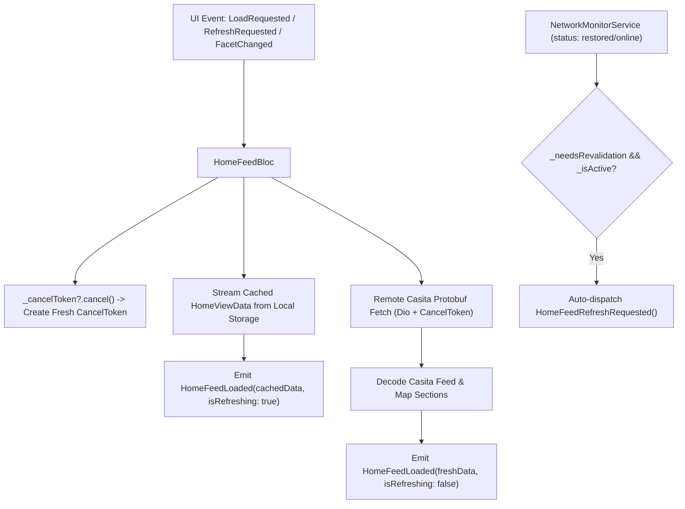

# home_feed_bloc.dart

> Source File: `[lib/features/home_feed/application/home_feed_bloc.dart](file:///c:/Users/Admin/Musify_MU/lib/features/home_feed/application/home_feed_bloc.dart)`
> Layer: `lib/features/home_feed/application`

## Executive Summary
`home_feed_bloc.dart` manages the asynchronous state lifecycle of the primary home feed. It coordinates Stale-While-Revalidate (SWR) streaming, facet chip switching (All, Music, Podcasts & Shows), Dio `CancelToken` abort management when leaving the screen, and automatic network restoration revalidation via `NetworkMonitorService`.

## Core Architectural Mechanics

### 1. Stale-While-Revalidate (SWR) Execution
Upon receiving `HomeFeedLoadRequested`:
- Emits `HomeFeedLoading(activeFacet: _activeFacet)`.
- Invokes `emit.forEach<HomeViewData>(_loadHomeFeed(facet: _activeFacet, cancelToken: cancelToken))` which yields two pulses:
  1. **Cache pulse**: Instantly renders previously persisted Casita data from local storage, giving zero-latency cold start UI.
  2. **Network pulse**: Once the remote request succeeds, replaces stale data with the latest feed sections and updates the local cache.
- If network failure occurs while cached data was already yielded, it preserves `staleData` inside `HomeFeedError(..., staleData: loadedData)`.

### 2. Request Lifecycle & Cancellation Handling
When navigating away from the home screen:
- Dispatches `HomeFeedCancelRequested()`.
- Sets `_isActive = false`.
- Calls `_cancelToken?.cancel('User left home screen')`, aborting active Dio network transfers and freeing bandwidth for playback or search.
- When re-entering the tab, `HomeFeedActivated()` resets `_isActive = true` and triggers revalidation if data went stale while backgrounded.

### 3. Automatic Connectivity Revalidation
Listens to `_networkMonitor?.statusStream`:
- When status switches to `NetworkStatus.restored` or `NetworkStatus.online` while `_needsRevalidation` is true, automatically triggers `HomeFeedRefreshRequested()` without requiring user intervention.

## API Breakdown

### Events (`sealed class HomeFeedEvent`)
- `HomeFeedLoadRequested`: Initial load dispatching SWR stream.
- `HomeFeedRefreshRequested`: Explicit pull-to-refresh bypassing local cache.
- `HomeFeedFacetChanged(HomeFacet facet)`: Changes active facet (`all`, `music`, `podcasts`).
- `HomeFeedCancelRequested`: Aborts in-flight network requests.
- `HomeFeedActivated`: Resumes screen lifecycle and evaluates revalidation.

### States (`sealed class HomeFeedState extends Equatable`)
- `HomeFeedLoading`: Initial loading state with `activeFacet`.
- `HomeFeedLoaded`: Active content with `data: HomeViewData`, `isRefreshing: bool`, and `activeFacet: HomeFacet`.
- `HomeFeedError`: Failure state with `message: String` and optional `staleData: HomeViewData?`.

### `class HomeFeedBloc extends Bloc<HomeFeedEvent, HomeFeedState>`
- **Fields**:
  - `_loadHomeFeed`: Use case encapsulating repository operations.
  - `_networkMonitor`: Network connectivity listener.
  - `_cancelToken`: Dio cancellation handle for current operation.
  - `_isLoading`: Concurrency mutex preventing overlapping load triggers.
  - `_isActive`: Screen visibility state.
  - `_needsRevalidation`: Tracks whether cached data requires a fresh network sync.
  - `_activeFacet`: Active filter facet enum.

## Dependency Mapping

### Incoming Dependencies (What imports this file)
- `app.dart`: Injects BLoC globally into application tree.
- `home_feed_view.dart`: Binds BLoC to scroll view and pull-to-refresh indicator.
- `main_screen.dart` & `hidden_drawer_scaffold.dart`: Dispatches lifecycle events (`HomeFeedActivated`, `HomeFeedCancelRequested`).
- `online_home_screen.dart` & `home_tab.dart`: Home container screens.
- `injection.dart`: Dependency injection registration.
- `home_feed_bloc_test.dart`: Unit testing suite.

### Outgoing Dependencies (What this file imports)
- `network_monitor_service.dart`: [[04-Reference/lib/core/network/status/network_monitor_service|network_monitor_service.dart]]
- `network_status.dart`: [[04-Reference/lib/core/network/status/network_status|network_status.dart]]
- `load_home_feed.dart`: [[04-Reference/lib/features/home_feed/domain/usecases/load_home_feed|load_home_feed.dart]]

## Architectural Warnings & Gotchas
1. **Always Cancel Previous Token on Event Start**: Each handler (`_onLoad`, `_onRefresh`, `_onFacetChanged`) must cancel the preceding token before assigning a new `CancelToken()` to avoid unhandled async responses overwriting state.
2. **Never Emit Blank Screen on Refresh Failure**: If refresh fails while existing content is displayed, `HomeFeedLoaded` must remain emitted with `isRefreshing: false`, followed by a snackbar event via `HomeFeedError(..., staleData: currentData)`.
