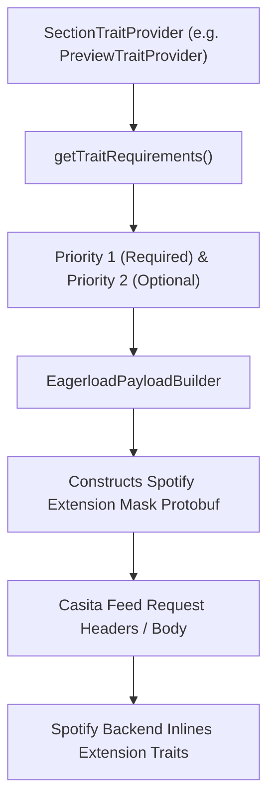

# section_trait_provider.dart

> Source File: `[lib/features/home_feed/data/eagerload/section_trait_provider.dart](file:///c:/Users/Admin/Musify_MU/lib/features/home_feed/data/eagerload/section_trait_provider.dart)`
> Layer: `lib/features/home_feed/data/eagerload`

## Executive Summary
`section_trait_provider.dart` defines the contract and 22 concrete provider implementations that declare which Protobuf `ExtensionKind` traits are required (Priority 1) or optional (Priority 2) for each Casita feed section. This directly corresponds to Spotify Android's `p.qqv` architecture, allowing `EagerloadPayloadBuilder` to build the binary metadata mask sent with Casita HTTP requests.

## Core Architectural Mechanics

### 1. Priority Levels
The contract defines a priority mapping:
- **Priority 1 (Required)**: Traits without which the section cannot render fundamentally (e.g. `SHORTCUTS_CARD_TRAIT` 119 for Shortcuts).
- **Priority 2 (Optional / Progressive Hydration)**: Supplementary traits like audio previews, visual identities, or marketing tags that enhance the card if available on Spotify's CDN.

### 2. Comprehensive Section Trait Catalog

| Section Case | Provider Class | Section ID | Priority 1 (Required) | Priority 2 (Optional) |
|---|---|---|---|---|
| Case 2 | `ShortcutsTraitProvider` | 2 | `119` (ShortcutsCard) | `119` |
| Case 4 | `PreviewTraitProvider` | 4 | - | `118`, `116`, `179`, `12` |
| Case 6 | `ImmersivePreviewTraitProvider` | 6 | `118` (PreviewCard) | `116`, `178` |
| Case 7 | `AnchorsTraitProvider` | 7 | `119` (ShortcutsCard) | - |
| Case 8 | `ContentEvaluationListTraitProvider` | 8 | `119` | - |
| Case 12 | `PromotionV1TraitProvider` | 12 | `167` (PromoV1) | - |
| Case 13 | `PromotionV3TraitProvider` | 13 | `171` (PromoV3) | - |
| Case 15 | `ActionCardCarouselTraitProvider` | 15 | `97` (SimpleTrait) | `97` |
| Case 16 | `LiveEventTraitProvider` | 16 | `122`, `123`, `124` (Concert) | - |
| Case 17 | `ShowcaseTraitProvider` | 17 | `178`, `167`, `179` | - |
| Case 18 | `VideoPromoTraitProvider` | 18 | `118` | `181`, `249`, `118`, `178` |
| Case 23 | `CampaignLinkCarouselTraitProvider` | 23 | `97` | - |
| Case 24 | `VerticalSingleEntryTraitProvider` | 24 | `171` | `116` |
| Case 25 | `VideoCarouselTraitProvider` | 25 | `118` | `181` |
| Case 27 | `AssociatedPreviewTraitProvider` | 27 | `118` | `116`, `178` |
| Case 28 | `BannerWithAnimationsTraitProvider` | 28 | `171` | - |
| Case 33 | `AudioPromoTraitProvider` | 33 | `116` | - |
| Case 35 | `PlayLinkPromoTraitProvider` | 35 | `116` | - |
| Case 36 | `AudioSpotlightTraitProvider` | 36 | `116` | - |
| Case 37 | `PreviewCarouselTraitProvider` | 37 | `118` | `116` |
| Case 39 | `PreviewPromotionCarouselTraitProvider` | 39 | `118` | `116` |
| Case 41 | `ReflectionTraitProvider` | 41 | `167` | `171` |

## API Breakdown

### Interfaces & Classes

#### `abstract class SectionTraitProvider`
- Direct equivalent to Spotify Android `p.qqv`.
- `int? get sectionId`: Protobuf Section discriminator case / section ID.
- `Map<int, List<int>> getTraitRequirements()`: Returns mapping of priority levels (1 = Required, 2 = Optional) to lists of ExtensionKind integer IDs.

## Dependency Mapping

### Incoming Dependencies (What imports this file)
- `eagerload_payload_builder.dart`: [[04-Reference/lib/features/home_feed/data/eagerload/eagerload_payload_builder|eagerload_payload_builder.dart]] iterates providers to assemble request payload.

### Outgoing Dependencies (What this file imports)
- No internal project dependencies (standalone provider implementations).

## Architectural Warnings & Gotchas
1. **Never Change Integer IDs**: ExtensionKind integer IDs represent immutable Spotify backend protocol tags. Modifying them causes silent payload drops on Spotify's gateway.
2. **Immutable Instances**: All 22 providers use `const` constructors for zero memory overhead when aggregated in `EagerloadPayloadBuilder`.
