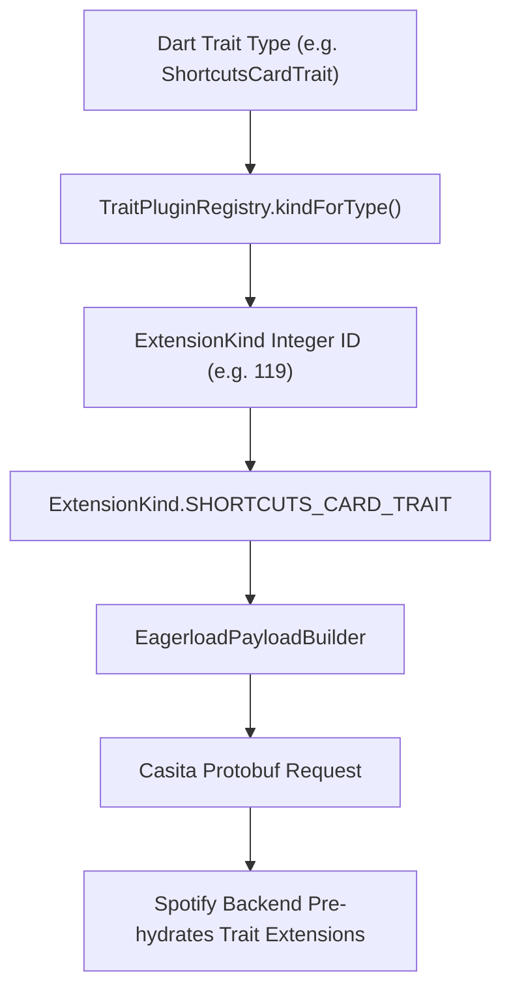

# trait_plugin_registry.dart

> Source File: `[lib/features/home_feed/data/eagerload/trait_plugin_registry.dart](file:///c:/Users/Admin/Musify_MU/lib/features/home_feed/data/eagerload/trait_plugin_registry.dart)`
> Layer: `lib/features/home_feed/data/eagerload`

## Executive Summary
`trait_plugin_registry.dart` implements the bidirectional type-to-ID mapping between Dart Trait models and Spotify's protobuf `ExtensionKind` enum constants. It corresponds directly to Spotify Android's `p.c2w` (`PluginRegistry`) and `p.b2w` (`ExtendedMetadataPlugin`), enabling the eager-load system to dynamically compile binary extension masks for remote Casita and Kodiak requests.

## Core Architectural Mechanics

### Registered Extension Kinds

| Trait Type | ExtensionKind ID | Protobuf Enum Name |
|---|---|---|
| `SimpleCardTrait` | 97 | `ExtensionKind.SIMPLE_TRAIT` |
| `ShortcutsCardTrait` | 119 | `ExtensionKind.SHORTCUTS_CARD_TRAIT` |
| `PreviewCardTrait` | 118 | `ExtensionKind.PREVIEW_CARD_TRAIT` |
| `IdentityTrait` | 178 | `ExtensionKind.IDENTITY_TRAIT` |
| `VisualIdentityTrait` | 179 | `ExtensionKind.VISUAL_IDENTITY_TRAIT` |
| `AudioPreviewPlaybackTrait` | 116 | `ExtensionKind.AUDIO_PREVIEW_PLAYBACK_TRAIT` |
| `PreviewPlaybackTrait` | 181 | `ExtensionKind.PREVIEW_PLAYBACK_TRAIT` |
| `ShowAccessTrait` | 31 | `ExtensionKind.SHOW_ACCESS` |
| `AudiobookSpecificsTrait` | 52 | `ExtensionKind.AUDIOBOOK_SPECIFICS` |
| `AudiobookPriceTrait` | 64 | `ExtensionKind.AUDIOBOOK_PRICE` |
| `PromoV1Trait` | 167 | `ExtensionKind.PROMO_V1_TRAIT` |
| `PromoV3Trait` | 171 | `ExtensionKind.PROMO_V3_TRAIT` |
| `ConcertTrait` | 122 | `ExtensionKind.CONCERT` |
| `ConcertLocationTrait` | 123 | `ExtensionKind.CONCERT_LOCATION` |
| `ConcertMarketingTrait` | 124 | `ExtensionKind.CONCERT_MARKETING` |
| `ConsumptionExperienceTrait` | 182 | `ExtensionKind.CONSUMPTION_EXPERIENCE_TRAIT` |

## API Breakdown

### Classes

#### `class TraitPlugin`
- Direct equivalent to Spotify Android `p.b2w`.
- **Fields**:
  - `traitType`: `Type` Dart model class.
  - `extensionKindValue`: `int` raw integer tag.
  - `extensionKind`: `ExtensionKind?` protobuf enum constant.

#### `class TraitPluginRegistry`
- Direct equivalent to Spotify Android `p.c2w`.
- **Methods**:
  - `static void ensureInitialized()`: Populates lookup tables once on first access.
  - `static int? kindForType(Type type)`: Resolves ExtensionKind integer tag for a Trait model.
  - `static Type? typeForKind(int kind)`: Resolves Trait model for a given ExtensionKind integer tag.

## Dependency Mapping

### Incoming Dependencies (What imports this file)
- `eagerload_payload_builder.dart`: Compiles eagerload extension masks.
- `kodiak_data_layer_test.dart`: Validates registry integrity.

### Outgoing Dependencies (What this file imports)
- `traits.dart`: [[04-Reference/lib/features/home_feed/domain/models/traits|traits.dart]] exports all domain trait models.

## Architectural Warnings & Gotchas
1. **Lazy Initialization Safety**: Callers do not need to invoke `ensureInitialized()` manually; `kindForType()` and `typeForKind()` automatically check `if (!_initialized)` before querying internal maps.
2. **Protobuf Enum Alignment**: The integer IDs (e.g. 97, 119, 167) must strictly match Spotify's compiled `extension_kind.proto` definitions; changing an integer causes Spotify's backend to omit requested metadata fields.
