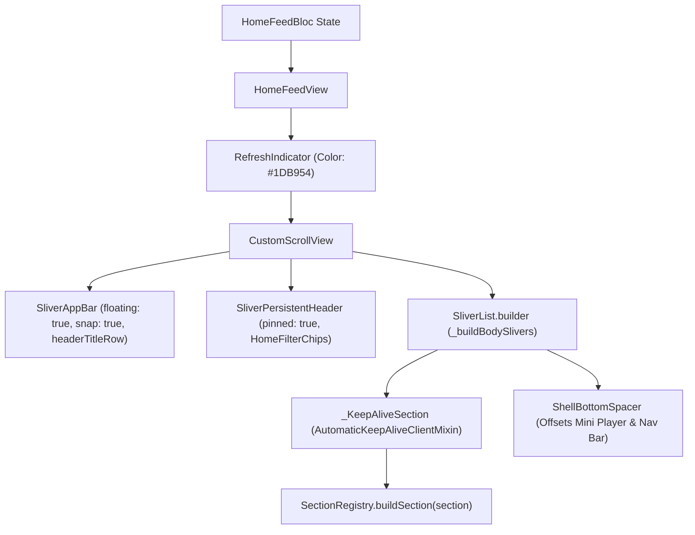

# home_feed_view.dart

> Source File: `[lib/features/home_feed/presentation/home_feed_view.dart](file:///c:/Users/Admin/Musify_MU/lib/features/home_feed/presentation/home_feed_view.dart)`
> Layer: `lib/features/home_feed/presentation`

## Executive Summary
`home_feed_view.dart` is the primary view for rendering the authenticated Spotify home feed. It orchestrates sliver layout mechanics (a snap-floating title app bar, a pinned sticky filter chip row, and a virtualized list of SDUI sections), integrates pull-to-refresh with timeout guards, manages view lifecycle activations via `didUpdateWidget`, and preserves section scroll states via `AutomaticKeepAliveClientMixin`.

## Core Architectural Mechanics



### 1. Multi-Tier Sliver Header Architecture
- **Header Title Row**: `SliverAppBar(floating: true, snap: true, pinned: false)`. Scrolls away with upward swipes but immediately snaps back into view on any downward gesture.
- **Filter Chips**: `SliverPersistentHeader(pinned: true)` using `StickyHeaderDelegate`. Remains persistently visible at the top of the viewport when scrolling through sections.
- **Body Slivers**: Employs `SliverList.builder` to lazily instantiate sections as they enter the viewport.

### 2. View Lifecycle and Inactivity Management
Observes `widget.isActive` inside `didUpdateWidget`:
- If transitions from active to inactive: Dismisses active snackbars (`AppSnackBar.clear(context)`) and fires `HomeFeedCancelRequested()` to abort background transfers.
- If transitions from inactive to active: Checks whether the BLoC is currently loading (fires `HomeFeedLoadRequested()`) or requires stale-data revalidation (fires `HomeFeedActivated()`).

### 3. AutomaticKeepAlive for Complex Section Carousels
Every section widget is wrapped in `_KeepAliveSection`:
```dart
class _KeepAliveSectionState extends State<_KeepAliveSection>
    with AutomaticKeepAliveClientMixin {
  @override
  bool get wantKeepAlive => true;
  ...
}
```
This ensures horizontal carousel scroll offsets, video player instances, and image caches inside shelves are not discarded and re-initialized when scrolled off-screen.

## API Breakdown

### Classes

#### `class HomeFeedView extends StatefulWidget`
- **Fields**:
  - `headerTitleRow`: `Widget?` custom top row (e.g. avatar, greetings, notification bell).
  - `isActive`: `bool` whether this view is the active tab in the shell scaffold.

#### `class _HomeFeedViewState extends State<HomeFeedView>`
- **Constants**:
  - `_defaultChips`: Fallback list of `HomeChip` (`all`, `music`, `podcasts`).
- **Methods**:
  - `didUpdateWidget(HomeFeedView oldWidget)`: Dispatches cancellation or activation lifecycle events.
  - `_buildBodySlivers(BuildContext, HomeFeedState)`: Returns loading shimmer, section sliver list, or error empty state.
  - `_buildSection(HomeSection section)`: Wraps `SectionRegistry().buildSection(section)` in `_KeepAliveSection`.

#### `class _KeepAliveSection extends StatefulWidget`
- Wraps child widget with `AutomaticKeepAliveClientMixin` preserving scroll and element state.

## Dependency Mapping

### Incoming Dependencies (What imports this file)
- `online_home_screen.dart`: [[04-Reference/lib/features/home/presentation/online_home_screen|online_home_screen.dart]] places `HomeFeedView` into the home tab viewport.

### Outgoing Dependencies (What this file imports)
- `app_snack_bar.dart`: [[04-Reference/lib/core/ui/widgets/app_snack_bar|app_snack_bar.dart]] error toast notifications.
- `sticky_header_delegate.dart`: [[04-Reference/lib/core/ui/widgets/sticky_header_delegate|sticky_header_delegate.dart]] pinned filter chip sliver delegate.
- `shell_bottom_spacer.dart`: [[04-Reference/lib/core/ui/widgets/shell_bottom_spacer|shell_bottom_spacer.dart]] bottom padding for mini player.
- `home_header.dart`: [[04-Reference/lib/features/home/presentation/widgets/home_header|home_header.dart]] filter chip widget.
- `home_feed_bloc.dart`: [[04-Reference/lib/features/home_feed/application/home_feed_bloc|home_feed_bloc.dart]] state machine.
- `home_view_data.dart`: [[04-Reference/lib/features/home_feed/domain/models/home_view_data|home_view_data.dart]] domain models.
- `section_registry.dart`: [[04-Reference/lib/features/home_feed/presentation/section_registry|section_registry.dart]] SDUI widget factory.
- `home_feed_shimmer.dart`: [[04-Reference/lib/features/home_feed/presentation/widgets/home_feed_shimmer|home_feed_shimmer.dart]] skeleton loader.

## Architectural Warnings & Gotchas
1. **RefreshIndicator Timeout Safety**: `onRefresh` waits for `HomeFeedLoaded` or `HomeFeedError` but attaches an 8-second timeout (`timeout(const Duration(seconds: 8))`) to prevent the pull-to-refresh spinner from hanging indefinitely if network sockets stall.
2. **Bottom Spacer Offset**: The final item in `SliverList.builder` must always be `const ShellBottomSpacer()` to prevent the persistent mini player and floating navigation bar from obscuring the last shelf.
