# section_registry.dart

> Source File: `[lib/features/home_feed/presentation/section_registry.dart](file:///c:/Users/Admin/Musify_MU/lib/features/home_feed/presentation/section_registry.dart)`
> Layer: `lib/features/home_feed/presentation`

## Executive Summary
`section_registry.dart` is the Server-Driven UI (SDUI) component registry for Musify's home feed, directly corresponding to Spotify Android's `p.s400` / `KodiakElementRegistry`. It acts as a deterministic factory dispatching strongly-typed `HomeSection` domain entities (deserialized from Casita protobuf responses) to their corresponding Flutter presentation widgets.

## SDUI Dispatch Architecture

```mermaid
flowchart TD
    CasitaProto["Casita Protobuf Response"] --> Parser["CasitaParser / SectionMapper"]
    Parser --> HomeSection["HomeSection (sectionType discriminator)"]
    HomeSection --> Registry["SectionRegistry.buildSection(section)"]
    Registry --> Switch{"sectionType"}
    Switch -- 'shortcuts' --> QuickGrid["QuickGridSection (2x4 / 2x3 Grid)"]
    Switch -- 'recentsShelf' --> Recents["RecentsCarouselSection"]
    Switch -- 'preview' --> PodcastPreview["PodcastPreviewSection"]
    Switch -- 'immersivePreview' / 'associatedPreview' --> PreviewFeed["PreviewFeedSection"]
    Switch -- 'showcase' --> Showcase["ShowcaseSection"]
    Switch -- 'videoPromo' --> VideoPromo["VideoPromoSection"]
    Switch -- 'audioSpotlight' / 'audioPromo' --> AudioSpotlight["AudioSpotlightSection"]
    Switch -- 'liveEvent' --> LiveEvent["LiveEventSection"]
    Switch -- 'interactiveEntrypoint' --> InteractivePrompt["InteractivePromptSection"]
    Switch -- 'topStoryCarousel' --> StoryBubble["StoryBubbleCarousel"]
    Switch -- 'verticalSingleEntry' --> VerticalCard["VerticalCardSection"]
    Switch -- 'reflection' --> Reflection["ReflectionSection"]
    Switch -- 'inlineCard' --> InlineCard["InlineCardSection"]
    Switch -- 'contentEvaluationList' --> EpisodeList["EpisodeListSection"]
    Switch -- 'videoCarousel' / 'watchFeed' --> VideoCarousel["VideoCarouselSection"]
    Switch -- 'previewCarousel' / 'previewPromotionCarousel' --> PreviewCarousel["PreviewCarouselSection"]
    Switch -- 'actionCardCarousel' --> ActionCard["ActionCardSection"]
    Switch -- 'campaignLinkCarousel' --> CampaignCarousel["CampaignCarouselSection"]
    Switch -- 'promotionV1' / 'promotionV3' --> PromoBanner["PromotionBannerSection"]
    Switch -- 'playLinkPromo' --> PlayLink["PlayLinkSection"]
    Switch -- 'fullBleedBanner' --> FullBleedBanner["FullBleedBannerSection"]
    Switch -- 'banner' --> CaughtUpBanner["CaughtUpBannerSection"]
    Switch -- 'anchors' --> NullWidget["SizedBox.shrink() (Rendered in header)"]
    Switch -- unknown --> Fallback["SizedBox.shrink()"]
```

## Tag & Protocol Mapping Breakdown

| sectionType | Android Proguard Target | Protobuf Section Case / Tag | Output Widget |
|---|---|---|---|
| `shortcuts` | `p.arn0` / `p.yex0` | Case 2 | `QuickGridSection` |
| `recentsShelf` | `p.hdr0` / `p.ony0` | Case 10 | `RecentsCarouselSection` |
| `preview` | `p.kkn0` -> `vab0` | Case 4 | `PodcastPreviewSection` |
| `immersivePreview` | `p.hif0` -> `iab0` | Case 6 | `PreviewFeedSection` |
| `showcase` | `p.ppx0` -> `aox0` | Case 17 | `ShowcaseSection` |
| `videoPromo` | `p.vbb0` | Case 18 | `VideoPromoSection` |
| `audioSpotlight` / `audioPromo` | `p.m7b0` | Case 36 & 33 | `AudioSpotlightSection` |
| `liveEvent` | `p.e270` / `p.xoo0` | Case 16 | `LiveEventSection` |
| `interactiveEntrypoint` | `p.jtf0` | Case 30 | `InteractivePromptSection` |
| `topStoryCarousel` | `p.rp31` | Case 31 | `StoryBubbleCarousel` |
| `verticalSingleEntry` | `p.ur61` | Case 24 | `VerticalCardSection` |
| `reflection` | `p.rxr0` | Case 41 | `ReflectionSection` |
| `inlineCard` | `p.fn20` | Case 34 | `InlineCardSection` |
| `contentEvaluationList` | `p.dei` | Case 8 | `EpisodeListSection` |
| `videoCarousel` / `watchFeed` | `p.lg81` | Case 25 & 11 | `VideoCarouselSection` |
| `previewCarousel` | `p.qcb0` | Case 37 & 39 | `PreviewCarouselSection` |
| `actionCardCarousel` | `p.d20` | Case 15 | `ActionCardSection` |
| `campaignLinkCarousel` | `p.cua` | Case 23 | `CampaignCarouselSection` |
| `promotionV1` / `promotionV3` | `p.zno0` / `p.ke21` | Case 12, 13, 28 | `PromotionBannerSection` |
| `playLinkPromo` | `p.oal0` | Case 35 | `PlayLinkSection` |
| `fullBleedBanner` | `p.FullBleedBanner` | Case 26 | `FullBleedBannerSection` |
| `banner` | `p.zno0` / `p.en4` | Case 19 | `CaughtUpBannerSection` |
| `anchors` | `p.vj3` | Case 7 | `SizedBox.shrink()` |

## API Breakdown

### Classes

#### `class SectionRegistry`
- **Constructor**: `const SectionRegistry()`
- **Methods**:
  - `Widget buildSection(HomeSection section)`: Switches on `section.sectionType` and returns the mapped widget instance. Unknown or non-visual types cleanly return `const SizedBox.shrink()` without crashing the feed.

## Dependency Mapping

### Incoming Dependencies (What imports this file)
- `home_feed_view.dart`: [[04-Reference/lib/features/home_feed/presentation/home_feed_view|home_feed_view.dart]] invokes `buildSection` inside `SliverList.builder`.
- `kodiak_data_layer_test.dart`: [[04-Reference/test/features/home_feed/kodiak_data_layer_test|kodiak_data_layer_test.dart]] verifies complete coverage across all section types.

### Outgoing Dependencies (What this file imports)
- `home_view_data.dart`: [[04-Reference/lib/features/home_feed/domain/models/home_view_data|home_view_data.dart]]
- All 23 presentation section widgets in `lib/features/home_feed/presentation/widgets/sections/`.

## Architectural Warnings & Gotchas
1. **Never Fall Back to Generic Carousels**: If a sectionType is unknown or malformed, the registry intentionally returns `const SizedBox.shrink()`. Blindly falling back to `ContentCarouselSection` creates broken UI cards when item payloads differ in schema.
2. **Anchor Handling**: `anchors` sections represent filter chip data (All, Music, Podcasts). They are extracted during parsing and rendered into the sticky header; `SectionRegistry` must ignore them in the main scroll stream.
