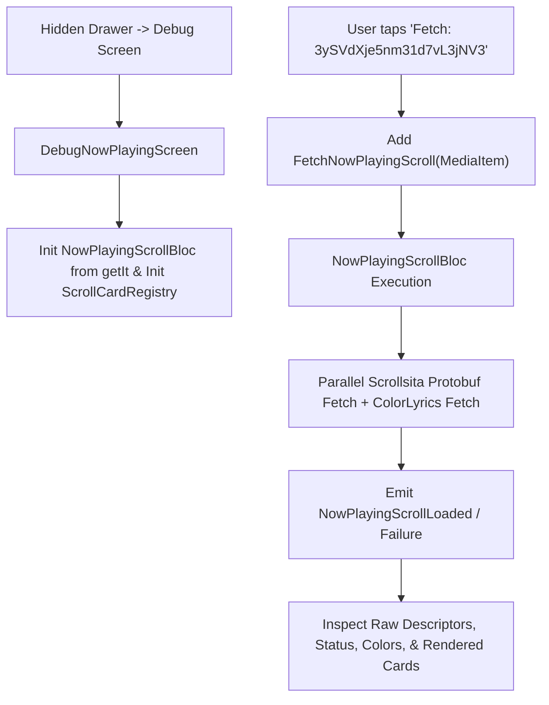

# debug_now_playing_screen.dart

> Source File: `[lib/features/player/presentation/screens/debug_now_playing_screen.dart](file:///c:/Users/Admin/Musify_MU/lib/features/player/presentation/screens/debug_now_playing_screen.dart)`
> Layer: `lib/features/player/presentation/screens`

## Executive Summary
`debug_now_playing_screen.dart` is a developer diagnostics view accessible via the hidden navigation drawer. It allows isolated end-to-end verification of the Spotify Scrollsita SDUI cards and ColorLyrics pipeline without requiring active audio playback or ExoPlayer session setup. It feeds a canonical Spotify `MediaItem` (`spotify:track:3ySVdXje5nm31d7vL3jNV3`) into `NowPlayingScrollBloc`, validates protobuf deserialization, inspects extracted palette colors, and renders production card sections directly.

## Diagnostic Flow

### 1. Isolated Pipeline Validation
The screen eliminates playback dependencies by mocking a complete `MediaItem`:
- **Track ID**: `3ySVdXje5nm31d7vL3jNV3` (`Saiyaara`)
- **Artist URI**: `spotify:artist:1bTROl5p3rGTpvKeWnGgrw`
- **Metadata**: Verified monthly listeners, bio, and 300x300 CDN album artwork URI.

### 2. Registry Parity Testing
`_initRegistry()` configures `ScrollCardRegistry` identically to `PlayerScreen`:
- Binds `CreatorBioCardDescriptor`, `CreditsCardDescriptor`, `LiveEventsCardDescriptor`, and `MerchCardDescriptor` to their respective widget implementations.
- Enables engineers to verify card rendering, layout overflow, and Kodiak `DataPool` integration independently of gesture physics.

## API Breakdown

### Classes

#### `class DebugNowPlayingScreen extends StatefulWidget`
- Debug screen entry point instantiated by `drawer_menu.dart`.

#### `class _DebugNowPlayingScreenState extends State<DebugNowPlayingScreen>`
- **Fields**:
  - `_bloc`: `NowPlayingScrollBloc` injected via `getIt`.
  - `_registry`: `ScrollCardRegistry?` card widget builder registry.
  - `_pool`: `DataPool?` Kodiak SDUI cache reference.
  - `_testItem`: Static canonical `MediaItem` containing realistic Spotify track attributes.
- **Methods**:
  - `_fetchData()`: Dispatches `FetchNowPlayingScroll(_testItem)` to trigger remote fetching.
  - `_buildLoadedView(NowPlayingScrollLoaded state)`: Renders status cards, color swatches, descriptor inspector, lyrics section, and child cards.
  - `_buildFailureView(NowPlayingScrollFailure state)`: Renders diagnostic error banner and fallback card stack.
  - `_colorSwatch(String label, Color color)`: Displays visual color block with hex values.
  - `_cardDescriptorInfo(ScrollCardDescriptor desc)`: Renders debug details (type name, entity URI, contributor count).

## Dependency Mapping

### Incoming Dependencies (What imports this file)
- `drawer_menu.dart`: [[04-Reference/lib/features/shell/presentation/widgets/drawer_menu|drawer_menu.dart]] provides navigation entry point.

### Outgoing Dependencies (What this file imports)
- `injection.dart`: [[04-Reference/lib/app/di/injection|injection.dart]]
- `data_pool.dart`: [[04-Reference/lib/core/kodiak/dataloader/data_pool|data_pool.dart]]
- `now_playing_scroll_bloc.dart`: [[04-Reference/lib/features/player/application/scroll/now_playing_scroll_bloc|now_playing_scroll_bloc.dart]]
- `scroll_card_descriptor.dart`: [[04-Reference/lib/features/player/domain/models/scroll_card_descriptor|scroll_card_descriptor.dart]]
- `scroll_card_registry.dart`: [[04-Reference/lib/features/player/presentation/scroll/scroll_card_registry|scroll_card_registry.dart]]
- `lyrics_card.dart`: [[04-Reference/lib/features/player/presentation/widgets/sections/lyrics_card|lyrics_card.dart]]
- `lyrics_color_parser.dart`: [[04-Reference/lib/features/player/presentation/widgets/sections/lyrics_color_parser|lyrics_color_parser.dart]]
- `about_artist_card.dart`: [[04-Reference/lib/features/player/presentation/widgets/sections/about_artist_card|about_artist_card.dart]]
- `credits_card.dart`: [[04-Reference/lib/features/player/presentation/widgets/sections/credits_card|credits_card.dart]]
- `events_card.dart`: [[04-Reference/lib/features/player/presentation/widgets/sections/events_card|events_card.dart]]
- `merch_card.dart`: [[04-Reference/lib/features/player/presentation/widgets/sections/merch_card|merch_card.dart]]

## Architectural Warnings & Gotchas
1. **Bloc Disposal**: Because `_DebugNowPlayingScreenState` resolves `_bloc = getIt<NowPlayingScrollBloc>()` directly rather than through a `BlocProvider`, it must explicitly invoke `_bloc.close()` in `dispose()` to prevent memory leaks.
2. **Production Code Isolation**: This screen is intended strictly for internal testing and debugging. It is not surfaced in release user onboarding flows.
