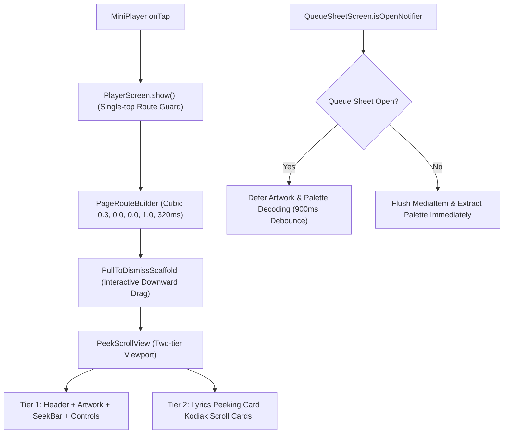

# player_screen.dart

> Source File: `[lib/features/player/presentation/screens/player_screen.dart](file:///c:/Users/Admin/Musify_MU/lib/features/player/presentation/screens/player_screen.dart)`
> Layer: `lib/features/player/presentation/screens`

## Executive Summary
`player_screen.dart` serves as the primary full-screen Now Playing user interface in Musify. It orchestrates the edge-to-edge modal transition, top gradient color blending with anti-glare shading, dynamic palette extraction via OKLab, two-tier scroll view integration via `PeekScrollView`, and background work deferral while the Queue Sheet modal is open.

## Key Architectural Mechanics



### 1. Single-Top Route Guarding and Spotify Route Transition
The static `PlayerScreen.show(context, playbackController)` method enforces a route mutex via `_isOpen`:
```dart
static bool _isOpen = false;
```
If an invocation arrives while `_isOpen` is true, the call returns immediately. When permitted, it pushes a non-opaque `PageRouteBuilder` with Spotify curve `Cubic(0.3, 0.0, 0.0, 1.0)`, duration 320ms forward and 280ms reverse, with slide transition from `Offset(0.0, 1.0)` to `Offset.zero`.

### 2. Queue Sheet Open Deferral (Zero Frame Drops During Navigation)
When a user opens the Queue Sheet on top of `PlayerScreen`, track transitions might trigger heavy work (e.g., 720x720 image decodes and 200x200 GPU palette extractions). To maintain 120fps during sheet physics:
- Listens to `QueueSheetScreen.isOpenNotifier`.
- If `isOpenNotifier.value` is true when a `MediaItem` changes, updates are diverted to `_pendingQueueItem` and guarded by a 900ms `_deferredQueueSyncTimer`.
- When the Queue Sheet dismisses, `_onQueueSheetOpenChanged` cancels the timer and calls `_flushPendingMediaItem()` immediately.

### 3. Overlay Hiding Top Gradient Formula
Replicating Spotify's `OverlayHidingGradientBackgroundView`:
```dart
final topGradientColor = Color.lerp(
  _currentScheme.primary,
  const Color(0xFF121212),
  0.32,
)!;
```
Blending 32% of `#121212` over the primary color eliminates specular glare at the top edge. The gradient is strictly applied to Tier 1 decoration so that when scrolling up into Tier 2 cards, the player gradient scrolls away rather than tinting the cards background.

### 4. Dynamic SDUI Registry Integration
In `_initRegistry()`, the screen binds `ScrollCardRegistry` to the app's `DataPool`:
- `CreatorBioCardDescriptor` -> `PlayerAboutArtistSection`
- `CreditsCardDescriptor` -> `PlayerCreditsSection`
- `LiveEventsCardDescriptor` -> `PlayerEventsSection`
- `MerchCardDescriptor` -> `PlayerMerchSection`

## API Breakdown

### Classes

#### `class PlayerScreen extends StatefulWidget`
- **Fields**:
  - `playbackController`: `PlaybackController` injected into the screen.
- **Static Methods**:
  - `show(BuildContext context, PlaybackController playbackController)`: Asynchronously launches the player route with root navigator.

#### `class _PlayerScreenState extends State<PlayerScreen>`
- **State Fields**:
  - `_peekScrollKey`: `GlobalKey<PeekScrollViewState>` controlling programmatic card expansion.
  - `_lyricsKey`: `GlobalKey` anchoring the lyrics section.
  - `_dragPosition`: `Duration?` actively scrubbed position.
  - `_isFavorite`: `bool` track favorited status.
  - `_shuffleEnabled`: `bool` cached shuffle mode.
  - `_repeatEnabled`: `bool` cached repeat mode.
  - `_currentScheme`: `ArtworkColorScheme` extracted OKLab palette.
  - `_displayedItem`: `MediaItem?` currently rendered track metadata.
  - `_pendingQueueItem`: `MediaItem?` deferred item during queue open state.
  - `_hasPendingQueueItem`: `bool` whether a pending item is queued.
  - `_scrollBloc`: `NowPlayingScrollBloc` for fetching lyrics and card streams.
- **Key Methods**:
  - `_updateScheme(MediaItem? item)`: Resolves `ColorExtractionService` from context or GetIt, queries cache or extracts palette from image URI or local song ID.
  - `_onMediaItemChanged(MediaItem? item)`: Checks queue sheet open status, triggers deferred timer or immediate rebuild.
  - `_flushPendingMediaItem()`: Flushes deferred track change and extracts new palette.
  - `_buildExpandedCards(...)`: Maps descriptors to registered widgets, providing fallback artist bio and credits sections if remote descriptors are empty.

## Dependency Mapping

### Incoming Dependencies (What imports this file)
- `mini_player.dart`: Calls `PlayerScreen.show(context, playbackController)` on mini player tap.

### Outgoing Dependencies (What this file imports)
- `injection.dart`: Inversion of control container access (`getIt`).
- `playback_controller.dart`: Audio transport commands and state streams.
- `artwork_color_scheme.dart`: Color scheme model for surfaces and accents.
- `color_extraction_service.dart`: Image sampling and OKLab color extraction.
- `eased_gradient.dart`: Non-linear multi-stop gradient builder.
- `data_pool.dart`: Kodiak reactive SDUI cache.
- `media_item_mapper.dart`: Utility extracting local song ID from MediaItem.
- `now_playing_scroll_bloc.dart`: BLoC requesting Scrollsita cards and lyrics.
- `scroll_card_descriptor.dart`: Polymorphic descriptors for card widgets.
- `scroll_card_registry.dart`: Factory mapping descriptors to card UI widgets.
- `lyrics_color_parser.dart`: Proto RGB color to Flutter Color conversion.
- `peek_scroll_view.dart`: Two-tier viewport layout coordinator.
- `pull_to_dismiss_scaffold.dart`: Gesture dismiss container.
- `queue_sheet_screen.dart`: Up next queue bottom sheet.

## Architectural Warnings & Gotchas
1. **Never use standard ModalBottomSheet for PlayerScreen**: `PlayerScreen.show` uses a custom `PageRouteBuilder` with `opaque: false` so the background route remains visible behind the pull-to-dismiss barrier.
2. **Palette Extraction Throttling**: Always route palette extraction through `_updateScheme` which verifies `_lastTrackId != item.id` before dispatching async extraction jobs.
3. **Queue Sheet Listener Cleanup**: `QueueSheetScreen.isOpenNotifier.removeListener(_onQueueSheetOpenChanged)` must be executed in `dispose()` to avoid memory leaks across player route lifecycles.
