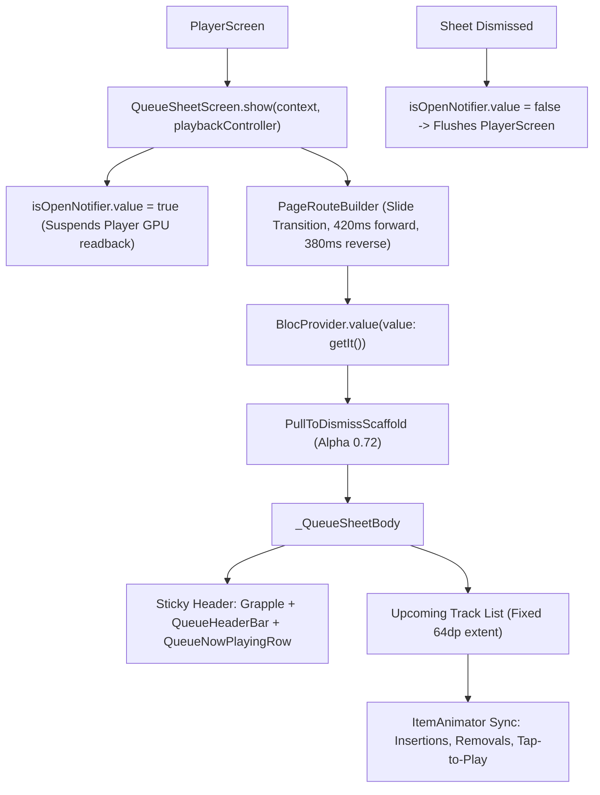

# queue_sheet_screen.dart

> Source File: `[lib/features/player/presentation/screens/queue_sheet_screen.dart](file:///c:/Users/Admin/Musify_MU/lib/features/player/presentation/screens/queue_sheet_screen.dart)`
> Layer: `lib/features/player/presentation/screens`

## Executive Summary
`queue_sheet_screen.dart` is a 1:1 replica of the native Spotify Android Queue Sheet (`layout_queue_sheet_content.xml`). It renders the sticky top header (grapple, queue header bar with clear button, and sticky now playing row) above an upcoming tracks list. It implements Android `DefaultItemAnimator` timing (375ms fade and translate), scroll position preservation during off-screen queue insertion/clearing, and route state notification to suspend background texture rendering in `PlayerScreen`.

## Core Architectural Mechanics

### 1. Zero-Stutter Concurrency Coordination
When the queue sheet opens, `QueueSheetScreen.isOpenNotifier.value` transitions to `true`. This signals `PlayerScreen` to defer high-cost tasks:
- Halts palette extraction readbacks from GPU textures.
- Defers decoding of 720x720 album covers during queue skip actions.
- When `whenComplete()` fires on route dismissal, `isOpenNotifier.value` reverts to `false`, immediately resuming normal playback UI processing.

### 2. Native DefaultItemAnimator Simulation
Replicating Android Spotify's `DefaultItemAnimator` timing:
- Total wait constant: `_itemAnimatorTotalWait = Duration(milliseconds: 375)` (120ms fade + 250ms move translation + 5ms buffer).
- Insertion sync: When new tracks are added to the user queue via context menu:
  - If inserted above the current scroll viewport, the scroll controller jumps by `+64.0px` per track to keep existing visible tracks firmly stationary.
  - If inserted within the viewport, their UIDs are added to `_animatedInsertUids`, triggering entry animations before cleanup after 375ms.

### 3. Queue Clear and Tap-to-Play Transition Logic
- When a user taps a track down the queue:
  - Computes skipped tracks between current position and the tapped track.
  - Adds skipped track UIDs to `_clearingUids` while setting `_tappedTrackUid`.
  - Dispatches `QueueTrackTapped(track: track, absoluteIndex: absoluteIndex)` to `QueueBloc`.
  - Animates the tapped track smoothly to the top of the list over 250ms with `Curves.easeInOutSine`.
- When clearing the queue:
  - If all user-queued tracks are off-screen above the scroll viewport, jumps scroll position by `-userQueueCount * 64.0` immediately without visual glitching.
  - If visible, marks visible queued UIDs in `_clearingUids` and animates them away before dispatching `QueueCleared()`.

## API Breakdown

### Classes

#### `class QueueSheetScreen extends StatelessWidget`
- **Static Fields**:
  - `_isOpen`: `bool` single-top route guard preventing duplicate pushes.
  - `isOpenNotifier`: `ValueNotifier<bool>` globally broadcast open/closed state.
- **Static Methods**:
  - `show(BuildContext context, PlaybackController playbackController)`: Initializes `QueueBloc` with `QueueStarted()`, sets `isOpenNotifier.value = true`, and presents modal route.

#### `class _QueueSheetBody extends StatefulWidget`
- **Fields**:
  - `dismissController`: `PullToDismissController` passed from outer scaffold.
- **State Class**: `_QueueSheetBodyState`

#### `class _QueueSheetBodyState extends State<_QueueSheetBody> with TickerProviderStateMixin`
- **State Fields**:
  - `_stretchController`: `SpotifyStretchController` handling overscroll rubber band.
  - `_scrollController`: `SpotifyPeekScrollController` coordinating scroll position.
  - `_knownUserQueueUids`: `Set<String>` tracks present before the last state emit.
  - `_animatedInsertUids`: `Set<String>` tracks currently playing insertion animations.
  - `_slideDownUids`: `Set<String>` tracks sliding down into view during tap transition.
  - `_clearingUids`: `Set<String>` tracks currently fading out.
  - `_tapTransitionTracks`: `List<ContextTrack>?` temporary snapshot frozen during transition.
  - `_tapAnimationGeneration`: `int` cancellation generation counter.
  - `_isClearingQueue`: `bool` whether queue clear animation is in progress.
- **Key Methods**:
  - `_syncUserQueueAnimations(QueueState state, {required bool isFromListener})`: Tracks delta between known and received UIDs, routing to off-screen jumps or on-screen animations.
  - `_handleClearQueue()`: Performs off-screen scroll compensation or visible item fade-out.
  - `_handleTrackTapped(ContextTrack track)`: Coordinates skipped track removal and smooth scroll to 0.

## Dependency Mapping

### Incoming Dependencies (What imports this file)
- `player_screen.dart`: Opens sheet on queue icon tap and observes `QueueSheetScreen.isOpenNotifier`.

### Outgoing Dependencies (What this file imports)
- `playback_controller.dart`: [[04-Reference/lib/core/audio/playback_controller|playback_controller.dart]]
- `spotify_encore_icons.dart`: [[04-Reference/lib/core/ui/icons/spotify_encore_icons|spotify_encore_icons.dart]]
- `queue_bloc.dart`: [[04-Reference/lib/features/player/application/queue/queue_bloc|queue_bloc.dart]]
- `queue_event.dart`: [[04-Reference/lib/features/player/application/queue/queue_event|queue_event.dart]]
- `queue_state.dart`: [[04-Reference/lib/features/player/application/queue/queue_state|queue_state.dart]]
- `context_track.dart`: [[04-Reference/lib/features/player/domain/models/context_track|context_track.dart]]
- `peek_scroll_view.dart`: [[04-Reference/lib/features/player/presentation/widgets/peek_scroll_view|peek_scroll_view.dart]]
- `pull_to_dismiss_scaffold.dart`: [[04-Reference/lib/features/player/presentation/widgets/pull_to_dismiss_scaffold|pull_to_dismiss_scaffold.dart]]
- `queue_controls_layout.dart`: [[04-Reference/lib/features/player/presentation/widgets/queue_controls_layout|queue_controls_layout.dart]]
- `queue_header_bar.dart`: [[04-Reference/lib/features/player/presentation/widgets/queue_header_bar|queue_header_bar.dart]]
- `queue_now_playing_row.dart`: [[04-Reference/lib/features/player/presentation/widgets/queue_now_playing_row|queue_now_playing_row.dart]]
- `queue_track_row.dart`: [[04-Reference/lib/features/player/presentation/widgets/queue_track_row|queue_track_row.dart]]
- `spotify_scroll_physics.dart`: [[04-Reference/lib/features/player/presentation/widgets/spotify_scroll_physics|spotify_scroll_physics.dart]]

## Architectural Warnings & Gotchas
1. **Fixed Item Extents Mandatory**: Track rows in the upcoming queue MUST maintain a strict 64.0dp extent (`itemExtent: 64.0`). All off-screen jump offsets and transition math depend directly on `index * 64.0`.
2. **Generation Guard on Timers**: All `Future.delayed(_itemAnimatorTotalWait)` callbacks verify `_tapAnimationGeneration == gen` before mutating state. Without this check, rapid sequential user taps result in race conditions and dropped tracks.
3. **Route Mutex**: Like `PlayerScreen`, `QueueSheetScreen.show` relies on static `_isOpen` to prevent multiple queue sheets from opening if tapped simultaneously.
