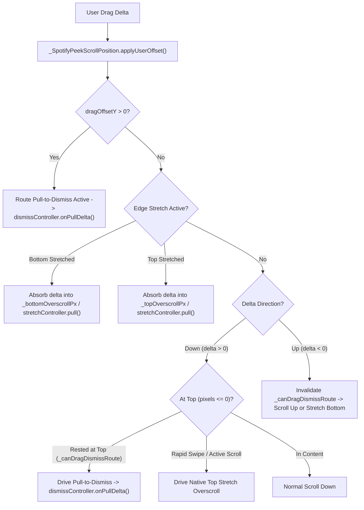

# peek_scroll_view.dart

> Source File: `[lib/features/player/presentation/widgets/peek_scroll_view.dart](file:///c:/Users/Admin/Musify_MU/lib/features/player/presentation/widgets/peek_scroll_view.dart)`
> Layer: `lib/features/player/presentation/widgets`

## Executive Summary
`peek_scroll_view.dart` implements a two-tier scroll view replicating Spotify's `PeekScrollView` and `FullScreenLayout` architecture. It manages the interaction between the viewport-locked main player (Tier 1) and the vertically scrollable card deck (Tier 2, containing lyrics, artist bio, and credits). Its core responsibility is seamlessly coordinating boundary gestures between inner list scrolling, Android stretch overscroll, and outer route pull-to-dismiss via custom scroll position mechanics.

## Core Architectural Mechanics

### 1. Two-Tier Layout Architecture
- **Tier 1 (Main Player Viewport)**: Height calculated as `screenHeight - peekHeight - bottomPadding`. Contains header, album artwork, track metadata, seekbar, and transport controls. The header has a `GestureDetector` that routes vertical drag directly to `dismissController.onPullDelta()`.
- **Tier 2 (Scrollable Cards Deck)**: Placed in a `SliverList`. The top card (typically `PlayerLyricsSection`) peeks into the Tier 1 viewport by `peekHeight` (64px) at scroll offset 0. Subsequent cards follow with 16px vertical spacing.

### 2. Gesture Arbitration in `_SpotifyPeekScrollPosition`
The critical engineering problem is disambiguating between pulling down to dismiss the modal player versus scrolling the card deck or triggering overscroll bounce.
- `_topArrivalTimestamp`: Tracks when the scroll position reached offset 0.
- `_canDragDismissRoute`: Evaluated in `drag()`. True only if the list was already resting at offset 0 for at least 400ms prior to the touch down event.
- If the user flings back up to the top and immediately swipes down, `_canDragDismissRoute` remains false, absorbing the motion into native top stretch overscroll rather than unintentionally closing the player.
- As soon as the user scrolls up into content (`delta < 0`), `_canDragDismissRoute` is permanently cleared for that gesture.

### 3. Bi-directional Stretch Absorption and Counter-Drag
When overscroll stretch is active:
- Pulling further extends the stretch proportionally to viewport dimensions (`_bottomOverscrollPx / viewport`).
- Dragging in the opposite direction consumes delta to contract the stretch back to 0 without scrolling the underlying list, preventing jarring scroll snaps.

## API Breakdown

### Classes

#### `class PeekScrollView extends StatefulWidget`
- **Fields**:
  - `dismissController`: `PullToDismissController` managing modal translation.
  - `header`: `Widget` top bar containing dismiss chevron and context menu trigger.
  - `mainContent`: `Widget` player column (artwork, seekbar, controls).
  - `peekingCard`: `Widget` card displayed partially at bottom of viewport.
  - `expandedCards`: `List<Widget>` remaining card widgets.
  - `peekHeight`: `double` (default: 64.0) visible peeking height.
  - `tier1Decoration`: `Decoration?` background gradient applied strictly to Tier 1.
- **State Class**: `PeekScrollViewState`

#### `class PeekScrollViewState extends State<PeekScrollView> with TickerProviderStateMixin`
- **Exposed Properties**:
  - `stretchController`: `SpotifyStretchController` controlling overscroll rubber-band.
  - `scrollController`: `SpotifyPeekScrollController` coordinating custom scroll position.
- **Methods**:
  - `scrollToExpanded()`: Programmatically animates cards deck to full viewport height over 500ms using `Cubic(0.3, 0.0, 0.0, 1.0)`.
  - `scrollToTop()`: Animates back to main player view over 500ms.

#### `class SpotifyPeekScrollController extends ScrollController`
- Creates and attaches `_SpotifyPeekScrollPosition`.

#### `class _SpotifyPeekScrollPosition extends ScrollPositionWithSingleContext`
- **Fields**:
  - `dismissController`: `PullToDismissController`.
  - `stretchController`: `SpotifyStretchController`.
  - `_bottomOverscrollPx`: `double` accumulated bottom stretch pixels.
  - `_topOverscrollPx`: `double` accumulated top stretch pixels.
  - `_topArrivalTimestamp`: `DateTime?` rest timestamp at top offset.
  - `_canDragDismissRoute`: `bool` whether downward pull dismisses the route.
  - `_isPullingRoute`: `bool` whether pull-to-dismiss is currently active.
- **Key Methods**:
  - `drag(DragStartDetails, VoidCallback)`: Evaluates rest duration and sets dismiss capability.
  - `applyUserOffset(double delta)`: Core multi-path delta routing engine.
  - `goBallistic(double velocity)`: Routes flings to `dismissController.onPullEnd()`, stretch spring rebound, or standard list momentum.

## Dependency Mapping

### Incoming Dependencies (What imports this file)
- `player_screen.dart`: Primary container widget for Now Playing.
- `queue_sheet_screen.dart`: Uses `SpotifyPeekScrollController` and `SpotifyStretchController`.
- `peek_scroll_view_test.dart`: Gesture tests.
- `pull_to_dismiss_scaffold_test.dart`: Gesture tests.

### Outgoing Dependencies (What this file imports)
- `pull_to_dismiss_scaffold.dart`: [[04-Reference/lib/features/player/presentation/widgets/pull_to_dismiss_scaffold|pull_to_dismiss_scaffold.dart]]
- `spotify_scroll_physics.dart`: [[04-Reference/lib/features/player/presentation/widgets/spotify_scroll_physics|spotify_scroll_physics.dart]]

## Architectural Warnings & Gotchas
1. **Always Use ClampingScrollPhysics**: `CustomScrollView` inside `PeekScrollView` must use `ClampingScrollPhysics` because all overscroll is manually synthesized and piped into `_stretchController`. Using `BouncingScrollPhysics` corrupts position offset tracking.
2. **RepaintBoundary on CustomScrollView**: The `CustomScrollView` is wrapped in `RepaintBoundary` to prevent canvas re-renders when the player controls seekbar or audio position streams update on Tier 1.
3. **400ms Rest Threshold**: The 400ms rest threshold before permitting pull-to-dismiss is critical for user experience; removing it causes rapid upward fling gestures that hit the top boundary to immediately dismiss the screen unexpectedly.
