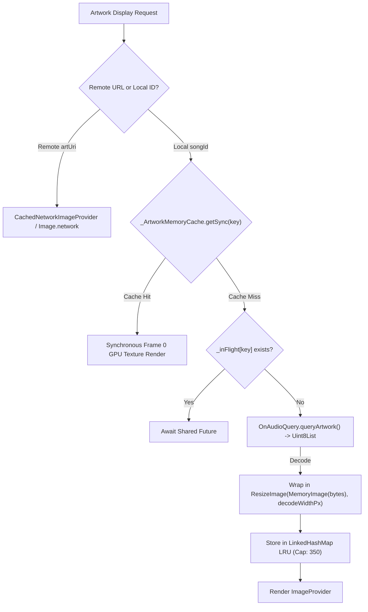

# player_artwork.dart

> Source File: `[lib/features/player/presentation/widgets/player_artwork.dart](file:///c:/Users/Admin/Musify_MU/lib/features/player/presentation/widgets/player_artwork.dart)`
> Layer: `lib/features/player/presentation/widgets`

## Executive Summary
`player_artwork.dart` handles the display and caching of album artwork for both remote Spotify tracks and local on-device audio files. It includes a custom in-memory LRU `ImageProvider` cache (`_ArtworkMemoryCache`) designed to eliminate MethodChannel re-queries and Skia JPEG re-decodes during 120Hz scrolling, along with the main `PlayerAlbumArtwork` card and blurred ambient `PlayerBackdrop`.

## Core Architectural Mechanics

### 1. Eliminating 120fps Drag Stutter via `_ArtworkMemoryCache`
The plugin `on_audio_query` wraps returned JPEG bytes in a fresh `MemoryImage` instance upon every build pass. Because `Uint8List` in Dart uses identity equality, every widget rebuild during drag-reordering or scroll animations bypassed Flutter's GPU `ImageCache`. This repeatedly triggered:
- Native Android JPEG re-encoding (`vendor.vivo.imageencoder.dump`).
- Skia CPU decoding (`SkJpegCodec::onGetPixels`).
- MethodChannel overhead and dropped frames.

`_ArtworkMemoryCache` solves this by:
- Caching the canonical `ImageProvider` per `_ArtworkCacheKey(songId, version, isLarge, querySize, decodeWidthPx)`.
- Wrapping bytes in `ResizeImage`, instructing Skia to decode thumbnails directly to target pixel dimensions (e.g. 144x144) rather than full 1000x1000 album textures.
- Providing synchronous frame 0 cache hits via `getSync()`.
- Managing an LRU cap of 350 providers.
- Tracking `_knownMissing` to prevent repeated negative queries.
- De-duplicating concurrent queries with `_inFlight`.

### 2. Player Backdrop Blur
`PlayerBackdrop` renders an ambient glow behind the player:
- Extracts local song ID from `MediaItem`.
- Wraps artwork in `ImageFiltered(imageFilter: ImageFilter.blur(sigmaX: 28, sigmaY: 28))`.
- Uses `RepaintBoundary` and 30% opacity so the blurred texture is painted into an isolated layer.

## API Breakdown

### Classes

#### `class _ArtworkMemoryCache`
- Private singleton LRU image provider cache.
- **Constants**:
  - `_maxCachedProviders = 350`
- **Methods**:
  - `static ImageProvider? getSync(_ArtworkCacheKey key)`: Synchronous O(1) LRU hit.
  - `static bool isKnownMissing(_ArtworkCacheKey key)`: Negative query check.
  - `static Future<ImageProvider?> load(_ArtworkCacheKey key)`: Asynchronous query with in-flight de-duplication.

#### `class _ArtworkCacheKey`
- Immutable cache key combining `songId`, `version`, `isLarge`, `querySize`, and `decodeWidthPx`.

#### `class PlayerAlbumArtwork extends StatelessWidget`
- **Fields**:
  - `item`: `MediaItem` current track.
  - `size`: `double?` optional fixed bounding box size.
- **Details**:
  - Displays square aspect ratio album cover with 12px rounded corners.
  - Renders soft elevation drop shadow (`BoxShadow(color: Colors.black38, blurRadius: 24, spreadRadius: 2)`).

#### `class PlayerArtworkImage extends StatefulWidget`
- Resolves local vs remote artwork, renders shimmer placeholder during loading, and displays fallback icon when artwork is unavailable.

#### `class PlayerBackdrop extends StatelessWidget`
- Renders full-screen blurred ambient backdrop.

## Dependency Mapping

### Incoming Dependencies (What imports this file)
- `player_screen.dart`: [[04-Reference/lib/features/player/presentation/screens/player_screen|player_screen.dart]] renders album art in Tier 1.
- `about_artist_card.dart`: [[04-Reference/lib/features/player/presentation/widgets/sections/about_artist_card|about_artist_card.dart]] reuses artwork rendering.
- `player_artwork_test.dart`: [[04-Reference/test/features/player/presentation/widgets/player_artwork_test|player_artwork_test.dart]] unit tests caching and display.

### Outgoing Dependencies (What this file imports)
- `media_item_mapper.dart`: [[04-Reference/lib/core/media/media_item_mapper|media_item_mapper.dart]] extracts songId and track identifiers.
- `player_theme.dart`: [[04-Reference/lib/features/player/presentation/widgets/player_theme|player_theme.dart]] styling and accent colors.

## Architectural Warnings & Gotchas
1. **Never Call QueryArtwork Directly in Build**: Always route local artwork queries through `PlayerArtworkImage` or `_ArtworkMemoryCache`. Uncached queries cause severe UI jank.
2. **ResizeImage Upscaling Disabled**: `allowUpscaling: false` is set so small embedded art is not upscaled unnecessarily, saving GPU memory.
