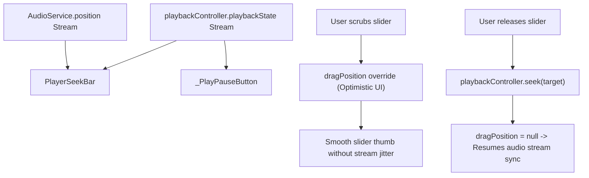

# player_controls.dart

> Source File: `[lib/features/player/presentation/widgets/player_controls.dart](file:///c:/Users/Admin/Musify_MU/lib/features/player/presentation/widgets/player_controls.dart)`
> Layer: `lib/features/player/presentation/widgets`

## Executive Summary
`player_controls.dart` houses the primary transport and scrubbing controls for the Now Playing screen. It defines `PlayerSeekBar` (stream-backed seek bar with secondary buffered progress tracking and optimistic user dragging), `PlayerPlaybackControls` (shuffle, previous, play/pause, skip, repeat), and `PlayerUtilityRow` (device picker and queue sheet entry point).

## Core Architectural Mechanics



### 1. Two-Tier Position Resolution in `PlayerSeekBar`
To avoid UI stutter while scrubbing, `PlayerSeekBar` nests two `StreamBuilder`s:
- Outer: `AudioService.position` stream (continuous tick).
- Inner: `playbackController.playbackState` stream (provides `bufferedPosition` and playback state).
- Resolved Position Priority:
  ```dart
  final currentPosition = dragPosition ??
      positionSnapshot.data ??
      state?.position ??
      Duration.zero;
  ```
- When the user drags the slider, `dragPosition` overrides the stream position immediately. When dragging ends (`onChangeEnd`), `playbackController.seek(target)` executes, and `dragPosition` is reset to `null` to smoothly rejoin the real-time audio service clock.

### 2. Secondary Track Buffered Progress
The slider utilizes Flutter's `Slider(secondaryTrackValue: bufferedValue)` with `secondaryActiveTrackColor: Colors.white.withValues(alpha: 0.35)`, showing how much audio ExoPlayer has buffered ahead of current playback.

### 3. Transport Control State Handling
- `_PlayPauseButton`: Displays `CircularProgressIndicator` if `processingState == AudioProcessingState.buffering`, play icon when paused, and pause icon when playing.
- `_TransportButton`: Renders icon button with optional active dot underneath for enabled modes like shuffle.

## API Breakdown

### Classes

#### `class PlayerSeekBar extends StatelessWidget`
- **Fields**:
  - `item`: `MediaItem` providing canonical `duration`.
  - `playbackController`: `PlaybackController` for dispatching `seek()`.
  - `dragPosition`: `Duration?` actively scrubbed user offset.
  - `onDragPositionChanged`: `ValueChanged<Duration?>` callback updating parent screen state.
- **Methods**:
  - `_formatDuration(Duration duration)`: Invokes `DurationFormatter.duration(duration)`.

#### `class PlayerPlaybackControls extends StatelessWidget`
- **Fields**:
  - `item`: `MediaItem` current track.
  - `playbackController`: `PlaybackController`.
  - `shuffleEnabled`: `bool` whether shuffle is active.
  - `repeatEnabled`: `bool` whether repeat mode is active.
  - `onShuffle`: `VoidCallback?` toggle callback.
  - `onRepeat`: `VoidCallback?` toggle callback.

#### `class PlayerUtilityRow extends StatelessWidget`
- **Fields**:
  - `onQueue`: `VoidCallback` callback presenting the Queue Sheet modal.
  - `onDevices`: `VoidCallback?` callback for Spotify Connect device picker.

#### `class _PlayPauseButton extends StatelessWidget`
- Observes `playbackController.playbackState` and renders 64x64 play/pause/buffer transport button.

#### `class _TransportButton extends StatelessWidget`
- Reusable 48x48 touch target transport action with optional active indicator dot.

## Dependency Mapping

### Incoming Dependencies (What imports this file)
- `player_screen.dart`: [[04-Reference/lib/features/player/presentation/screens/player_screen|player_screen.dart]] places seekbar and controls in Tier 1 column.

### Outgoing Dependencies (What this file imports)
- `playback_controller.dart`: [[04-Reference/lib/core/audio/playback_controller|playback_controller.dart]]
- `duration_formatter.dart`: [[04-Reference/lib/core/ui/formatters/duration_formatter|duration_formatter.dart]]
- `player_theme.dart`: [[04-Reference/lib/features/player/presentation/widgets/player_theme|player_theme.dart]]

## Architectural Warnings & Gotchas
1. **Clamp Slider Values**: Because streams from native audio players can briefly emit positions exceeding track duration (or negative values during track transitions), `sliderValue` and `bufferedValue` are strictly clamped between `0.0` and `maxValue`.
2. **Hit Target Sizes**: All transport buttons maintain minimum 48x48 pixel touch targets to comply with Material and iOS accessibility standards.
