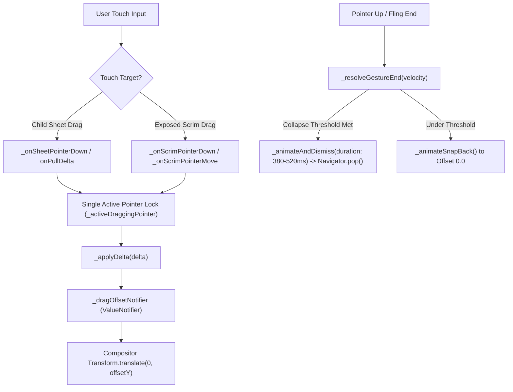

# pull_to_dismiss_scaffold.dart

> Source File: `[lib/features/player/presentation/widgets/pull_to_dismiss_scaffold.dart](file:///c:/Users/Admin/Musify_MU/lib/features/player/presentation/widgets/pull_to_dismiss_scaffold.dart)`
> Layer: `lib/features/player/presentation/widgets`

## Executive Summary
`pull_to_dismiss_scaffold.dart` provides an interactive pull-down gesture dismiss container designed to replicate Spotify's bottom-sheet and modal player dismiss physics. It handles multi-pointer gesture routing between child sheets and exposed scrim regions, manages velocity-sensitive snap-back and dismiss thresholds, and isolates sheet layout through `RepaintBoundary` caching to guarantee 120fps frame rendering without re-layout during drag translations.

## Core Architectural Mechanics



### 1. Pointer Arbitration and Multi-Touch Protection
To prevent gesture stutter or multiplied drag velocity when users touch with multiple fingers across both the sheet and the exposed scrim:
- Maintains separate pointer tracking sets: `_sheetPointers` and `_scrimPointers`.
- Enforces a single active dragging pointer (`_activeDraggingPointer`).
- If a pointer is actively dragging on the scrim, deltas from sheet listeners are ignored (`if (_activeDraggingPointer != null && _scrimPointers.contains(_activeDraggingPointer)) return;`).
- When a pointer lifts, pointer focus transfers gracefully to the next remaining pointer or nullifies.

### 2. Zero-Rebuild 120Hz Compositor Pipeline
During active dragging, running widget rebuilds or layout recalculations across complex hierarchies like the player or queue sheet drops frames. `PullToDismissScaffold` solves this via:
- Pre-building the child sheet inside a `RepaintBoundary` and passing it directly as the static `child` parameter of `ValueListenableBuilder<double>(_dragOffsetNotifier, child: cachedSheet)`.
- In the builder, `offsetY` updates only `Transform.translate(offset: Offset(0, offsetY), child: child)`.
- Flutter compositor simply updates the 2D transformation matrix of the existing GPU texture layer. The sheet widget tree has zero rebuilds and zero layout passes while moving.

### 3. Exposed Scrim Tap and Drag Detection
When the sheet is pulled down (`offsetY > 0`), an invisible touch hit-test region is dynamically mounted above the sheet:
```dart
if (offsetY > 0)
  Positioned(
    top: 0,
    left: 0,
    right: 0,
    height: offsetY,
    child: Listener(
      behavior: HitTestBehavior.opaque,
      onPointerDown: _onScrimPointerDown,
      onPointerMove: _onScrimPointerMove,
      onPointerUp: _onScrimPointerUp,
      onPointerCancel: _onScrimPointerCancel,
      child: const SizedBox.expand(),
    ),
  ),
```
A tap without dragging on this area immediately calls `_animateAndDismiss()`, matching native Android modal sheet dismiss behavior.

### 4. Distance and Velocity Adaptive Spring Duration
Dismiss and snap-back animations adapt their duration dynamically between 380ms and 520ms using Spotify's exact Cubic curve:
```dart
final distanceFraction = (remainingDistance / screenHeight).clamp(0.0, 1.0);
final velocityReduction = velocity.abs() > 100.0
    ? (1.0 - (velocity.abs() / 4000.0).clamp(0.0, 0.45))
    : 1.0;
final durationMs = (400 + 120 * distanceFraction * velocityReduction)
    .round()
    .clamp(380, 520);
```

## API Breakdown

### Interfaces & Classes

#### `abstract class PullToDismissController`
Controller interface exposed to child components (e.g. `PeekScrollView` and `QueueSheetScreen`):
- `double get dragOffsetY`: Current vertical translation offset in pixels.
- `bool get isDismissing`: Whether the dismiss animation or navigation pop is in progress.
- `void onPullDelta(double delta)`: Appends vertical drag delta to the active drag offset.
- `void onPullEnd(double velocity)`: Notifies controller that gesture ended with pixel/sec velocity.
- `void dismiss()`: Triggers immediate pop transition.

#### `class PullToDismissScaffold extends StatefulWidget`
- **Constructor Parameters**:
  - `builder`: `Widget Function(BuildContext, PullToDismissController)` child builder function.
  - `dismissDistanceThreshold`: `double` (default: 110.0px) minimum pull distance to trigger dismiss when velocity is neutral.
  - `dismissVelocityThreshold`: `double` (default: 750.0px/s) fling velocity triggering collapse regardless of distance.
  - `barrierBaseAlpha`: `double` (default: 0.70) maximum darkness alpha of background dimming scrim.

#### `class _PullToDismissScaffoldState extends State<PullToDismissScaffold> with SingleTickerProviderStateMixin implements PullToDismissController`
- **Fields**:
  - `_animController`: `AnimationController` driving snap-back and dismiss springs.
  - `_dragAnimation`: `Animation<double>?` active tween interpolation.
  - `_dragOffsetNotifier`: `ValueNotifier<double>` reactive notifier updating `Transform.translate`.
  - `_sheetPointers`: `Set<int>` active pointer IDs contacting the sheet.
  - `_scrimPointers`: `Set<int>` active pointer IDs contacting the exposed upper scrim.
  - `_scrimVelocityTrackers`: `Map<int, VelocityTracker>` per-pointer velocity tracking on scrim.
  - `_activeDraggingPointer`: `int?` pointer ID currently driving motion.
- **Methods**:
  - `_applyDelta(double delta)`: Stops in-flight animations and clamps offset between 0.0 and infinity.
  - `_resolveGestureEnd(double velocity)`: Evaluates fling velocity (> 200px/s) or last movement direction to decide collapse vs snap back.
  - `_animateAndDismiss([double velocity])`: Drives sheet to screen height and pops route upon completion.
  - `_animateSnapBack([double velocity])`: Smoothly animates offset back to 0.0 without stutters.

## Dependency Mapping

### Incoming Dependencies (What imports this file)
- `player_screen.dart`: Wraps the full player view in `PullToDismissScaffold`.
- `queue_sheet_screen.dart`: Wraps the queue bottom sheet in `PullToDismissScaffold`.
- `peek_scroll_view_test.dart`: Test harness verifying drag interaction.
- `pull_to_dismiss_scaffold_test.dart`: Unit and widget tests verifying pointer arbitration and thresholds.

### Outgoing Dependencies (What this file imports)
- No internal project imports (standalone Flutter UI/gesture component).

## Architectural Warnings & Gotchas
1. **Never Wrap Inner ListViews in Nested ScrollControllers without PullToDismiss Coordination**: If a child contains a scrollable view, it must coordinate via `onPullDelta` only when its scroll offset is at 0.0 (as implemented in `PeekScrollView`).
2. **Animation Assignment Order**: Tween animations must be assigned to `_dragAnimation` before calling `_animController.forward(from: 0.0)` to avoid evaluating stale or null animation instances on the first frame.
3. **PopScope Interaction**: Uses Flutter 3.12+ `PopScope(canPop: !_isDismissing, onPopInvokedWithResult: ...)` to intercept Android back button presses and trigger smooth slide dismiss instead of an abrupt route pop.
