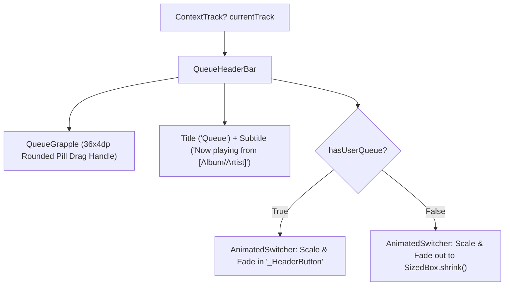

# queue_header_bar.dart

> Source File: `[lib/features/player/presentation/widgets/queue_header_bar.dart](file:///c:/Users/Admin/Musify_MU/lib/features/player/presentation/widgets/queue_header_bar.dart)`
> Layer: `lib/features/player/presentation/widgets`

## Executive Summary
`queue_header_bar.dart` renders the sticky top app bar and drag grapple for the Spotify Android Queue Sheet modal. It displays the "Queue" title, dynamic "Now playing from [Context Title]" subtitle, and the interactive animated "Clear" queue action button.

## Core Architectural Mechanics



### 1. Animated Clear Button Transition
When tracks exist in the user queue, the 'Clear' button transitions in smoothly via `AnimatedSwitcher` over 300ms using `Curves.decelerate` with combined `FadeTransition` and `ScaleTransition`:
```dart
static final Animatable<double> _clearScaleTween = Tween<double>(
  begin: 0.0,
  end: 1.0,
).chain(CurveTween(curve: Curves.decelerate));
```
When tapped, it initiates `_handleClearQueue()` inside `QueueSheetScreen`.

### 2. Context Extraction Priority
`_getPlayingContext(ContextTrack? track)` resolves subtitle text with strict hierarchy:
1. `track.metadata['context_title']` (e.g. Playlist or Radio name).
2. `track.album` (if not empty and not 'Unknown Album').
3. `track.artist` (fallback).

## API Breakdown

### Classes

#### `class QueueGrapple extends StatelessWidget`
- Top 36x4dp centered rounded drag handle with 35% white opacity.

#### `class QueueHeaderBar extends StatelessWidget`
- **Fields**:
  - `dismissController`: `PullToDismissController`.
  - `hasUserQueue`: `bool` controls visibility of Clear button.
  - `currentTrack`: `ContextTrack?` currently playing track.
  - `onClearTapped`: `VoidCallback` clear action handler.

#### `class _HeaderButton extends StatefulWidget`
- Interactive button with scale feedback on tap down using `Cubic(0.3, 0.0, 0.0, 1.0)`.

## Dependency Mapping

### Incoming Dependencies (What imports this file)
- `queue_sheet_screen.dart`: [[04-Reference/lib/features/player/presentation/screens/queue_sheet_screen|queue_sheet_screen.dart]] renders `QueueHeaderBar` and `QueueGrapple` in its sticky header.

### Outgoing Dependencies (What this file imports)
- `player_theme.dart`: [[04-Reference/lib/features/player/presentation/widgets/player_theme|player_theme.dart]]
- `pull_to_dismiss_scaffold.dart`: [[04-Reference/lib/features/player/presentation/widgets/pull_to_dismiss_scaffold|pull_to_dismiss_scaffold.dart]]

## Architectural Warnings & Gotchas
1. **Never Hardcode Subtitle Colors**: Subtitle uses `PlayerColors.textSecondary` with white bold emphasis on the context name to ensure WCAG AA contrast against `#121212`.
2. **Fixed 56dp Height**: The header maintains a fixed 56dp vertical height to prevent layout jumps during Clear button transitions.
