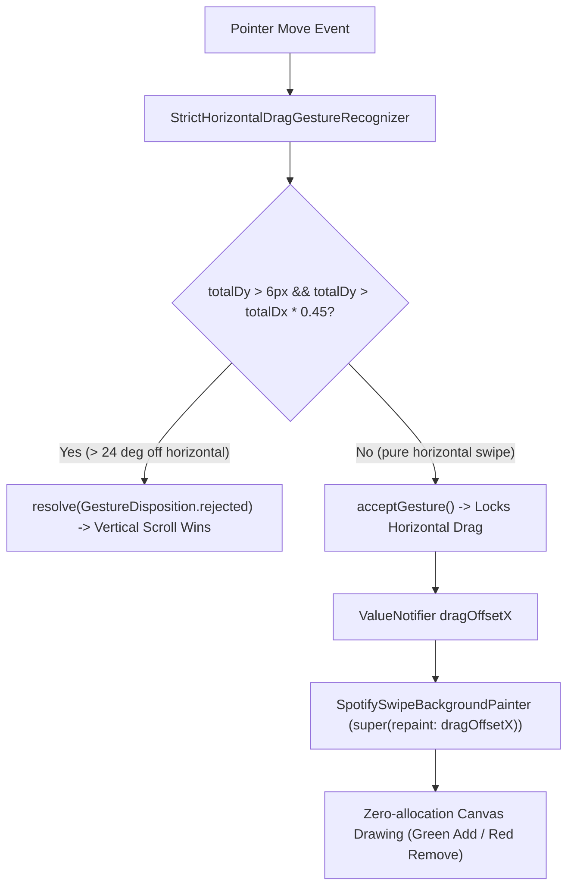

# queue_swipe_background.dart

> Source File: `[lib/features/player/presentation/widgets/queue_swipe_background.dart](file:///c:/Users/Admin/Musify_MU/lib/features/player/presentation/widgets/queue_swipe_background.dart)`
> Layer: `lib/features/player/presentation/widgets`

## Executive Summary
`queue_swipe_background.dart` provides high-precision horizontal swipe gesture filtering and zero-allocation 120Hz canvas painting for track rows in the queue sheet. It implements `StrictHorizontalDragGestureRecognizer` to eliminate accidental swipe activations during vertical scrolling and `SpotifySwipeBackgroundPainter` (a 1:1 port of Android Spotify `p/l1q0.java` `onChildDraw`).

## Core Architectural Mechanics

### 1. Angular Gesture Discrimination (`StrictHorizontalDragGestureRecognizer`)
In standard Flutter `Dismissible` or `HorizontalDragGestureRecognizer`, diagonal finger movement during rapid list scrolling often triggers horizontal item dismissals unintentionally. `StrictHorizontalDragGestureRecognizer` solves this via:
- Measuring `totalDx` and `totalDy`.
- If vertical movement exceeds 6px and the swipe angle exceeds ~24 degrees off horizontal (`totalDy > totalDx * 0.45`), the gesture is immediately rejected so vertical list momentum continues without hesitation.
- To accept the gesture, horizontal movement must exceed effective slop (minimum 12px) and exceed vertical drift by at least 2.2x (`totalDx > totalDy * 2.2`).

### 2. Zero-Allocation 120Hz Canvas Painter (`SpotifySwipeBackgroundPainter`)
Faithfully porting Android Spotify's `ItemTouchHelper.Callback.onChildDraw`:
- Initialized with `super(repaint: dragOffsetX)` using a pre-allocated `Paint()` instance.
- Avoids rebuilding widget trees or creating garbage collector pressure during 120Hz swipe animations.
- **Positive Swipe (Right)**: Clips canvas to `Rect.fromLTWH(0, 0, dx, height)` filled with accent green (`#1DB954`) and renders `SpotifyEncoreIcons.addToQueuePaths`.
- **Negative Swipe (Left)**: Clips canvas from right edge filled with red (`#E22134`) and renders `SpotifyEncoreIcons.removeFromQueuePaths`.

## API Breakdown

### Classes

#### `class StrictHorizontalDragGestureRecognizer extends HorizontalDragGestureRecognizer`
- Custom gesture recognizer filtering out non-horizontal swipes.

#### `class SpotifySwipeBackgroundPainter extends CustomPainter`
- **Fields**:
  - `dragOffsetX`: `ValueNotifier<double>` continuous horizontal translation stream.
- **Colors**:
  - `_positiveGreen`: `PlayerColors.accent` (`#1DB954`)
  - `_negativeRed`: `Color(0xFFE22134)`

## Dependency Mapping

### Incoming Dependencies (What imports this file)
- `queue_track_row.dart`: [[04-Reference/lib/features/player/presentation/widgets/queue_track_row|queue_track_row.dart]] uses recognizer and painter for swipe-to-queue actions.

### Outgoing Dependencies (What this file imports)
- `spotify_encore_icons.dart`: [[04-Reference/lib/core/ui/icons/spotify_encore_icons|spotify_encore_icons.dart]]
- `player_theme.dart`: [[04-Reference/lib/features/player/presentation/widgets/player_theme|player_theme.dart]]

## Architectural Warnings & Gotchas
1. **Never Reallocate Paint in paint()**: `_fillPaint` is declared as a final class field. Allocating `Paint` or `Path` objects inside `paint()` causes garbage collection pauses during swipe interactions.
2. **Repaint Boundary Coordination**: Parent rows must be wrapped in `RepaintBoundary` to prevent canvas clips from redrawing adjacent track tiles.
