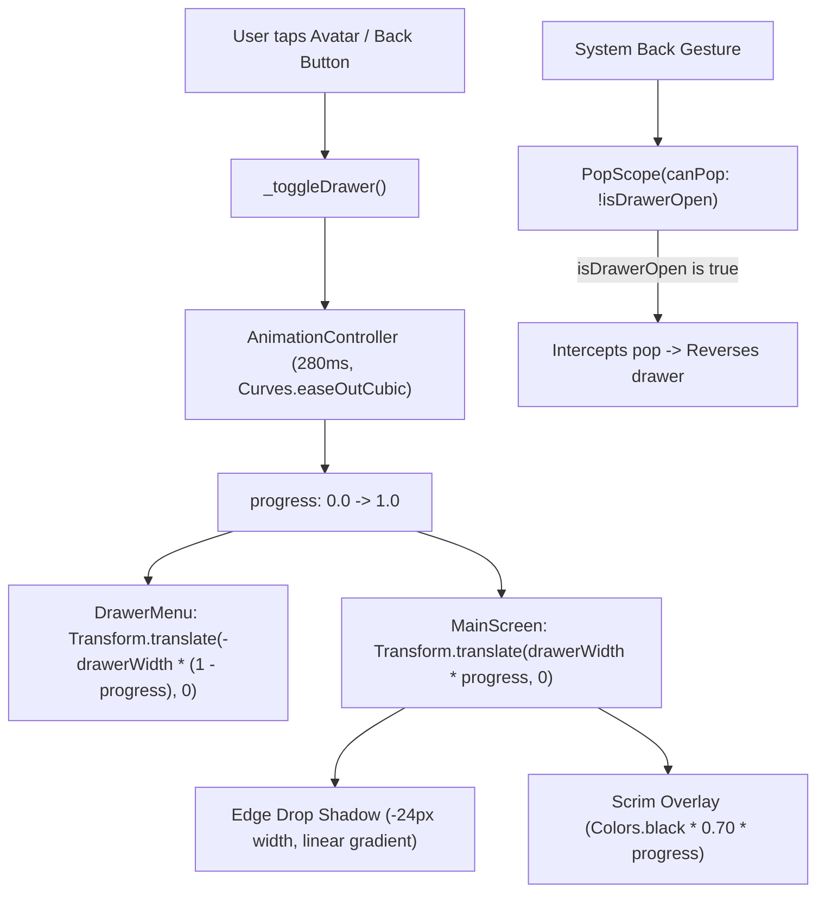

# hidden_drawer_scaffold.dart

> Source File: `[lib/features/shell/presentation/hidden_drawer_scaffold.dart](file:///c:/Users/Admin/Musify_MU/lib/features/shell/presentation/hidden_drawer_scaffold.dart)`
> Layer: `lib/features/shell/presentation`

## Executive Summary
`hidden_drawer_scaffold.dart` provides the 3D-styled sliding drawer navigation container for Musify. Rather than overlaying an Android modal drawer over the content, it slides the entire foreground `MainScreen` 83% to the right while translating the background `DrawerMenu` in from the left. Crucially, it preserves the element tree and state of `MainScreen` by permanently caching it as Child 0 inside a `RepaintBoundary`, preventing element deactivation or rebuilds during drawer animation.

## Core Architectural Mechanics



### 1. Element Preservation & Zero-Rebuild Composition
Standard drawer implementations often rebuild or re-parent their child widgets when toggling visibility, causing media players to flicker and active scroll positions to reset. `_HiddenDrawerScaffoldState` guarantees element tree permanence via:
```dart
void _initMainScreen() {
  _mainScreen = RepaintBoundary(
    key: const ValueKey('hidden_drawer_main_screen'),
    child: MainScreen(...),
  );
}
```
In the `build()` method, `_mainScreen` is ALWAYS child index 0 in the inner `Stack`. Even as translation matrices and dimming scrims animate, Flutter never deactivates, unmounts, or re-lays out `MainScreen`.

### 2. Geometry & Physics (83% Push Ratio)
- Computes `drawerWidth = screenWidth * 0.83`, leaving a 17% visible slice of the foreground app on the right edge.
- The drawer slides in from `-drawerWidth * (1.0 - progress)`.
- The main screen slides out to `drawerWidth * progress`.
- Left-edge drop shadow (`Positioned(left: -24, width: 24, ...)`) renders a seamless elevation cast onto the drawer menu.
- A tap on the dimmed scrim immediately triggers `_toggleDrawer()`, closing the menu.

### 3. Android Back Press Interception
Uses `PopScope(canPop: !isDrawerOpen)` with `onPopInvokedWithResult`. If the user presses the system back button while the drawer is open, `canPop: false` cancels the app exit and triggers `_toggleDrawer()`.

## API Breakdown

### Classes

#### `class HiddenDrawerScaffold extends StatefulWidget`
- **Fields**:
  - `playbackController`: `PlaybackController?` global audio session handle.
  - `modePersistence`: `ModePersistence` loads/saves online vs offline preference.
  - `createHomeFeedBloc`: Factory initializing `HomeFeedBloc`.
  - `createBrowseBloc`: Factory initializing `BrowseBloc`.
  - `createLibraryBloc`: Factory initializing `LibraryBloc(userId)`.

#### `class _HiddenDrawerScaffoldState extends State<HiddenDrawerScaffold> with SingleTickerProviderStateMixin`
- **Fields**:
  - `_animationController`: `AnimationController` with 280ms duration.
  - `_curvedAnimation`: `Animation<double>` combining `Curves.easeOutCubic` (forward) and `Curves.easeInCubic` (reverse).
  - `_mainScreen`: `Widget` cached persistent instance of `MainScreen`.
- **Methods**:
  - `_toggleDrawer()`: Starts forward or reverse spring animation.
  - `_initMainScreen()`: Creates and caches the `RepaintBoundary`-isolated `MainScreen`.
  - `didUpdateWidget(...)`: Re-initializes `_mainScreen` only when controller or mode persistence references change.

## Dependency Mapping

### Incoming Dependencies (What imports this file)
- `app.dart`: [[04-Reference/lib/app/app|app.dart]] uses `HiddenDrawerScaffold` as root content widget.

### Outgoing Dependencies (What this file imports)
- `mode_persistence.dart`: [[04-Reference/lib/app/di/mode_persistence|mode_persistence.dart]]
- `playback_controller.dart`: [[04-Reference/lib/core/audio/playback_controller|playback_controller.dart]]
- `browse_bloc.dart`: [[04-Reference/lib/features/browse/application/browse_bloc|browse_bloc.dart]]
- `home_feed_bloc.dart`: [[04-Reference/lib/features/home_feed/application/home_feed_bloc|home_feed_bloc.dart]]
- `library_bloc.dart`: [[04-Reference/lib/features/library/application/library_bloc|library_bloc.dart]]
- `main_screen.dart`: [[04-Reference/lib/features/shell/presentation/main_screen|main_screen.dart]]
- `drawer_menu.dart`: [[04-Reference/lib/features/shell/presentation/widgets/drawer_menu|drawer_menu.dart]]

## Architectural Warnings & Gotchas
1. **Never Conditionally Swap MainScreen Position**: Placing `_mainScreen` inside conditional branches changes its slot in the Element tree, causing complete state loss across tabs.
2. **RepaintBoundary on Drawer and Main Screen**: Both the drawer menu and the main screen are isolated inside `RepaintBoundary` instances so that 280ms translations only update GPU matrix transforms.
