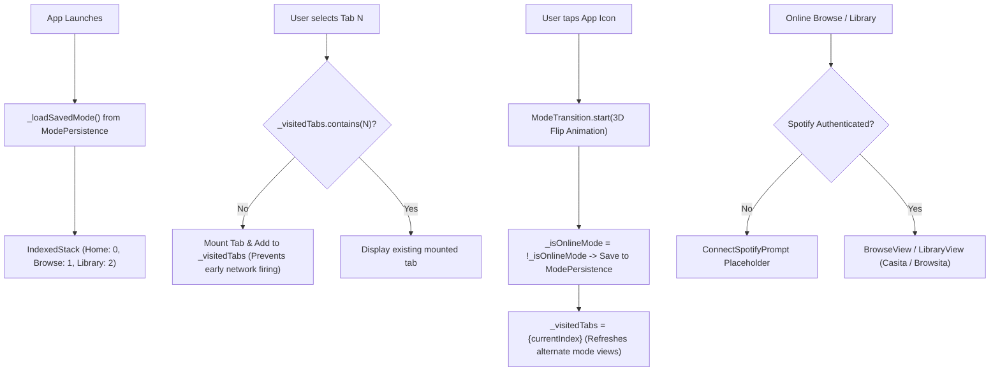

# main_screen.dart

> Source File: `[lib/features/shell/presentation/main_screen.dart](file:///c:/Users/Admin/Musify_MU/lib/features/shell/presentation/main_screen.dart)`
> Layer: `lib/features/shell/presentation`

## Executive Summary
`main_screen.dart` is the primary tab routing and navigation shell of Musify. It hosts the root `IndexedStack` managing the three primary application tabs (Home, Browse/Search, and Library), lazy-mounts views via a visited tab tracker, orchestrates the 3D flipped coin transition between Online and Offline modes, manages Spotify authentication gating, and embeds the persistent `MiniPlayer` and bottom navigation bars.

## Navigation & Dual Mode Architecture



### 1. Lazy Tab Activation (`_visitedTabs`)
To guarantee that network-intensive APIs (like Browsita or Spotify Library) do not execute during cold-start while Home is still initializing, `MainScreen` uses:
```dart
final Set<int> _visitedTabs = {0}; // Home tab is always visited
```
In the `IndexedStack`:
- Tab 0 (Home): Mounted immediately.
- Tab 1 (Browse): Replaced with `const SizedBox.shrink()` until index 1 is tapped for the first time.
- Tab 2 (Library): Replaced with `const SizedBox.shrink()` until index 2 is tapped.

### 2. Online / Offline Mode Transition
Musify features a dual-personality architecture:
- **Offline Mode**: Operates entirely on local files stored on Android/iOS storage via `on_audio_query` and SQLite database queries.
- **Online Mode**: Streams audio and loads SDUI feeds via Spotify's private protobuf protocol.
- Tapping the top-right app icon starts `ModeTransition.start(...)`, rendering a 3D coin-flip animation with perspective matrix transforms. Upon completion, `_visitedTabs` is reset to `{_currentIndex}`, ensuring that unvisited tabs load in the newly selected mode when accessed.

### 3. Auth-Gated Providers
For online views requiring Spotify credentials (`_BrowseTab` and `_LibraryTab`), the views are wrapped in `AuthGatedBlocProvider`:
- If unauthenticated, displays `ConnectSpotifyPrompt` with a customized prompt and call-to-action to log in via PKCE OAuth.
- If authenticated, instantiates `createBrowseBloc()` or `createLibraryBloc(userId)` and renders the active cloud feeds.

### 4. Bottom Navigation & Mini Player Composition
The scaffold's `bottomNavigationBar` stacks:
1. `MiniPlayer`: Edge-to-edge floating playback strip with track artwork, title, play/pause toggle, and tap gesture opening `PlayerScreen`.
2. `AppBottomNavigation`: Bottom tab buttons with network badge animation.
3. `NetworkStatusBottomBar`: Slides up when offline or reconnecting.

## API Breakdown

### Classes

#### `class MainScreen extends StatefulWidget`
- **Fields**:
  - `onMenuPressed`: `VoidCallback` opens hidden side drawer.
  - `isDrawerOpen`: `bool` whether drawer is currently open.
  - `playbackController`: `PlaybackController?` audio engine handle.
  - `modePersistence`: `ModePersistence` loads/saves online mode preference.
  - `createHomeFeedBloc`: Factory for `HomeFeedBloc`.
  - `createBrowseBloc`: Factory for `BrowseBloc`.
  - `createLibraryBloc`: Factory for `LibraryBloc`.

#### `class _MainScreenState extends State<MainScreen>`
- **Fields**:
  - `_currentIndex`: `int` (0 = Home, 1 = Browse, 2 = Library).
  - `_iconKey`: `GlobalKey` anchor for mode transition animation.
  - `_isOnlineMode`: `bool` whether online cloud mode is active.
  - `_modeLoaded`: `bool` whether preferences have resolved from disk.
  - `_visitedTabs`: `Set<int>` lazy mount tracker.
- **Methods**:
  - `_loadSavedMode()`: Reads stored preference before rendering.
  - `_toggleMode()`: Triggers 3D animation, flips state, and writes preference to disk.

#### `class _BrowseTab extends StatelessWidget`
- Switches between `OfflineBrowseView` and auth-gated `BrowseView`.

#### `class _LibraryTab extends StatelessWidget`
- Switches between `OfflineLibraryView` and auth-gated `LibraryView`.

## Dependency Mapping

### Incoming Dependencies (What imports this file)
- `hidden_drawer_scaffold.dart`: [[04-Reference/lib/features/shell/presentation/hidden_drawer_scaffold|hidden_drawer_scaffold.dart]] embeds `MainScreen`.

### Outgoing Dependencies (What this file imports)
- `network_status_bloc.dart`: [[04-Reference/lib/core/network/status/bloc/network_status_bloc|network_status_bloc.dart]]
- `mode_persistence.dart`: [[04-Reference/lib/app/di/mode_persistence|mode_persistence.dart]]
- `playback_controller.dart`: [[04-Reference/lib/core/audio/playback_controller|playback_controller.dart]]
- `color_extraction_service.dart`: [[04-Reference/lib/core/color/color_extraction_service|color_extraction_service.dart]]
- `mode_transition.dart`: [[04-Reference/lib/core/ui/animations/mode_transition|mode_transition.dart]]
- `app_header.dart`: [[04-Reference/lib/core/ui/widgets/app_header|app_header.dart]]
- `auth_gated_bloc_provider.dart`: [[04-Reference/lib/core/ui/widgets/auth_gated_bloc_provider|auth_gated_bloc_provider.dart]]
- `connect_spotify_prompt.dart`: [[04-Reference/lib/core/ui/widgets/connect_spotify_prompt|connect_spotify_prompt.dart]]
- `browse_bloc.dart`: [[04-Reference/lib/features/browse/application/browse_bloc|browse_bloc.dart]]
- `browse_view.dart`: [[04-Reference/lib/features/browse/presentation/browse_view|browse_view.dart]]
- `offline_browse_view.dart`: [[04-Reference/lib/features/browse/presentation/offline_browse_view|offline_browse_view.dart]]
- `home_tab.dart`: [[04-Reference/lib/features/home/presentation/home_tab|home_tab.dart]]
- `home_feed_bloc.dart`: [[04-Reference/lib/features/home_feed/application/home_feed_bloc|home_feed_bloc.dart]]
- `library_bloc.dart`: [[04-Reference/lib/features/library/application/library_bloc|library_bloc.dart]]
- `library_view.dart`: [[04-Reference/lib/features/library/presentation/library_view|library_view.dart]]
- `offline_library_view.dart`: [[04-Reference/lib/features/library/presentation/offline_library_view|offline_library_view.dart]]
- `mini_player.dart`: [[04-Reference/lib/features/player/presentation/widgets/mini_player|mini_player.dart]]
- `bottom_navigation.dart`: [[04-Reference/lib/features/shell/presentation/widgets/bottom_navigation|bottom_navigation.dart]]
- `network_status_bottom_bar.dart`: [[04-Reference/lib/features/shell/presentation/widgets/network_status_bottom_bar|network_status_bottom_bar.dart]]

## Architectural Warnings & Gotchas
1. **Never Mount Unvisited Tabs**: Always check `_visitedTabs.contains(index)` in `IndexedStack`. Eagerly mounting all three tabs fires simultaneous requests to Casita, Browsita, and Spotify Library, causing 429 rate limits and poor cold-start FPS.
2. **Back Button Routing**: If on Browse or Library (`_currentIndex != 0`), pressing Android back returns to Home (`_currentIndex = 0`) instead of popping the application route.
