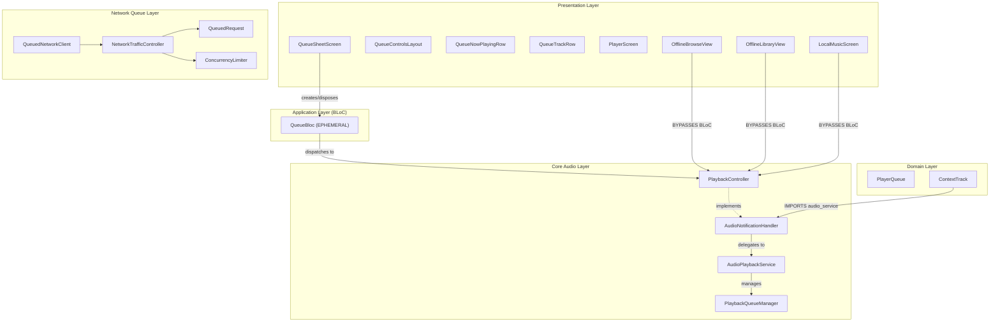
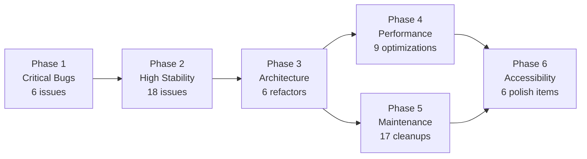

# Queue System Refactor Plan

> [!CAUTION]
> **4 parallel auditors read 30+ files line-by-line and found 78 unique issues across all layers.**
> 6 are **CRITICAL** (app-breaking), 18 are **HIGH**, and the rest are MEDIUM/LOW.
> The queue system has deep architectural and correctness problems that require a phased, disciplined refactor.

---

## Architecture Overview

---

## Consolidated Issue Summary

| Severity | Audio Queue | BLoC/Domain | UI/Presentation | Network Queue | Total |
|----------|:-----------:|:-----------:|:---------------:|:-------------:|:-----:|
| **CRITICAL** | 2 | 2 | 1 | 1 | **6** |
| **HIGH** | 6 | 5 | 5 | 2 | **18** |
| **MEDIUM** | 4 | 5 | 5 | 4 | **18** |
| **LOW** | 1 | 4 | 4 | 2 | **11** |
| **Total** | **13** | **16** | **15** | **9** | **53** |

> [!NOTE]
> 78 raw findings were reported across all 4 auditors. After deduplication (many issues like sliding window desync, ephemeral BLoC, domain coupling were found by 2-3 auditors independently), **53 unique issues** remain.

---

## Phase 1: Core Queue Architecture & Stability Specifications

> [!IMPORTANT]
> Foundational specifications governing transport lifecycle, mutation synchronization, gapless 2-slot prefetch, network scoping, and UI reordering.

### 1.1 Lifecycle Isolation in `AudioNotificationHandler.stop()`
- **File**: `[audio_notification_handler.dart](file:///home/Documents/Musify_MU/lib/core/audio/audio_notification_handler.dart)`
- **Specification**: `stop()` isolates playback service termination (`_playbackService.stop()` and `super.stop()`) from event stream lifecycle management. Stream subscription `_playbackSub` remains active throughout normal player usage, and cancels exclusively in `dispose()` upon application termination.

### 1.2 Guaranteed Audio Synchronization in `QueueBloc` Mutations
- **File**: `[queue_bloc.dart](file:///home/Documents/Musify_MU/lib/features/player/application/queue/queue_bloc.dart)`
- **Specification**: Asynchronous queue mutations execute sequentially within `_enqueueMutation`. When all active mutations finish (`_pendingMutations == 0`), `whenComplete` triggers `_emitQueueChange()`. Any audio service stream updates received during in-flight mutations are guaranteed to emit the latest reconciled state without dropped updates.

### 1.3 Native 2-Slot Pipeline Architecture (`PlaybackQueueManager`)
- **File**: `[playback_queue_manager.dart](file:///home/Documents/Musify_MU/lib/core/audio/playback_queue_manager.dart)`
- **Specification**: Audio playback is structured 1:1 with Spotify's C++ `ContextPlayer` 2-slot gapless prefetch pipeline. `just_audio`'s `ConcatenatingAudioSource` maintains strictly two slots: Slot 0 (currently audible track) and Slot 1 (next upcoming track prefetched at `PrefetchLevel.media`). The entire context is preserved as linear metadata in `_fullTracks`. Slicing upcoming tracks via `sublist(_currentIndex + 1)` and loading subsequent Cosmos pages on demand eliminates sliding window arithmetic, boundary offset errors, and memory bloat.

### 1.4 Immediate Audio Preload Synchronization
- **File**: `[playback_queue_manager.dart](file:///home/Documents/Musify_MU/lib/core/audio/playback_queue_manager.dart)`
- **Specification**: Index advancement is handled reactively by `onIndexChanged`. When Slot 0 finishes, `just_audio` transitions gaplessly into Slot 1. The manager removes the completed Slot 0 audio source, shifts Slot 1 into Slot 0, and loads the new upcoming track into Slot 1 via `_refreshPrefetchSlot()`. Preload transitions operate on immediate audio source tags without asynchronous prepend races.

### 1.5 Explicit Request Tagging in `QueuedNetworkClient`
- **File**: `[queued_network_client.dart](file:///home/Documents/Musify_MU/lib/core/network/client/queued_network_client.dart)`
- **Specification**: `QueuedNetworkClient.get` forwards `tag: tag` directly to `NetworkTrafficController`. Request superseding and deduplication operate exclusively on explicit tags rather than URI path fallbacks, ensuring distinct queries and mutations are never inadvertently cancelled or dropped.

### 1.6 Reorder Boundaries & Tap Transition Lock
- **Files**: `[queue_sheet_screen.dart](file:///home/Documents/Musify_MU/lib/features/player/presentation/screens/queue_sheet_screen.dart)`, `[queue_bloc.dart](file:///home/Documents/Musify_MU/lib/features/player/application/queue/queue_bloc.dart)`
- **Specification**: Upcoming items render via `ReorderableListView.builder` with `onReorderItem: (oldIndex, newIndex)`. Reorder gestures are locked during active tap transitions (`_tapTransitionTracks != null`). In `QueueBloc._onReordered`, target indices are clamped within visible track bounds (`0 <= target < visibleTracks.length`), and updated upcoming tracks sync directly to the audio engine via `setNextTracks(upcomingMediaItems)`.

---

## Phase 2: High-Severity Stability Fixes

### 2.1 Reorder across window boundaries leaves playlist desynchronized
- **File**: [playback_queue_manager.dart#L108-L133](file:///c:/Users/Admin/Musify_MU/lib/core/audio/playback_queue_manager.dart#L108-L133)
- **Fix**: If either from/to index crosses window boundary, rebuild the window slice or remove/insert from `_playlist` accordingly.

### 2.2 Reentrancy race in `onIndexChanged` causes duplicate appends/prepends
- **File**: [playback_queue_manager.dart#L187-L233](file:///c:/Users/Admin/Musify_MU/lib/core/audio/playback_queue_manager.dart#L187-L233)
- **Fix**: Add `_isUpdatingWindow` boolean guard. Update `_windowEndIndex`/`_windowStartIndex` synchronously before awaiting audio source insertion.

### 2.3 Fast-path reconciliation truncates newly paginated tracks
- **File**: [queue_bloc.dart#L508-L540](file:///c:/Users/Admin/Musify_MU/lib/features/player/application/queue/queue_bloc.dart#L508-L540)
- **Fix**: Remove the `lengthDiff <= 2` shortcut. Only fast-path when lengths are identical, or re-slice and append the extra tracks.

### 2.4 Cross-section drag reverts on sheet reopen (ephemeral `_userQueuedUids`)
- **File**: [queue_bloc.dart#L297-L332](file:///c:/Users/Admin/Musify_MU/lib/features/player/application/queue/queue_bloc.dart#L297-L332)
- **Fix**: Persist `is_queued` / `provider` into `MediaItem.extras` when tracks are moved across sections, OR maintain `_userQueuedUids` in a persistent singleton.

### 2.5 Mutation index drift from stale absolute indices on rapid operations
- **File**: [queue_bloc.dart#L325-L397](file:///c:/Users/Admin/Musify_MU/lib/features/player/application/queue/queue_bloc.dart#L325-L397)
- **Fix**: Track mutations by track `uid` rather than binding fixed absolute indices at dispatch time. Dynamically resolve indices inside the mutation chain.

### 2.6 Out-of-bounds operations when `currentIndex == -1`
- **File**: [queue_bloc.dart#L390-L423](file:///c:/Users/Admin/Musify_MU/lib/features/player/application/queue/queue_bloc.dart#L390-L423)
- **Fix**: Guard all mutation handlers against `state.currentIndex < 0`. Defer mutations or resolve from `_lastQueueIndex`.

### 2.7 `seekToAbsoluteIndex` stops playback when seeking outside window
- **File**: [playback_queue_manager.dart#L93-L104](file:///c:/Users/Admin/Musify_MU/lib/core/audio/playback_queue_manager.dart#L93-L104)
- **Fix**: Record `wasPlaying` before `setQueue`, restore after.

### 2.8 `NetworkTrafficController._executeDirectly` deadlocks on sync throw
- **File**: [network_traffic_controller.dart#L157-L197](file:///c:/Users/Admin/Musify_MU/lib/core/network/queue/network_traffic_controller.dart#L157-L197)
- **Fix**: Wrap `request.execution()` in `Future.sync(...)` so synchronous exceptions still decrement `_activeExecutions`.

### 2.9 `ConcurrencyLimiter` queue barging causes starvation
- **File**: [concurrency_limiter.dart#L15-L29](file:///c:/Users/Admin/Musify_MU/lib/core/utils/concurrency_limiter.dart#L15-L29)
- **Fix**: Transfer slot reservations directly to waking completers instead of decrementing `_activeCount` and re-checking.

### 2.10 Out-of-bounds `queueIndex` during queue transitions
- **File**: [audio_notification_handler.dart#L64-L66,L137-L138](file:///c:/Users/Admin/Musify_MU/lib/core/audio/audio_notification_handler.dart#L64-L66)
- **Fix**: Emit `playbackState` with `queueIndex: initialIndex` during queue swap, or guard index until `setQueue` completes.

### 2.11 Artwork path crashes from unsanitized filenames
- **File**: [audio_notification_handler.dart#L228-L232](file:///c:/Users/Admin/Musify_MU/lib/core/audio/audio_notification_handler.dart#L228-L232)
- **Fix**: Hash `item.id` for safe filenames: `final safeKey = md5.convert(utf8.encode(item.id)).toString();`

### 2.12 `setShuffleMode` and `setRepeatMode` unimplemented
- **File**: [audio_notification_handler.dart](file:///c:/Users/Admin/Musify_MU/lib/core/audio/audio_notification_handler.dart) / [audio_playback_service.dart](file:///c:/Users/Admin/Musify_MU/lib/core/audio/audio_playback_service.dart)
- **Fix**: Implement both in `AudioNotificationHandler` by forwarding to `AudioPlaybackService._player`.

### 2.13 Empty path / content URI crash in `_createAudioSource`
- **File**: [playback_queue_manager.dart#L235-L242](file:///c:/Users/Admin/Musify_MU/lib/core/audio/playback_queue_manager.dart#L235-L242)
- **Fix**: Detect URI scheme properly: `pathOrUrl.contains('://') ? Uri.parse(pathOrUrl) : Uri.file(pathOrUrl)`, with empty-check guard.

### 2.14 Multi-touch state corruption in `_StrictHorizontalDragGestureRecognizer`
- **File**: [queue_track_row.dart#L532-L560](file:///c:/Users/Admin/Musify_MU/lib/features/player/presentation/widgets/queue_track_row.dart#L532-L560)
- **Fix**: Track coordinates per pointer via `Map<int, Offset>` or reject secondary pointers.

### 2.15 `TickerCanceled` exception on animation disposal during swipe-to-delete
- **File**: [queue_track_row.dart#L281-L295](file:///c:/Users/Admin/Musify_MU/lib/features/player/presentation/widgets/queue_track_row.dart#L281-L295)
- **Fix**: Use `.orCancel` on ticker future, or execute `onRemove()` immediately at domain level.

### 2.16 Gesture arena conflicts in sticky header (button taps aborted by pull-to-dismiss)
- **File**: [queue_sheet_screen.dart#L430-L442](file:///c:/Users/Admin/Musify_MU/lib/features/player/presentation/screens/queue_sheet_screen.dart#L430-L442)
- **Fix**: Restrict vertical drag recognizer to grapple/blank header areas only, exclude interactive controls.

### 2.17 `setAudioSource` desynchronizes queue manager state
- **File**: [audio_playback_service.dart#L29-L35](file:///c:/Users/Admin/Musify_MU/lib/core/audio/audio_playback_service.dart#L29-L35)
- **Fix**: Notify `PlaybackQueueManager` to reset `_playlist = null` when single-track playback bypasses the queue.

### 2.18 `EpisodeMetaTrait` parsing completely missing in metadata service
- **File**: [extended_metadata_service.dart#L186-L208](file:///c:/Users/Admin/Musify_MU/lib/core/media/extended_metadata_service.dart#L186-L208)
- **Fix**: Add `else if (trait is EpisodeMetaTrait)` branch to map podcast episodes to `TrackMeta`.

---

## Phase 3: Architectural Refactoring

### 3.1 Promote `QueueBloc` to app-scoped singleton
- **Current**: Created inside `QueueSheetScreen.show()`, disposed on dismiss. `_userQueuedUids` lost, `_uidSeed` resets, no cross-feature access.
- **Target**: Register in [injection.dart](file:///c:/Users/Admin/Musify_MU/lib/app/di/injection.dart) as a feature singleton. Provide at root `MultiBlocProvider`. All features dispatch events to the same `QueueBloc`.
- **Files**: `injection.dart`, `queue_sheet_screen.dart`, `queue_bloc.dart`

### 3.2 Decouple `ContextTrack` from `audio_service`
- **Current**: Domain model imports `package:audio_service/audio_service.dart`, contains `fromMediaItem()` and `toMediaItem()`.
- **Target**: Move conversion logic to `lib/core/media/context_track_mapper.dart`. Keep `ContextTrack` as a pure Dart value object.
- **Files**: `context_track.dart`, new `context_track_mapper.dart`

### 3.3 Split `PlaybackController` into focused interfaces (ISP)
- **Current**: God interface with transport, navigation, mode setting, metadata, and queue mutation methods.
- **Target**: Split into `PlayerTransportController` (play/pause/seek/stop) and `QueueMutationController` (insert/remove/reorder/clear).
- **Files**: `playback_controller.dart`, `audio_notification_handler.dart`, `queue_bloc.dart`

### 3.4 Unify queue access across features (eliminate BLoC bypass)
- **Current**: `OfflineBrowseView`, `OfflineLibraryView`, `LocalMusicScreen` call `PlaybackController.playQueue()` directly, bypassing BLoC.
- **Target**: All features dispatch events to `QueueBloc` (e.g., `QueuePlayRequested`, `QueueTrackAdded`). Centralize DomainTrack-to-MediaItem mapping.
- **Files**: `offline_browse_view.dart`, `offline_library_view.dart`, `local_music_screen.dart`

### 3.5 Remove leaking third-party enums from application state
- **Current**: `QueueState` exposes `AudioServiceShuffleMode` and `AudioServiceRepeatMode`.
- **Target**: Define `PlayerShuffleMode` and `PlayerRepeatMode` domain enums. Map in BLoC.
- **Files**: `queue_state.dart`, `queue_bloc.dart`

### 3.6 Replace global static `isOpenNotifier` with proper navigation coordination
- **Current**: `QueueSheetScreen.isOpenNotifier` is a static `ValueNotifier<bool>`.
- **Target**: Use route observer or shared player controller state.
- **Files**: `queue_sheet_screen.dart`, `player_screen.dart`

---

## Phase 4: Performance Optimization

### 4.1 Fix `PlayerQueue.props` O(N) string joins on every equality check
- **File**: [player_queue.dart#L50-L56](file:///c:/Users/Admin/Musify_MU/lib/features/player/domain/models/player_queue.dart#L50-L56)
- **Fix**: Replace with `[revision, currentTrack?.uid]` since `revision` is a monotonic counter.

### 4.2 Lower `scrollCacheExtent` from 3500px to ~400px
- **File**: [queue_sheet_screen.dart#L561](file:///c:/Users/Admin/Musify_MU/lib/features/player/presentation/screens/queue_sheet_screen.dart#L561)
- **Impact**: Currently keeps ~110 offscreen rows fully materialized. Reducing restores Flutter's lazy list virtualization.

### 4.3 Remove excessive `RepaintBoundary` nesting
- `QueueNowPlayingRow`: 5 boundaries in a single 64dp row
- `QueueTrackRow`: 2 boundaries per row (100+ GPU layers for 50 items)
- `QueueControlsLayout`: 4 boundaries (container + 3 buttons)
- **Fix**: Keep boundaries only around high-frequency repaint elements (equalizer canvas).

### 4.4 Extract `SliderThemeData` from `PlayerSeekBar.build()`
- **File**: [player_controls.dart#L54-L71](file:///c:/Users/Admin/Musify_MU/lib/features/player/presentation/widgets/player_controls.dart#L54-L71)
- **Fix**: Lift to static const or parent theme. Currently rebuilt on every 200ms position tick.

### 4.5 Add sliding window eviction (unbounded memory growth)
- **File**: [playback_queue_manager.dart#L199-L232](file:///c:/Users/Admin/Musify_MU/lib/core/audio/playback_queue_manager.dart#L199-L232)
- **Fix**: Evict tracks from opposite end when window exceeds max capacity (~70 tracks). Currently grows monotonically to full playlist size.

### 4.6 Cache `nextTracks` getter (repeated list concatenation)
- **File**: [player_queue.dart#L25](file:///c:/Users/Admin/Musify_MU/lib/features/player/domain/models/player_queue.dart#L25)
- **Fix**: Compute `[...userQueue, ...contextTracks]` once during construction.

### 4.7 Remove broken `Expando` memoization in `ContextTrack`
- **File**: [context_track.dart#L63-L71](file:///c:/Users/Admin/Musify_MU/lib/features/player/domain/models/context_track.dart#L63-L71)
- **Fix**: Remove `Expando` cache entirely. Near-zero cache hit rate on reconstructed immutable value objects.

### 4.8 Add LRU eviction + disk cleanup for artwork cache
- **File**: [audio_notification_handler.dart#L20,L228-L233](file:///c:/Users/Admin/Musify_MU/lib/core/audio/audio_notification_handler.dart#L20)
- **Fix**: Cap `_cachedArtUris` at ~200 entries with LRU eviction. Delete evicted files.

### 4.9 Replace full queue sort with priority insertion in `NetworkTrafficController`
- **File**: [network_traffic_controller.dart#L204-L208](file:///c:/Users/Admin/Musify_MU/lib/core/network/queue/network_traffic_controller.dart#L204-L208)
- **Fix**: Use binary insertion or heap-based `PriorityQueue`.

---

## Phase 5: Maintenance & Code Cleanup

### 5.1 Delete dead code: `queue_now_playing_card.dart` and `queue_track_tile.dart`
- Neither file is imported anywhere. 284 lines of orphaned code with their own animation controllers.

### 5.2 Remove 375ms artificial delay from BLoC business logic
- **File**: [queue_bloc.dart#L53,L175,L198,L391](file:///c:/Users/Admin/Musify_MU/lib/features/player/application/queue/queue_bloc.dart#L53)
- **Fix**: Handle animation timing in presentation layer (`AnimatedList` completion callbacks), not in BLoC.

### 5.3 Fix `PlayerQueue.copyWith` null-clearing issue
- **File**: [player_queue.dart#L33-L47](file:///c:/Users/Admin/Musify_MU/lib/features/player/domain/models/player_queue.dart#L33-L47)
- **Fix**: Use sentinel pattern to distinguish omitted arguments from explicit `null`.

### 5.4 Fix `ContextTrack.artist` empty-string fallback bug
- **File**: [context_track.dart#L24-L25](file:///c:/Users/Admin/Musify_MU/lib/features/player/domain/models/context_track.dart#L24-L25)
- **Fix**: Check `isNotEmpty` in addition to null: `if (name != null && name.isNotEmpty) return name;`

### 5.5 Extract hardcoded magic numbers to shared constants
- Row height `64.0` hardcoded in 7+ places
- Animation duration `375ms` duplicated across BLoC and screen files
- **Fix**: Create `QueueLayoutConstants` class.

### 5.6 Eliminate triplicated DomainTrack-to-MediaItem mapping
- 3 files copy-paste identical 11-line mapping code
- **Fix**: Add extension `List<DomainTrack>.toMediaItems()` in `media_item_mapper.dart`.

### 5.7 Replace stringly-typed `provider` with enum
- **File**: [context_track.dart#L11,L18](file:///c:/Users/Admin/Musify_MU/lib/features/player/domain/models/context_track.dart#L11)
- **Fix**: `enum TrackProvider { queue, context, autoplay }`

### 5.8 Fix destructive type erasure in `ContextTrack.fromMediaItem`
- **File**: [context_track.dart#L48-L52](file:///c:/Users/Admin/Musify_MU/lib/features/player/domain/models/context_track.dart#L48-L52)
- **Fix**: Store `Map<String, dynamic>` instead of `Map<String, String>`.

### 5.9 Add missing `dispose:` callback for `AudioPlaybackService` in DI
- **File**: [injection.dart#L94](file:///c:/Users/Admin/Musify_MU/lib/app/di/injection.dart#L94)

### 5.10 Populate or remove dead `prevTracks` field
- **File**: [player_queue.dart#L12](file:///c:/Users/Admin/Musify_MU/lib/features/player/domain/models/player_queue.dart#L12)

### 5.11 Default `QueueState.isPlaying` to `false`
- **File**: [queue_state.dart#L18](file:///c:/Users/Admin/Musify_MU/lib/features/player/application/queue/queue_state.dart#L18)

### 5.12 Use `restartable()` transformer for `QueueStarted` event
- **File**: [queue_bloc.dart#L82](file:///c:/Users/Admin/Musify_MU/lib/features/player/application/queue/queue_bloc.dart#L82)

### 5.13 Remove silent `.catchError((_) {})` in mutation chain
- **File**: [queue_bloc.dart#L74](file:///c:/Users/Admin/Musify_MU/lib/features/player/application/queue/queue_bloc.dart#L74)
- **Fix**: Log errors and revert optimistic state on failure.

### 5.14 Fix `context.size` access in drag handlers
- **File**: [queue_track_row.dart#L221,L239](file:///c:/Users/Admin/Musify_MU/lib/features/player/presentation/widgets/queue_track_row.dart#L221)
- **Fix**: Use `MediaQuery.sizeOf(context).width`.

### 5.15 Fix state mutation inside `build()` (scroll jump + palette extraction)
- **Files**: [queue_sheet_screen.dart#L503-L505](file:///c:/Users/Admin/Musify_MU/lib/features/player/presentation/screens/queue_sheet_screen.dart#L503-L505), [player_screen.dart#L334](file:///c:/Users/Admin/Musify_MU/lib/features/player/presentation/screens/player_screen.dart#L334)
- **Fix**: Move to `initState()` / `addPostFrameCallback` / `BlocListener`.

### 5.16 Add single-top route guard on `QueueSheetScreen.show()`
- **Fix**: Add `if (isOpenNotifier.value) return;` at start.

### 5.17 Implement stub callbacks or hide unimplemented buttons
- "Edit" header button and "Timer" footer button are no-op stubs.

---

## Phase 6: Accessibility & Polish

### 6.1 Add `Semantics` to all queue interactive controls
- Shuffle, Repeat, Timer buttons lack screen reader labels
- Play/pause button has no `Semantics` or tooltip
- Reorder drag handles have no semantic actions (TalkBack/VoiceOver can't reorder)
- Swipe gestures have no semantic equivalents

### 6.2 Fix touch target size violations
- `_EncoreCirclePlayPauseButton` is 34x34dp (minimum: 48x48dp)

### 6.3 Fix responsive layout / text scaling overflow
- `_SessionModifierButton` has fixed `height: 58`; overflows at high text scale factors
- Fixed-width labels clip on localized text

### 6.4 Extract hardcoded strings to localization files
- 40+ hardcoded English strings across queue widgets

### 6.5 Centralize hardcoded color literals to `PlayerColors`
- `Color(0xFF242424)`, `Color(0xFF262626)`, `Color(0xFF282828)`, etc. scattered across 10+ files

### 6.6 Fix floating-point equality check on animation controller
- **File**: [queue_track_row.dart#L193-L199](file:///c:/Users/Admin/Musify_MU/lib/features/player/presentation/widgets/queue_track_row.dart#L193-L199)
- **Fix**: Use `_collapseController.isCompleted` instead of `== 1.0`.

---

## Execution Order & Dependencies

> [!TIP]
> **Recommended approach**: Execute Phase 1 immediately (1-2 sessions). Then tackle Phase 2 + Phase 3 together since many HIGH bugs are symptoms of the architectural issues. Phases 4-6 can be parallelized after architecture is stable.

---

## Files Touched Per Phase

| Phase | Files Modified | Files Created | Files Deleted |
|-------|:-:|:-:|:-:|
| Phase 1 | 5 | 0 | 0 |
| Phase 2 | 10 | 0 | 0 |
| Phase 3 | 8 | 2 | 0 |
| Phase 4 | 7 | 0 | 0 |
| Phase 5 | 12 | 1 | 0 |
| Phase 6 | 6 | 0 | 2 |
